# End-to-end DAF technology workflow

This is a reference operating model, not a claim that every sponsor uses the same sequence or vendors.

```mermaid
flowchart LR
    A[1. Program design\nSponsor, policies, partners] --> B[2. Account onboarding\nIdentity, agreements, roles]
    B --> C[3. Contribution intake\nCash, securities, complex assets]
    C --> D[4. Custody, investment & ledger\nPositions, pools, SMAs, fees]
    D --> E[5. Grant recommendation\nCharity, amount, purpose, anonymity]
    E --> F[6. Eligibility, risk & approval\nCharity status, benefit, sanctions, sponsor decision]
    F --> G[7. Liquidity & disbursement\nACH, check, wire, remittance]
    G --> H[8. Nonprofit receipt & reconciliation\nMatch donor, fund, purpose, campaign]
    H --> I[9. Reporting & oversight\nStatements, tax, audit, analytics]
    I --> D
    F -->|Decline or cure| E
    G -->|Failed or returned payment| F
```

## 1. Program design and launch

**Sponsor responsibilities:** establish governance, program policies, grant standards, investment policy, fees, succession/inactivity rules, internal controls, and final decision rights.

**Technology/operations:** configure brand and roles; connect custody, banking, charity data, accounting, CRM, document, identity, sanctions, and payment services; define ledgers, approvals, and audit trails.

**Evidence to collect:** legal sponsor agreement, service-provider relationships, policy versions, system of record, control ownership, data-flow and subprocessor maps.

## 2. Account onboarding

The donor or advisor supplies identity, contact, fund name, advisory roles, succession choices, investment preferences, and agreements. A sponsor or its service provider validates required information, creates the charitable subaccount, and provisions access.

**Decision points:** individual vs. entity donor, authorized users, advisor permissions, identity/fraud escalation, sponsor acceptance, custodian account creation, and white-label attribution.

## 3. Contribution intake and charitable receipt

The donor transfers cash, public securities, or—if accepted—other assets. The sponsor takes legal control; operational systems track receipt, restrictions, valuation evidence, tax acknowledgment, liquidation or in-kind retention, and exceptions.

**Technology surfaces:** transfer instructions, brokerage feeds, asset case management, valuation/appraisal documents, receipts, workflow status, and general/subledger entries.

## 4. Custody, investment, and subaccounting

Assets may enter pooled investments, sponsor-selected options, or separately managed accounts where allowed. Systems reconcile positions and cash, allocate income/fees, calculate fund values, and present balances to staff, donors, and advisors.

**Key controls:** legal account owner, investment authority, trade/data timing, unitization, fee calculation, stale prices, negative cash, and reconciliation breaks.

## 5. Grant recommendation

The donor or advisor searches for a recipient, selects amount and timing, enters purpose/designation, chooses what identity information to share, and submits a recommendation. The recommendation is not itself the sponsor's approval or payment.

**Technology surfaces:** charity search, saved/recurring grants, campaign attribution, anonymous giving, balance and minimum checks, APIs or embedded DAF flows.

## 6. Eligibility, risk review, and sponsor approval

The sponsor evaluates the proposed recipient and use under law and program policy. The workflow may verify current exempt status, public-charity classification, sanctions and fraud signals, prohibited/private benefit, supporting-organization status, international-grant requirements, and internal restrictions. Exceptions may require documents, manual review, decline, or a revised recommendation.

The sponsor retains final control; software or outsourced administrators support but do not erase that legal distinction.

## 7. Liquidity and disbursement

Approved grants trigger liquidity checks, divestment if needed, payment creation, approval controls, ACH/check/wire execution, remittance, and status updates. A grant-initiation tool may only transmit a recommendation; a separate sponsor, bank, or payment facilitator may move funds.

**Exceptions:** insufficient liquid cash, stale address/bank data, returned ACH, lost/expired check, rejected recipient, refund, reissue, or unclaimed funds.

## 8. Nonprofit receipt and reconciliation

The recipient matches the payment and remittance to a donor/fund, purpose, appeal, event, or peer fundraiser; records donor disclosure preferences; acknowledges the gift without issuing a second charitable tax receipt to the donor; and resolves unknown or restricted payments.

**Common data needs:** sponsor, fund name, donor/contact sharing, amount, approved purpose, recommendation date, payment date/method, grant and tracking IDs, and campaign designation.

## 9. Reporting, service, and oversight

Sponsors generate donor statements and tax acknowledgments, program and board reporting, financial statements, audit evidence, regulatory filings, service metrics, and exception reports. Donors/advisors monitor balances and grants; nonprofits update payment and acknowledgment records.

## Cross-cutting control planes

- Identity, authentication, role-based access, privacy, consent, and security monitoring.
- Immutable or reconstructable transaction history, approvals, documents, and audit logs.
- Data ownership, retention, portability, APIs, reconciliation, and change management.
- Service-level management, incident response, business continuity, and vendor oversight.
- Regulatory and policy versioning, including the effective rule used for each decision.

## Evidence boundary

The legal-control description comes from IRS guidance (`SRC-001`). Examples of sponsor, administrator, portal, grant-initiation, and foundation-platform functions are supported by the registered first-party sources. The map itself is a synthesized research model; it should be tested against sponsor interviews, demos, control documents, and actual exception cases.
