# Business capability map

**Derived from:** [the outcome model](../01-enterprise-outcomes/outcome-model.md). A capability is *what the enterprise can do*, independent of who does it or how. Each capability has:
- exactly one **accountable human role** (organizational accountability);
- a **software execution mode** (who or what performs the work);
- the outcomes it serves.

Accountability and execution are deliberately separate columns (addendum §19).

Execution modes:
- **DET**: deterministic service.
- **AGT-A**: AI-assisted analysis (Category 2).
- **AGT-S**: supervised agent execution (Category 3).
- **HUM**: human-authorized decision (Category 4).
- **EXT**: external party under contract.

## Level-0 capability domains

```mermaid
flowchart LR
  subgraph Relationship["1. Relationship & Access"]
    C11[Party & identity]:::c
    C12[Delegated authority]:::c
    C13[Advisor & institution integration]:::c
    C14[Donor & advisor servicing]:::c
    C15[Discovery & education]:::c
  end
  subgraph Assets["2. Charitable Asset Stewardship"]
    C21[Contribution intake]:::c
    C22[Asset acceptance & valuation]:::c
    C23[Custody & positions]:::c
    C24[Investment policy & execution]:::c
    C25[Liquidity & treasury]:::c
  end
  subgraph Grants["3. Charitable Distribution"]
    C31[Recipient registry & eligibility]:::c
    C32[Recommendation intake]:::c
    C33[Grant decisioning]:::c
    C34[Disbursement & remittance]:::c
    C35[Post-grant obligations]:::c
  end
  subgraph Record["4. Record & Assurance"]
    C41[Event ledger & fund accounting]:::c
    C42[Reconciliation]:::c
    C43[Fees & billing]:::c
    C44[Reporting & filings]:::c
    C45[Evidence & audit]:::c
  end
  subgraph Control["5. Policy, Risk & Governance"]
    C51[Policy-as-code]:::c
    C52[Screening & fraud]:::c
    C53[Exception management]:::c
    C54[Governance & delegations]:::c
    C55[Third-party & concentration risk]:::c
    C56[Security & privacy]:::c
  end
  subgraph Learn["6. Intelligence & Improvement"]
    C61[Philanthropic intelligence]:::c
    C62[Operational telemetry]:::c
    C63[Enterprise digital twin]:::c
    C64[Controlled change]:::c
  end
  Relationship --> Assets --> Record
  Relationship --> Grants --> Record
  Control -.governs.-> Assets & Grants & Record & Relationship
  Record --> Learn
  Learn -.proposes changes via C64.-> Control
  classDef c fill:#eef,stroke:#446
```

## Capability table

| ID | Capability | Outcomes | Accountable role | Execution | Notes |
|---|---|---|---|---|---|
| C1.1 | Party and identity management (donors, advisors, successors, entities, relationships) | O-02, O-08, O-17 | Head of Client and Partner Operations | DET + AGT-A + EXT (identity provider) | One canonical Party; the relationship graph drives disqualified-person tests |
| C1.2 | Delegated authority (who may recommend, view, trade, act as agent) | O-02, O-03, O-17 | Head of Client and Partner Operations | DET | Includes AI agents acting *for donors* as delegated principals with scoped, revocable grants |
| C1.3 | Advisor and institution integration (APIs, embedded accounts, SSO, data feeds) | O-09, O-14 | Head of Partnerships | DET + EXT | The advisor relationship is preserved by design (DD-010) |
| C1.4 | Donor and advisor servicing | O-09, O-16 | Head of Client and Partner Operations | AGT-S (answers) + HUM (exceptions) | Answers must be grounded in authoritative state and approved policy |
| C1.5 | Discovery and education | O-13, O-09 | Head of Philanthropic Intelligence | AGT-A | Must include the "direct gift may be better" comparison |
| C2.1 | Contribution intake (intents, settlement matching, acknowledgment) | O-01 | Controller | DET + AGT-A (orphan matching) | |
| C2.2 | Asset acceptance and valuation | O-01, O-04 | Complex Asset Specialist (lead) | HUM + AGT-A + EXT (appraisers, liquidators) | The specialist bottleneck is modeled in the digital twin |
| C2.3 | Custody and positions | O-03, O-04 | Treasurer / CFO | EXT (qualified custodian) + DET (position mirror) | The sponsor never self-custodies securities |
| C2.4 | Investment policy and execution | O-04 | Chief Investment Officer (may be outsourced CIO) | HUM (policy) + DET (rebalancer, mandate checks) + EXT (managers, advisors) | DD-007: no autonomous discretionary authority |
| C2.5 | Liquidity and treasury | O-04, O-06 | Treasurer / CFO | DET + HUM (parameters) | |
| C3.1 | Recipient registry and eligibility (US and foreign) | O-06, O-15 | Head of Grants Compliance | DET (continuous IRS/OFAC refresh) + AGT-A (resolution) + EXT (data providers) | Commercializable (see 10-) |
| C3.2 | Recommendation intake | O-06 | Head of Client and Partner Operations | DET | Channels: portal, API, advisor platform, conversation-to-structure, donor agents |
| C3.3 | Grant decisioning | O-06, O-08 | Head of Grants Compliance | DET (routine) + AGT-A (flags, dossiers) + HUM (exceptions) | Flag-only AI rule |
| C3.4 | Disbursement and remittance | O-06, O-15 | Controller | DET + EXT (bank, rail) | Payments are released only by the payment gate |
| C3.5 | Post-grant obligations (expenditure responsibility reports, restricted-grant follow-up, returned funds) | O-06, O-07 | Head of Grants Compliance | AGT-S (tracking, drafting) + HUM | |
| C4.1 | Event ledger and fund accounting | O-05 | Controller | DET | Single source of financial truth |
| C4.2 | Reconciliation (custodian, bank, rail, recipient) | O-05 | Controller | DET + AGT-A (break triage) + HUM (write-offs) | |
| C4.3 | Fees and billing (sponsor fees, advisor fees, partner revenue share) | O-05, O-14 | Controller | DET | |
| C4.4 | Reporting and filings (990, Schedule D, 8282, state, statements) | O-12, O-07 | CFO | DET + HUM (sign-off) | |
| C4.5 | Evidence and audit (control evidence ledger, auditor access) | O-07, O-10, O-12 | Chief Risk and Compliance Officer | DET | Commercializable |
| C5.1 | Policy-as-code (authoring, versioning, back-testing, approval) | O-07, O-10, O-18 | General Counsel (law → policy); policy owners per domain | HUM (approve) + DET (execute) + AGT-A (draft, impact analysis) | Commercializable |
| C5.2 | Screening and fraud (sanctions, account takeover, payee integrity, insider) | O-07, O-08 | Chief Risk and Compliance Officer | DET + AGT-A + HUM | |
| C5.3 | Exception management (single queue, SLAs, routing by skill) | All | COO | DET (routing) + HUM | One queue, not departmental inboxes |
| C5.4 | Governance and delegations | O-10 | Board / CEO | HUM | Delegation register is machine-readable and enforced |
| C5.5 | Third-party and concentration risk | O-11 | COO | DET (telemetry) + AGT-A (SOC analysis) + HUM | |
| C5.6 | Security and privacy | O-17 | CISO (may be fractional at small scale) | DET + EXT + HUM | |
| C6.1 | Philanthropic intelligence (recipient information, evidence grades, donor goals) | O-13 | Head of Philanthropic Intelligence | AGT-A + DET | Commercializable |
| C6.2 | Operational telemetry (time, cost, error, intervention per outcome) | O-18 | COO | DET | |
| C6.3 | Enterprise digital twin | O-18, O-10 | COO | DET (simulation) | See [`../11-scenarios-and-validation/`](../11-scenarios-and-validation/) |
| C6.4 | Controlled change (observe → … → verify) | O-18 | COO with Change Board | AGT-A (propose) + DET (simulate, test) + HUM (approve) | Cannot weaken safeguards autonomously |

## What is *not* a capability

- **Departmental handoffs.** There is no "send to compliance" capability. Grant decisioning *calls* screening, eligibility and policy services, and routes only exceptions to people.
- **Status inquiries.** They are a symptom of a missing shared state machine and disappear with it (ACT-030).
- **Data re-entry.** C1.1 and C4.1 own the canonical records, and everything else reads projections.

## Commercializable capabilities (for [`../10-market-and-business-model/`](../10-market-and-business-model/))

C3.1 (eligibility), C3.3 (decisioning), C3.4 with C4.2 (disbursement and reconciliation), C4.5 (evidence), C5.1 (policy-as-code), C2.1 with C2.2 (intake and acceptance), C6.1 (philanthropic intelligence), C1.3 (embedded accounts). Each is evaluated there for buyers, alternatives, switching costs and regulatory exposure.
