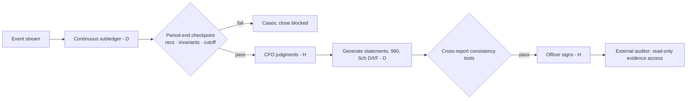

# Accounting, reconciliation, reporting and compliance-calendar workflows (WF-19 to WF-21)

Conventions as in [`wf-contributions.md`](wf-contributions.md).

---

## WF-19 Continuous reconciliation and break resolution

**Outcomes:** O-05, O-08, O-11, O-15.
**Legacy departments:** accounting, treasury, operations, investment operations.

### Legacy approach [I]
- Daily or monthly reconciliation of custodian and bank statements to the recordkeeper, in spreadsheets (ACT-038).
- Grant payments are reconciled by hand to bank confirmations (ACT-077). Remittance carries no grant ID in ACH addenda at any readable top-10 sponsor ([`../../mission-2026-11-14/b4013-02-b4222-02-remittance-and-portal-features.md`](../../mission-2026-11-14/b4013-02-b4222-02-remittance-and-portal-features.md)).
- Breaks age.
- Cross-institution reconciliation evidence: [`../../daf-cross-institution-reconciliation-evidence-2026-11-11.md`](../../daf-cross-institution-reconciliation-evidence-2026-11-11.md); economics scenario: [`../../daf-reconciliation-economics-scenario-model-2026-11-11.md`](../../daf-reconciliation-economics-scenario-model-2026-11-11.md).

### Redesigned approach
**Triggers:** `PositionChanged`, `PaymentSettled`, `PaymentReturned`, bank and custodian feed events, `ContributionReceived`.

1. **Three-way match on arrival (Cat 1).** Each external record is matched to the internal event that should explain it.

   | External record | Matched to | Match key |
   |---|---|---|
   | Custodian transaction | Trade or contribution instruction | Instruction ID or intent reference |
   | Bank cash movement | Payment instruction | Idempotency key carried in the rail's reference field |
   | Rail settlement | Payment instruction | Same key |

   Matching is *by construction* wherever the enterprise controls the reference. Pattern rules handle the rest.
2. **Break detection.** `ReconciliationBreakDetected` is raised immediately, with a classification: timing, amount, unknown item, or missing item. Timing breaks inside the expected settlement window are auto-tolerated and aged.
3. **Triage.** The **break-triage agent** (Cat 2) proposes a cause and a resolution, citing evidence such as a custodian corporate-action notice or a bank fee. It cannot post entries (DEC-033).
4. **Resolution.**
   - Known patterns: a D rule resolves with a reason code (`ReconciliationBreakResolved`).
   - Adjustments and write-offs above the threshold: the controller, plus a second approver above the higher threshold (DEC-034). *Why human:* adjustments change donors' balances or the sponsor's books.
5. **Critical breaks.** A position change without an instruction is treated as a possible unauthorized movement. It opens an incident and a CRCO notification at once, never just a queue item.

**Evidence:** daily match statistics per source, break register with aging, resolution records.

**Eliminated or changed:**
- Transformed: ACT-038.
- Automated: ACT-077.
- Reduced: ACT-058.

**Metrics:**
- Auto-match rate [T: ≥ 99.5% of external records].
- Break P95 age [T: ≤ 3 business days].
- Unexplained position changes open beyond 4 hours [T: 0].

```mermaid
flowchart LR
  EXT[Custodian / bank / rail feeds] --> M{Match by construction<br/>instruction id / idempotency key}
  M -->|matched| OK[Matched → ledger confirmed]
  M -->|timing, within window| AG[Tolerated + aged]
  M -->|break| BR[ReconciliationBreakDetected]
  BR --> CR{Unexplained position change?}
  CR -->|yes| INC[Incident + CRCO - critical]
  CR -->|no| TA[Break-triage agent - Cat 2 proposes]
  TA --> KP{Known pattern rule?}
  KP -->|yes| RES[Resolved by rule - D]
  KP -->|no / above threshold| CTL[Controller (+2nd approver) - H]
```

---

## WF-20 Continuous close, financial statements, Form 990 and Schedule D

**Outcomes:** O-05, O-12, O-07, O-10.
**Legacy departments:** accounting, finance, tax, compliance, external auditor, board.

### Legacy approach [I]
- Month-end close is a multi-day project (ACT-039).
- The annual audit runs on prepared-by-client lists and samples (ACT-041).
- The 990 is prepared from extracts, and Schedule D Part I aggregates are compiled separately.
- The repository found filed Schedule D values diverging from DAFRC's imputed rows, with 2,564 itemized corrections ([industry report §1](../../DAF-INDUSTRY-REPORT-2026-11.md)). That demonstrates how error-prone aggregate reporting is across the industry.

### Redesigned approach
**Triggers:** a calendar event (period end), plus the continuous event stream.

1. **Continuous subledger.** Every journal entry is posted at event time (C4.1), with its posting rule version. The GL is a projection.
2. **Period-end checkpoint (D).** Verification, not assembly:
   - All reconciliations are within tolerance (WF-19).
   - Every accrual rule has run.
   - Invariants hold: trial balance, the unit identity, cash in transit.
   - Cutoff tests pass, using effective-time versus recorded-time queries for late events.

   Failures block the close and open cases.
3. **Judgments (H, CFO).** Estimates, valuations of illiquid holdings, and disclosures. Each is recorded as a decision with evidence (DEC-063).
4. **Statements and filings (D generation).**
   - Financial statements and the 990, including Schedule D Part I (number of DAFs, aggregate contributions, grants, year-end value under §6033(k)), Schedule I and Schedule F inputs, are generated from the ledger.
   - Cross-report consistency tests: Schedule D aggregates = ledger aggregates; Schedule I lines = grant ledger grouped by recipient.
   - An officer signs (ACT-044).
5. **Audit.** The external auditor gets read-only access to the evidence ledger and runs its own queries and samples (ACT-041 eliminated). The auditor's independence is preserved: it chooses its own procedures.

**Eliminated or changed:**
- Transformed: ACT-039.
- Eliminated: ACT-041.
- Automated: ACT-044.
- ACT-042 retained.

**Metrics:**
- Close duration [T: ≤ 2 business days to approved statements, monthly].
- Audit PBC requests answered by self-service [T: ≥ 80%].
- Filing consistency test failures at sign-off [T: 0].



---

## WF-21 State charitable registration and regulatory deadline management

**Outcomes:** O-07, O-12, O-10.
**Legacy departments:** compliance, legal, finance, outside counsel.

### Legacy approach [I]
- A spreadsheet calendar of state renewals and federal filings.
- Outside counsel or a registration service.
- Missed renewals are found by notices.
- Evidence: CO and CT have open data; most CO notices are a 1-day filing lag; CA, NY, PA, MA and WA required manual review ([`../../mission-2026-11-14/b50-02-state-registration.md`](../../mission-2026-11-14/b50-02-state-registration.md)).

### Redesigned approach
**Trigger:** `RegulatoryDeadlineApproaching` (T-60, T-30, T-7), generated from the obligation register. `ComplianceObligationChanged` re-derives the calendar.

1. **Obligation register (C5.1 / GC).** Each obligation is a machine-readable record: citation, jurisdiction, frequency, trigger (fiscal year end + n), owner, and the evidence that satisfies it. Source: the [regulatory applicability map](../08-governance-and-compliance/).
2. **Filing assembly (D).** Financial inputs come from WF-20 outputs. The **compliance drafting agent** (Cat 3, supervised) fills state forms from canonical data and prepares the filing package. It does not submit. Where a state portal has no API, a human submits. Automated form-filling of government portals is outside policy unless the state offers an API.
3. **Sign-off and submission (H).** An officer signs where required (DEC-047).
4. **Status tracking.** Receipts are stored as `Evidence`. Registry status is re-checked from open data where it is available (CO, CT), and manually elsewhere.
5. **Escalation.** A missed T-7 escalates to the CEO and Audit Committee chair.

**Eliminated or changed:**
- Automated: ACT-047.
- Transformed: ACT-050.

**Metrics:** late filings [T: 0]; registration lapses [T: 0]; obligations without an owner or control (the coverage test) [T: 0].
