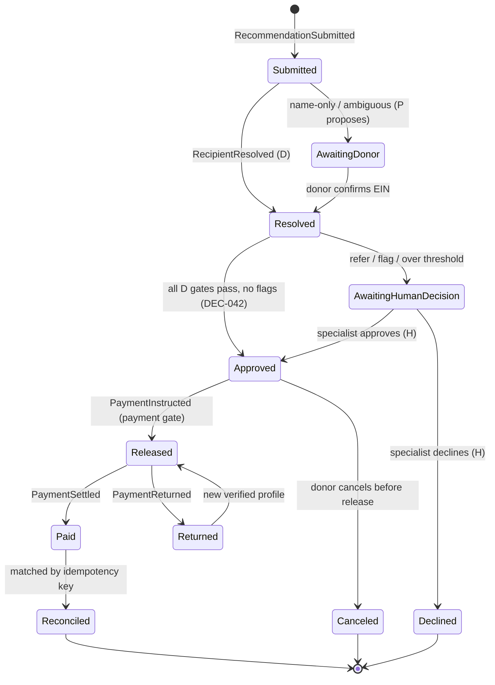
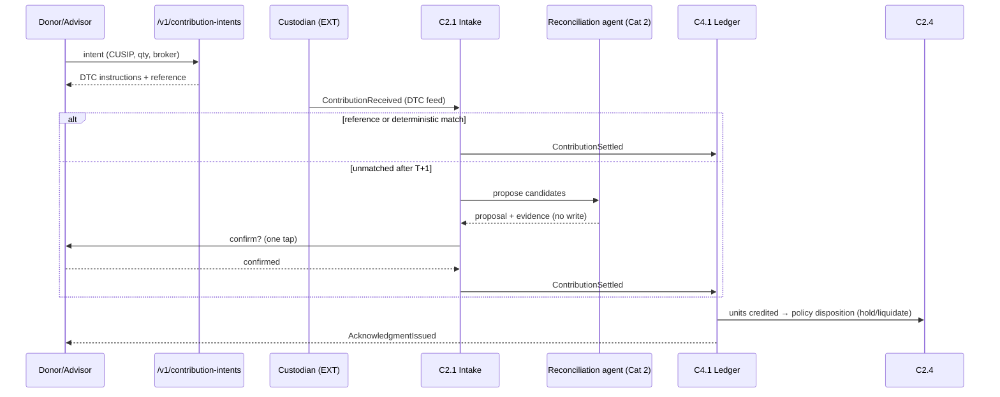
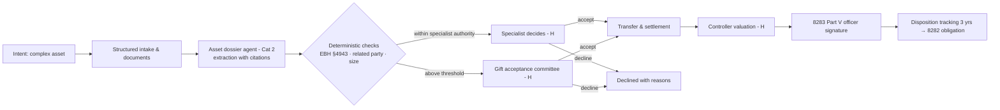

# Contribution workflows (WF-01 to WF-04)

Conventions:
- **Capabilities** are C1.1–C6.4 from [`../02-business-capabilities/capability-map.md`](../02-business-capabilities/capability-map.md).
- **Events** are names from [`../06-data-and-knowledge/events.csv`](../06-data-and-knowledge/events.csv).
- **Decision IDs** are DEC-nnn from [`../01-enterprise-outcomes/outcome-decisions.csv`](../01-enterprise-outcomes/outcome-decisions.csv).
- **Eliminated or changed activities** are ACT-nnn from [`../01-enterprise-outcomes/legacy-activity-classification.csv`](../01-enterprise-outcomes/legacy-activity-classification.csv).
- **Agent categories** follow the mission brief:
  - Cat 1, deterministic;
  - Cat 2, AI-assisted analysis;
  - Cat 3, supervised agent execution;
  - Cat 4, human-authorized;
  - Cat 5, prohibited autonomous.
- **[I]** marks an inferred description of legacy practice. No sponsor publishes its internal procedures or effort (strategic synthesis §0 F, Q-N03).
- **[T]** marks a design *target*, not a measurement.

---

## WF-01 Routine cash contribution → routine domestic grant (reference end-to-end)

**Outcomes:** O-01, O-02, O-05, O-06, O-09, O-15.
**Legacy departments spanned:** donor services, operations (contributions), accounting, grants processing, compliance, treasury.

### Legacy approach [I]
1. The donor initiates an ACH pull or wire through a portal, or mails a check.
2. Operations matches the incoming cash to an account from a bank report (manual for wires without a reference).
3. Accounting posts the receipt in the recordkeeping system's batch. Units are issued at the next batch NAV.
4. A letter-generation job, or a person, produces the acknowledgment. Letters for some gift types are mailed.
5. The donor recommends a grant through a portal form, by email, or through an advisor.
6. Grants processing checks the recipient in an IRS lookup and an OFAC search per grant, or at least for new recipients (batch 2A/2C: [`../../batch-2a-charity-vetting-grant-approval-2026-11-12.md`](../../batch-2a-charity-vetting-grant-approval-2026-11-12.md), [`../../batch-2c-grant-approval-decision-system-benchmark-2026-11-12.md`](../../batch-2c-grant-approval-decision-system-benchmark-2026-11-12.md)).
7. A supervisor approves a batch.
8. Treasury funds the disbursement account, often by liquidating pool units.
9. Payment runs weekly or monthly, by check or EFT. Processors document $100 check thresholds and monthly batches ([`../../mission-2026-11-14/g1913-processor-disbursement-rules.md`](../../mission-2026-11-14/g1913-processor-disbursement-rules.md)).
10. A cover letter or remittance is sent out of band ([`../../mission-2026-11-14/b4013-02-b4222-02-remittance-and-portal-features.md`](../../mission-2026-11-14/b4013-02-b4222-02-remittance-and-portal-features.md)).
11. Accounting reconciles cleared payments later. Donors and charities phone or email for status.

**Typical latency:**
- Sponsors publish no measured P50/P90 turnaround. Only 5 of 28 published turnaround statements are measured, all of them vendor figures ([industry report §4](../../DAF-INDUSTRY-REPORT-2026-11.md)).
- "Instant approval" claims define no timestamps or denominator ([`../../ren-instant-grant-approval-rcf-policy-clarity-audit-2026-11-12.md`](../../ren-instant-grant-approval-rcf-policy-clarity-audit-2026-11-12.md)).
- Handoffs [I]: 6–8 between units.

### Redesigned approach
**Trigger events:** `ContributionIntentDeclared` (optional), `ContributionReceived`, `ContributionSettled`, `RecommendationSubmitted`.

**Contribution leg:**
- The donor's ACH pull is created through `POST /v1/contribution-intents`. It carries a unique reference, so matching (DEC-003) is deterministic.
- On the bank settlement event, C2.1 matches the receipt to the intent, and C5.2 screens the donor (DEC-007; list version pinned).
- `ContributionSettled` is emitted. C4.1 posts the journal and issues units at the current NAV. C2.4 applies the standing allocation.
- The acknowledgment is generated from the settlement event (DEC-006). Its content is schema-tested to include the §170(f)(18) exclusive-legal-control statement. Delivery emits `AcknowledgmentIssued`.

**Grant leg** (state machine `Grant`):

| From | Event / condition | To |
|---|---|---|
| — | `RecommendationSubmitted` (privilege checked, idempotency key) | Submitted |
| Submitted | exact EIN → `RecipientResolved` (D, DEC-036) | Resolved |
| Resolved | `EligibilityEvaluated` = pass (Pub 78 / BMF public charity, not revoked, data fresh within SLO) and `ScreeningCompleted` = pass and no `GrantFlagged` and amount ≤ routine threshold and balance sufficient after earmark | Approved (DEC-042, Cat 1) |
| Resolved | any refer / flag | AwaitingHumanDecision (see WF-06..WF-09) |
| Approved | `PaymentInstructed` (payment gate: verified PaymentProfile, not in cooling-off, within fan-out caps) | Released |
| Released | `PaymentSettled` | Paid |
| Paid | `ReconciliationResult` matched by idempotency key | Reconciled (terminal) |
| Released | `PaymentReturned` | Returned → WF-10 |

**Agents:** none on the happy path. The **benefit-risk agent** (Cat 2) runs asynchronously on the purpose text and recognition fields. It can only add a flag (DEC-040, DD-005). If it is still running when the D gates pass, the grant waits up to a policy-set window [T: 2 minutes] and then proceeds. A flag raised after release opens a post-payment review case; it does not unwind the payment automatically.

**Human decisions:** none on the routine path. Why none: the recipient is a listed §170(b)(1)(A) organization, so §4966(c)(1) excepts the grant and Rev. Proc. 2018-32 reliance applies. DD-004.

**Controls:**
- Requests are not instructions (DD-003).
- The payment gate segregates payee creation from payment release.
- Fan-out caps.
- A data-freshness SLO blocks the D path on stale IRS or OFAC data.

**Evidence:**
- Decision records holding the policy version and the BMF, Pub 78, revocation and OFAC versions.
- Settlement reference.
- Remittance hash.
- Journal entries.

**Eliminated or changed activities:**
- Eliminated: ACT-006, ACT-010, ACT-017, ACT-018, ACT-028, ACT-030, ACT-031, ACT-077.
- Automated: ACT-011, ACT-019.
- Reduced: ACT-024.
- Transformed: ACT-025.

**Metrics:**
- P50 recommendation → Approved [T: < 1 minute].
- P50 Approved → Paid on RTP / FedNow-capable rails [T: same business day]; on ACH [T: ≤ 2 business days].
- Human touches on the routine path [T: 0].
- Share of grants on the routine path: measure it, do not assume it. The repository's review-need proxy is 7–8.5% of grants per grant at three nationals ([strategic synthesis §0 A](../../mission-2026-11-14/strategic-synthesis.md)), which implies at most about 91.5–93% routine. **This is a proxy, not observed review.**

---

## WF-02 Appreciated publicly traded securities contribution

**Outcomes:** O-01, O-03, O-04, O-05.
**Legacy departments:** donor services, operations, investment operations, accounting.

### Legacy approach [I]
1. The donor's broker sends securities by DTC (DTC = the Depository Trust Company) to the sponsor's custodian account. The instruction often lacks a donor reference.
2. Operations hunts for the owner of "orphan" deposits by calling brokers or matching against faxed letters of intent.
3. The gift date and valuation (mean of high and low on the gift date, for the donor's records) are worked out by hand.
4. Investment operations liquidates by default.
5. Accounting posts.
6. An acknowledgment is mailed, describing the shares without value. Year-end deposits drive surge staffing (ACT-015).

### Redesigned approach
**Triggers:** `ContributionIntentDeclared`, then `ContributionReceived` from the custodian DTC feed, then `ContributionSettled`.

1. **Intent first.** The donor or advisor submits `POST /v1/contribution-intents` with CUSIP, quantity and delivering broker. The API returns DTC instructions containing a unique reference in the free-text field. Asset class acceptability is a D check (DEC-001).
2. **Match.** C2.1 matches the custodian receipt to the intent: exact on the reference, then deterministic on CUSIP + quantity + delivering participant + date window. Residual unmatched receipts after T+1 go to the **reconciliation agent** (Cat 2), which proposes candidate intents with evidence. The donor confirms the proposal through a one-tap link, or a contribution specialist confirms it (DEC-010). The agent cannot post anything.
3. **Completed-gift date.** Set by the D rule: the date the securities are received in the sponsor's custody account.
4. **Book value.** Market close by policy (DEC-004). The acknowledgment describes the securities without stating a dollar value, per policy; the donor-facing information page shows the high/low mean as information only.
5. **Investment.** Disposition follows policy (ACT-016 is transformed). Policy may hold the position in a pool if it is in the approved universe, or liquidate through `TradeInstructed` after the pre-trade check.
6. Ledger posting, unit issuance, acknowledgment and notification to donor and advisor all hang off the one `ContributionSettled` event.

**Human decisions:** only orphan matching where the donor does not confirm (low volume), and restricted securities (Rule 144 legends, which go to WF-03).

**Controls:**
- Units cannot be issued without a custodian settlement record.
- Sanctions screen on the donor.
- Restricted-security detection on the CUSIP and legend flag, which routes to WF-03.

**Evidence:** custodian record hash, match method (exact / deterministic / confirmed-proposal), acknowledgment hash.

**Eliminated or changed:**
- ACT-010 transformed: intent references remove most of the matching work.
- Reduced: ACT-015.
- Transformed: ACT-016.
- Automated: ACT-011, ACT-037.

**Metrics:**
- Share of receipts matched without humans [T: ≥ 98% once intents are adopted]. The adoption rate of intents is an unknown and drives this number.
- Receipt → acknowledgment [T: same day].
- Orphan aging [T: P95 < 5 business days].

---

## WF-03 Complex privately held asset contribution (closely held stock, LP/LLC interests, real estate)

**Outcomes:** O-01, O-03, O-04, O-07, O-08.
**Legacy departments:** relationship / planned giving, legal, finance, investment committee, operations, outside counsel and appraisers.

### Legacy approach [I]
1. Email-driven intake.
2. A legal review memo.
3. Finance reviews liabilities.
4. A gift acceptance committee meets on its calendar.
5. Documents circulate as PDFs. The donor obtains a qualified appraisal. The sponsor signs Form 8283 Part V.
6. Liquidation is negotiated case by case.

Many sponsors outsource this to non-cash processors ([`../../mission-2026-11-14/b40n14-03-b38c-03-noncash-vendors-dpn.md`](../../mission-2026-11-14/b40n14-03-b38c-03-noncash-vendors-dpn.md); [`../../mission-2026-11-14/direction-noncash-gift-infrastructure.md`](../../mission-2026-11-14/direction-noncash-gift-infrastructure.md)). Elapsed time is weeks to months and depends on asset type; no published figures were found.

### Redesigned approach
This is the one contribution path where **specialist human judgment is indispensable** (DEC-002). Redesign changes how the judgment is supported, not who makes it.

**Trigger:** `ContributionIntentDeclared` with an asset class that policy classes as complex.

**State machine `ComplexAssetCase`:** `Declared → DocumentsRequested → DossierPrepared → UnderReview → (Accepted | Declined | AcceptedWithConditions) → TransferInProgress → Settled → DispositionTracking (3 years for Form 8282) → Closed`.

**Steps:**
1. **Structured intake.** A typed questionnaire, driven by asset class. It covers entity documents, liabilities, encumbrances, environmental questions for real estate, the transfer-restriction and right-of-first-refusal clauses, and the donor's ownership percentage. It is document upload, not free email.
2. The **asset dossier agent** (Cat 2) extracts terms from the operating agreement and deeds and produces a risk dossier. It covers transfer restrictions; capital-call obligations; UBTI indicators; a **§4943 excess business holdings** pre-check (combined holdings of the DAF and disqualified persons, computed deterministically from declared relationships plus extracted ownership); an environmental red-flag checklist; and the liquidity path. Every extracted term carries a page and span citation.
3. **Deterministic checks.** Excess-business-holdings arithmetic, the related-party test (a disqualified-person purchaser is a §4958 / §4967 issue), and size thresholds that decide the authority level.
4. **Human decision (DEC-002).** The complex asset specialist decides within delegated authority; above the threshold, the gift acceptance committee decides (C5.4 delegation register). *Why human:* acceptance takes on liabilities and fiduciary risk, judgment over incomplete facts is unavoidable, and a wrong acceptance cannot be cheaply reversed.
5. **Valuation for books (DEC-005, controller).** Separate from the donor's qualified appraisal. The specialist cannot both accept and value above the threshold (segregation of duties).
6. **Form 8283 Part V signature (ACT-012).** An officer signs. The agent pre-validates that the donee section is consistent with the received date and description.
7. **Disposition tracking.** On `NoncashAssetDisposed` within 3 years, a Form 8282 obligation is created automatically (ACT-013), with a deadline task.

**Exceptions:** an undisclosed liability discovered after transfer (incident plus counsel); a buyer who is a disqualified person (deny or restructure, H); an appraisal that is inconsistent with the dossier (flag; the sponsor does not opine on the donor's deduction).

**Evidence:** dossier with citations, the committee decision with the evidence viewed, valuation memo, 8283 and 8282 filing receipts.

**Eliminated or changed:**
- ACT-014 is retained as human, but its preparation is automated.
- Automated: ACT-013.
- ACT-012 is retained.
- ACT-015 is reduced: these cases are no longer queued behind cash volume.

**Metrics:**
- Intake complete → decision [T: P50 ≤ 10 business days for standard closely held stock]. This is a design target; there is no baseline.
- Specialist hours per case: measured. This is the main input to the digital twin's specialist-capacity model (see 11-).

---

## WF-04 Cryptocurrency contribution

**Outcomes:** O-01, O-04, O-07, O-08.
**Legacy departments:** operations, finance, compliance, and an external crypto broker or processor.

### Legacy approach [I]
Many sponsors accept crypto through an intermediary processor that receives it and liquidates immediately. Others decline. Repository coverage: [`../../mission-2026-11-14/queue-batch29-regulation-litigation-crypto.md`](../../mission-2026-11-14/queue-batch29-regulation-litigation-crypto.md). Steps:
1. Wallet address issued by email.
2. Manual reconciliation of on-chain receipt.
3. Manual valuation.
4. The appraisal question: crypto is generally treated as property needing a qualified appraisal over $5,000 for the donor's deduction (to be confirmed by the [regulatory map](../08-governance-and-compliance/)).

### Redesigned approach
**Policy:** an accepted-asset list (D, DEC-001). Out-of-list tokens go to a human (ACT-076, retained).

1. `POST /v1/contribution-intents` with asset and chain. The sponsor's **qualified custodian or processor (EXT)** issues a *per-intent deposit address*, which makes matching deterministic. The sponsor never holds keys (DD-008).
2. **Pre-receipt screening.** The custodian's blockchain-analytics risk score on the source address (P, external) feeds a D threshold. Above it, the contribution goes into a hold, and a case opens for the sanctions officer (DEC-009). Sanctioned-address exposure is a hard decline, decided by H.
3. **Settlement.** The custodian confirms receipt after the policy number of confirmations. Liquidation follows policy, through a `TradeInstructed` equivalent at the custodian.
4. **Valuation and acknowledgment.** The book value is the realized proceeds or the policy price source. The acknowledgment describes units of the asset, not a dollar value.
5. 8283 and 8282 handling as in WF-03, steps 6–7, where the thresholds apply.

**Human decisions:** a source-of-funds hold release; out-of-list assets.

**Eliminated or changed:** ACT-010 (per-intent addresses remove matching).

**Metrics:**
- Share auto-matched [T: 100% where intents are used].
- Hold rate and false-positive rate, measured.

**Open issue:** custodian availability and terms for charities. This is a dependency for Phase 4.
