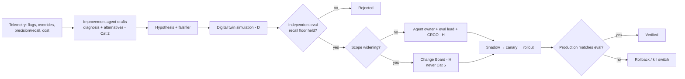

# Governance and controlled-change workflows (WF-22 to WF-24)

Conventions as in [`wf-contributions.md`](wf-contributions.md). These workflows carry out addendum §21: Observe → Diagnose → Hypothesize → Simulate → Test → Approve → Deploy → Verify, with no autonomous weakening of safeguards.

---

## WF-22 Regulatory or policy change → policy-as-code → back-test → approval → deployment

**Outcomes:** O-07, O-10, O-18.
**Legacy departments:** legal, compliance, operations, grants, IT, board.

### Legacy approach [I]
1. Counsel reads the new guidance and writes a memo.
2. Compliance updates the prose policy manual.
3. Operations retrains staff.
4. IT changes the configuration, if the system supports it.

There is no way to know how the change would have affected past grants. Interpretation drifts between staff.

Pending items the repository tracks:
- the 2023 proposed §4966 regulations, neither final nor withdrawn;
- the 2026–27 Priority Guidance Plan item on §§4966 and 6033 ([industry report §6](../../DAF-INDUSTRY-REPORT-2026-11.md)).

### Redesigned approach
**Triggers:**
- `ComplianceObligationChanged`, from obligation-register monitoring of the Federal Register and IRS sources;
- an internal policy proposal;
- an improvement proposal from WF-23's sibling process (the improvement agent).

**State machine `PolicyChange`:**
`Proposed → ImpactAnalyzed → Drafted → BackTested → IndependentlyTested → AwaitingApproval → (Approved | Rejected) → Scheduled → Published (PolicyPublished at effective time) → Verified`.

1. **Impact analysis (Cat 2).** The **drafting and impact agent** reads the change, through counsel-approved summaries rather than raw interpretation. It identifies affected policy rules, obligations and workflows, and drafts a change proposal. **Counsel owns the interpretation (DEC-045, H).** *Why:* law → policy is a legal judgment with personal liability for managers.
2. **Draft (H policy engineer, with C5.1 tooling).** Rule changes are written as decision-table diffs.
3. **Back-test (D).** The new rules are replayed against the historical recommendation corpus, using the inputs as they were known at the time (bitemporal). The diff report shows which past grants would have changed outcome (approve → refer, refer → approve), and the exception-volume impact. The digital twin projects the specialist workload.
4. **Independent test (D, run by a person other than the author).** Golden test vectors per obligation; regression tests; agent evaluations, if the change alters agent tool scope or prompts.
5. **Approval (H, DEC-058 or DEC-080).** The policy owner plus the CRCO approve. The board approves if the change is material: risk appetite, delegations or discretionary-hold policy. The author cannot approve (DD-011).
6. **Publish at the effective time.** New decisions reference the new version. In-flight cases continue under the version in force when they were *decided*, unless the change is a blocking one: a new prohibition applies to unreleased payments.
7. **Verify (D).** After deployment, compare actual refer and approve rates with the back-test forecast. A deviation beyond tolerance triggers review or rollback. Rollback means publishing the prior version as a new version; history is never rewritten.

**Proposed vs current law:** proposed rules are registered as `Obligation(status = proposed)`. Their policy drafts and back-tests are prepared in advance and held unpublished. Example: the advisor-as-donor-advisor rule (WF-12).

**Eliminated or changed:**
- Transformed: ACT-045.
- Transformed: ACT-050.
- Eliminated: ACT-046.

**Metrics:**
- Final-rule publication → compliant policy published [T: ≤ 30 days for prepared drafts].
- Post-deploy deviation from back-test [T: within ±10% on refer rate].

```mermaid
stateDiagram-v2
  [*] --> Proposed: ComplianceObligationChanged / proposal
  Proposed --> ImpactAnalyzed: agent drafts impact (Cat 2); counsel interprets (H)
  ImpactAnalyzed --> Drafted: policy engineer writes rule diff
  Drafted --> BackTested: replay historical corpus (bitemporal) + twin workload
  BackTested --> IndependentlyTested: tester ≠ author
  IndependentlyTested --> AwaitingApproval
  AwaitingApproval --> Approved: owner + CRCO (+ board if material) (H)
  AwaitingApproval --> Rejected
  Approved --> Published: PolicyPublished at effective time
  Published --> Verified: actual vs back-test within tolerance
  Published --> RolledBack: deviation → prior version republished
  Verified --> [*]
```

---

## WF-23 Agent permission or behavior change (and the improvement cycle)

**Outcomes:** O-18, O-08, O-17, O-10.
**Legacy departments:** none existed; this is new governance. The nearest analogue is model risk management in banking.

### Approach
**Triggers:**
- the **improvement agent** (Cat 2) proposes a change from telemetry, such as "the benefit-risk agent flags 40% of tuition-related purposes, and 95% are cleared";
- an engineering change to a model, prompt or tool scope;
- a vendor model deprecation.

**State machine `AgentChange`:**
`Observed → Diagnosed → Hypothesized → Simulated → Tested → AwaitingApproval → Deployed (AgentPermissionChanged / new version) → Verified | RolledBack`.

1. **Observe and diagnose.**
   - Telemetry: per agent, flag rate, human-override rate, precision and recall against human decisions on the evaluation set, latency and cost per completed outcome (C6.2).
   - The improvement agent drafts a diagnosis, required to list alternative explanations (Clarity). For example: is a high clear rate evidence of over-flagging, or of reviewer leniency?
2. **Hypothesize.** The proposed change is stated with its expected effect and its falsification criteria.
3. **Simulate (D).** The digital twin estimates the workload and risk effects.
4. **Test (D, independent).**
   - Offline evaluation on the frozen evaluation dataset, which includes adversarial cases (prompt injection, sanctions near-matches, benefit schemes).
   - **The recall floor on safety flags may not decrease.** A change that lowers flag volume must show no loss of recall on known-positive cases.
5. **Approve (H).** The agent owner, the evaluation lead and the CRCO's model-risk sign-off. **Any widening of tool scope** (new tools, write access, higher caps) needs the Change Board, and **can never grant Category 5 actions** (money movement, authoritative record changes, self-approval).
6. **Deploy.** Shadow mode first, then a canary on a share of traffic, then full rollout. The kill switch is tested before deployment.
7. **Verify.** Production metrics are compared with the evaluation. Drift alarms are set.

**Key safeguard:** the improvement cycle can propose *eliminating work*: removing a flag class, raising a threshold, retiring an agent. But eliminating a **safeguard** needs the same independent test and H approval as adding authority. The system cannot learn its way out of its own controls.

**Metrics:**
- Changes with a complete evidence chain [T: 100%].
- Post-deploy regressions caught by canary versus by incident.
- Cost per completed outcome, by agent.

---

## WF-24 Board oversight evidence pack

**Outcomes:** O-10, O-07, O-04, O-14.
**Legacy departments:** CEO office, finance, compliance, investments, corporate secretary.

### Legacy approach [I]
Quarterly board packs are assembled by hand from each department's reports (ACT-061). They are curated by management, weeks old by the time of the meeting, and not reproducible. Vendor-related directors exist (Charityvest/Foundation Source; [industry report §2.3](../../DAF-INDUSTRY-REPORT-2026-11.md)).

### Redesigned approach
**Triggers:** calendar (meeting T-10), plus threshold events at any time: a control failure, a critical break, a sanctions true match, a policy deviation, or a liquidity coverage breach.

1. **Live evidence views (D).** Each committee has a defined set of indicators, computed from the evidence ledger and telemetry:
   - control health (evidence present, by control);
   - exception volumes and SLA compliance;
   - flag recall and override rates;
   - reconciliation aging;
   - liquidity coverage;
   - fee and payout distribution by account cohort (payout measured at account level, which filings cannot show; [industry report §1](../../DAF-INDUSTRY-REPORT-2026-11.md));
   - vendor concentration;
   - incidents;
   - policy changes and their verification results.
2. **Snapshot for the meeting.** A frozen, hashed snapshot of the views, so that minutes reference what the board actually saw. It is generated, not curated.
3. **Management commentary (H).** Explanations are written by management and **clearly separated** from the generated data. Internal audit can query the same evidence independently.
4. **Board decisions.** Recorded as `Decision` and `Approval` objects that update the delegation register and policies directly, so a delegation approved by the board is the delegation enforced by the system (C5.4).
5. **Conflicts.** The relationship graph (C1.1) flags directors with relationships to vendors, grantees or donors on agenda items. Recusal is recorded.

**Eliminated or changed:**
- Transformed: ACT-061.
- ACT-062 retained.
- ACT-049 automated.
- ACT-073 transformed.

**Metrics:**
- Pack data age at meeting [T: ≤ 1 day].
- Board-approved delegations not reflected in enforcement [T: 0].
- Recusals recorded for flagged conflicts [T: 100%].
