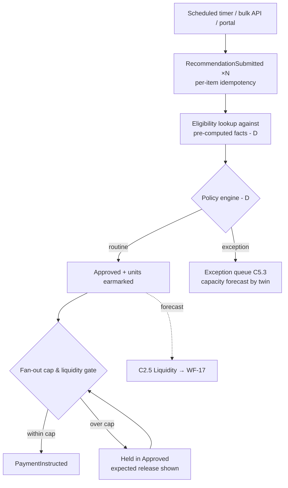
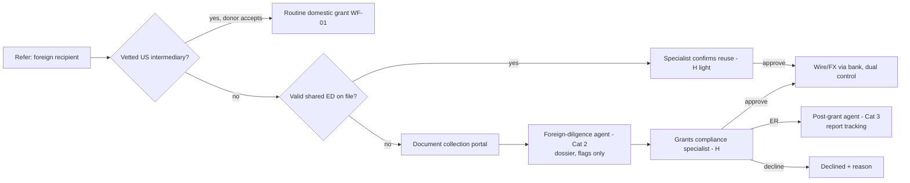
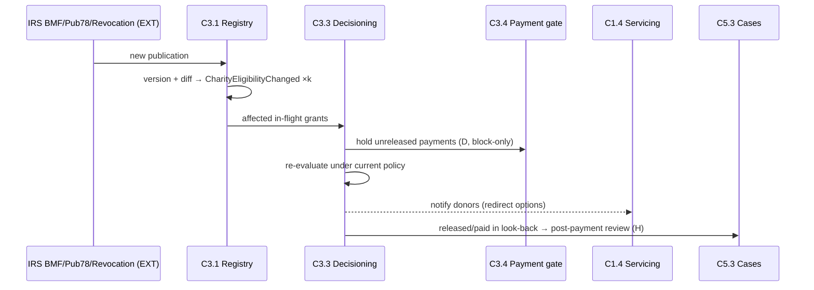
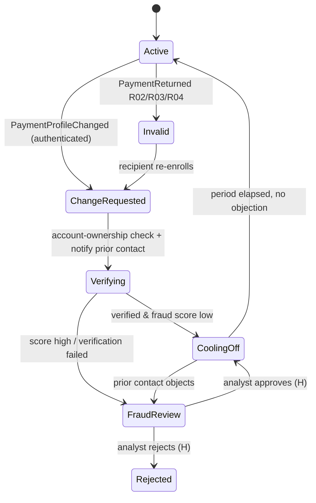
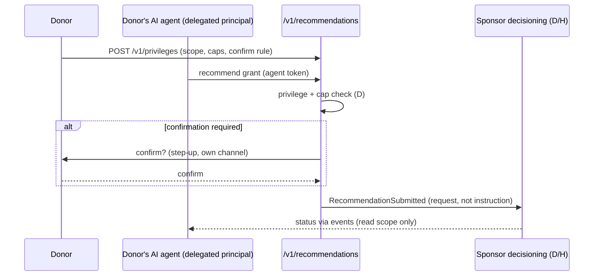

# Grant workflows (WF-05 to WF-11)

Conventions as in [`wf-contributions.md`](wf-contributions.md). The grant state machine is defined in WF-01.

---

## WF-05 High-volume and recurring grant recommendations (year-end surge, scheduled grants)

**Outcomes:** O-06, O-04, O-09, O-15.
**Legacy departments:** grants processing, compliance, treasury, donor services, IT (batch jobs).

### Legacy approach [I]
- Year-end recommendations queue for manual review. Staffing surges and backlogs form.
- Recurring grants are re-entered or re-run as scheduled batches, and each instance may be re-reviewed.
- Treasury liquidates in bulk at batch points.
- Status calls spike.

Evidence:
- Grant counts and sizes per sponsor, for example NPT FY2024 at 129,575 grants (governing, PR #74) ([`../../mission-2026-11-14/FINAL-STATUS.md`](../../mission-2026-11-14/FINAL-STATUS.md)).
- Average grants of about $4.5–6k at Fidelity, RCF and DAFgiving360 ([`../../mission-2026-11-14/FINAL-STATUS.md`](../../mission-2026-11-14/FINAL-STATUS.md)).
- Seasonality is not published at grant-day level.

### Redesigned approach
**Triggers:** `RecommendationSubmitted` (single, bulk file or API batch), or a scheduled-grant timer that emits `RecommendationSubmitted` with the standing grant's ID.

**Mechanism changes:**
1. **Decision reuse, not re-review.** A recurring grant is a standing `Recommendation` template. Each instance is re-evaluated deterministically against *current* eligibility and sanctions data. That costs nothing, so there is no reason to skip it. The instance goes to a human only if something changed: a new flag, an amount above threshold, or a change in eligibility.
2. **Continuous eligibility means volume does not scale review.** Eligibility for the whole payee universe is pre-computed on each IRS or OFAC refresh (WF-09). A recommendation to an already-known recipient is a lookup against a fresh fact, not a new investigation.
3. **Batch submission APIs** for advisors and institutions: `POST /v1/recommendations:batch` with per-item idempotency keys. Each item gets its own decision record, and partial acceptance is explicit.
4. **Fan-out caps and liquidity coupling.**
   - C2.5 receives the recommendation pipeline as a forecast stream.
   - Approved grants earmark units.
   - Payment release is capped by policy per window. Excess queues in `Approved` with an expected release time shown to the donor; it is never silently delayed.
   - Large waves trigger WF-17 (liquidity).
5. **Elastic exception queue.** The digital twin forecasts the exception load (rate × volume) and alerts weeks ahead if the specialist capacity is short. It does not discover the backlog after the fact.

**Human decisions:** only the exception share. Specialist staffing is planned from forecast volume × measured exception rate.

**Controls:**
- Batch items cannot share an idempotency key.
- Per-account and enterprise daily payment caps.
- Duplicate-recommendation detection: same account, recipient and amount within a window, which flags (D).

**Eliminated or changed:**
- Eliminated: ACT-017, ACT-018, ACT-028, ACT-030.
- Reduced: ACT-015.

**Metrics:**
- Routine-path latency during the surge week equals the non-surge P50 [T].
- Exception backlog P95 age ≤ SLA [T: 2 business days].
- Duplicate-payment rate [T: 0].

---

## WF-06 Foreign grant (equivalency determination or expenditure responsibility)

**Outcomes:** O-06, O-07, O-08.
**Legacy departments:** grants compliance, legal, operations, treasury (FX / wires), and often an outside intermediary.

### Legacy approach [I]
- Many sponsors route foreign grants through U.S. "friends of" organizations or intermediaries.
- Direct foreign grants need an equivalency determination (ED) or expenditure responsibility (ER). Each case is a fresh document-collection project.
- Foreign grants are 1.46% of dollars across the four largest nationals (NPT 4.84%) ([industry report §4](../../DAF-INDUSTRY-REPORT-2026-11.md)).
- Repository: [`../../mission-2026-11-14/direction-foreign-grants-schedule-f.md`](../../mission-2026-11-14/direction-foreign-grants-schedule-f.md).

### Redesigned approach
**Trigger:** `RecipientResolved` to a foreign entity, so `EligibilityEvaluated` returns `refer: foreign`.

**State machine `ForeignGrantCase`:**
`Referred → RouteChosen (Intermediary | ED | ER) → DocumentsCollected → DossierPrepared → SpecialistDecision → (Approved | Declined) → PaymentRelease (wire / FX) → Reporting (ER reports, if ER)`.

1. **Route selection (D first).**
   - If a vetted U.S. intermediary or "friends of" organization serves the recipient, the system offers it to the donor. The grant then becomes a routine domestic grant to a listed public charity.
   - If a *valid, current shared determination* exists for this recipient (ED reused across accounts, within its validity period), the route is ED-reuse. This mechanism makes determinations a reusable enterprise asset rather than a per-grant project.
2. **Document collection.** A recipient-facing portal and API (`/v1/recipients/{id}/documents`) collects governing documents, financials and the affidavit.
3. The **foreign-diligence agent** (Cat 2) translates and summarizes the documents, maps them to ED criteria with citations, and runs adverse-media and sanctions-adjacent screening (P). It produces a dossier with flags. It cannot clear sanctions or terrorism-financing indicators (DD-005).
4. **Human decision (DEC-043).** The grants compliance specialist decides. *Why human:* ED and ER are legal determinations with §4966 exposure, foreign facts are ambiguous, and Treasury's charity-sector risk guidance calls for risk-based judgment.
5. **Payment.** Wire or FX through the bank partner. Beneficiary bank screening is D, and the beneficiary is verified against the dossier.
6. **ER follow-up (if ER).** The **post-grant agent** (Cat 3, supervised) schedules report requests, ingests the recipient's reports, and checks spending against the agreement. Any variance is a flag for a human. It cannot waive, extend or close obligations.

**Controls:**
- Sanctions potential match → sanctions officer only (DEC-009).
- ED validity window enforced by D.
- Dual control on wires above threshold.

**Evidence:** route decision, ED or ER dossier with citations, approval, wire confirmation, ER reports and Schedule F inputs.

**Eliminated or changed:**
- ACT-021 retained (human), but determinations are reused.
- ACT-020 retained; tracking is automated.

**Metrics:**
- ED-reuse rate.
- Specialist hours per new determination.
- Days from referral to decision [T: P50 ≤ 15 business days for a new ED; same day for reuse].

---

## WF-07 Grant to a non-charity requiring expenditure responsibility (domestic)

**Outcomes:** O-06, O-07.
**Legacy departments:** grants compliance, legal, operations, finance.

### Legacy approach [I]
A rare, high-effort case. It is handled with templates, email and spreadsheets for report tracking. Repository proxy: grants to recipients needing ER fall inside the "core" review-need proxy, at 11.0% of top-50 dollars, which counts recipients, not observed review ([strategic synthesis §0 A](../../mission-2026-11-14/strategic-synthesis.md)).

### Redesigned approach
**Trigger:** `EligibilityEvaluated` returns `refer: ER-required`. Examples: a private non-operating foundation, a §501(c)(4)/(6) organization, a for-profit with a charitable project, or a Type III non-functionally-integrated supporting organization. Each case class is a D classification from BMF codes plus policy.

1. **Policy pre-screen (D).** Some classes are prohibited by sponsor policy outright. Example: grants to individuals are prohibited for DAFs by §4966(c)(1)(A). Those return `Declined` with a reason. No human is needed, because no judgment is involved.
2. **ER package.** A **drafting agent** (Cat 3) assembles the pre-grant inquiry, a draft grant agreement from approved clause templates, and the required terms (use restricted to purpose, reporting, records, repayment). Drafts are never sent without human approval.
3. **Human decision (DEC-043).** *Why:* ER requires a pre-grant inquiry judgment about the grantee's ability to fulfill the purpose. That is a legal determination.
4. **Execution.** E-signature. The grant is approved, then paid through the normal payment gate.
5. **Reporting** as in WF-06, step 6. **Schedule-driven obligations:** missing or diverted-funds reports generate escalations to the specialist and the GC.

**Eliminated or changed:** ACT-020 retained as human, with tracking automated.

**Metrics:** ER report on-time rate [T: ≥ 95%]; specialist hours per ER grant (measured).

---

## WF-08 Fiscal-sponsor grant (grant to a sponsored project)

**Outcomes:** O-06, O-15.
**Legacy departments:** grants processing, compliance, donor services.

### Legacy approach [I]
The donor names a project. Staff identify the fiscal sponsor, check its status, and ask whether the purpose restriction is acceptable. The restriction text is often free-form.

Evidence:
- Fiscal sponsors' dollar share is 4.4× their count share ([industry report §4](../../DAF-INDUSTRY-REPORT-2026-11.md)).
- De facto fiscal sponsors: [`../../mission-2026-11-14/g0503-03-de-facto-fiscal-sponsors.md`](../../mission-2026-11-14/g0503-03-de-facto-fiscal-sponsors.md).

### Redesigned approach
1. **Resolution.** The **resolution agent** (Cat 2) maps the project name to the fiscal sponsor's EIN, using the EIN-keyed fiscal-sponsor list (the repository's method in [`../../mission-2026-11-14/g0503-0501-exception-proxy-refinements.md`](../../mission-2026-11-14/g0503-0501-exception-proxy-refinements.md)) and project registries. The donor confirms.
2. **Eligibility of the fiscal sponsor (D).** If it is a listed public charity, the grant to the *sponsor* is routine.
3. **Restriction handling.** The project designation is recorded as a *purpose preference*, not a legal restriction that would compel the fiscal sponsor. Standard clause: "for the [project], a project of [sponsor]". Free-text restrictions are run through the benefit-risk agent (flag only).
4. If flagged, for example a project that appears to be donor-controlled or to provide services to the donor, the case goes to a specialist (H).
5. **Remittance.** Carries both the sponsor EIN and the project identifier, so the fiscal sponsor can allocate the funds without a phone call.

**Eliminated or changed:**
- Reduced: ACT-023.
- Transformed: ACT-025.
- Eliminated: ACT-075.

**Metrics:**
- Share of fiscal-sponsor grants on the routine path.
- Misallocation complaints from fiscal sponsors (measured).

---

## WF-09 Recipient eligibility change mid-flight (revocation, sanctions listing, status downgrade)

**Outcomes:** O-06, O-07, O-08, O-09.
**Legacy departments:** compliance, grants processing, operations, donor services.

### Legacy approach [I]
- Status is checked at recommendation time, sometimes again before a payment run.
- A revocation published between approval and payment is caught only if someone re-checks.
- Donors with recurring grants are not proactively told.

Evidence: grants to EINs under an IRS revocation are 0.082% of top-50 Schedule I dollars ([strategic synthesis §0 A](../../mission-2026-11-14/strategic-synthesis.md)), which shows that leakage exists.

### Redesigned approach
**Triggers:** `CharityEligibilityChanged` (from the IRS BMF, Pub 78 or auto-revocation diff) and `SanctionsListUpdated`.

1. **Diff ingestion (Cat 1).** Each IRS or OFAC publication is ingested, versioned and diffed. Every change becomes a bitemporal `EligibilityFact`, with its source version and effective date.
2. **Impact query.** All in-flight grants (`Submitted`, `Resolved`, `AwaitingHumanDecision`, `Approved`, not yet `Released`) and all standing recurring grants for affected recipients are selected.
3. **Automatic blocking.**
   - Unreleased payments are **held** (D). Holding is the safe direction: a change can block, never release (event-catalog §4.5).
   - Grants re-enter evaluation under current policy. A grant that was routine may now be `Declined`, if the recipient is revoked, or `AwaitingHumanDecision`, if its status has become ambiguous.
4. **Released and paid grants** within a look-back window go to a post-payment review case. *Why human:* recovery requests to a charity, and the question of whether the sponsor relied in good faith under Rev. Proc. 2018-32, are judgments.
5. **Notifications (D).** Affected donors are told, with options to redirect. The recipient profile shows the change.
6. **Sanctions listing.** Immediate freeze on payments. The sanctions officer handles the case. Any reporting to OFAC is decided by the sanctions officer and the GC (DEC-053).

**Evidence:** the diff file hash; the list of grants re-evaluated and their outcomes; hold events; notifications.

**Eliminated or changed:**
- Eliminated: ACT-018.
- Automated: ACT-019.

**Metrics:**
- Time from IRS or OFAC publication → holds applied [T: < 1 hour after ingestion].
- Released-after-revocation count [T: 0 beyond the policy reliance window].

---

## WF-10 Payment return and payee bank-account change

**Outcomes:** O-06, O-08, O-15, O-05.
**Legacy departments:** treasury and payments, accounting, grants processing, fraud (if any), donor services.

### Legacy approach [I]
- ACH returns arrive in bank reports and are worked by hand.
- Bank-detail changes arrive by email or letter from "the charity". This is the classic payee-hijack vector.
- Funds sit in suspense, and the donor is not told.
- Uncashed checks age into escheat ([`../../mission-2026-11-14/queue-batch34-escheat-terms.md`](../../mission-2026-11-14/queue-batch34-escheat-terms.md)).

### Redesigned approach
**Return path** (`PaymentReturned`):
1. The return code is mapped (D). R01/R09 (funds) are retried once. R02/R03/R04 (account closed, no account, invalid) invalidate the `PaymentProfile`.
2. Grant → `Returned`. Funds are released back from the earmark: the ledger reversal is automatic.
3. The recipient is asked, through its verified contact, to re-enroll a payment profile. The donor sees the status "recipient payment details being updated", not silence.
4. After N days without a valid profile, policy decides between a check fallback (D) and a donor redirect option.

**Profile change path** (`PaymentProfileChanged`):
1. A change request is accepted only through an authenticated recipient session or a verified rail directory, never from an email.
2. **Out-of-band verification (D).** Account-ownership verification through a third-party service, plus a notice to the *previous* verified contact.
3. **Cooling-off period** (policy, e.g. [T: 3 business days]). Payments to the new profile are blocked during it.
4. The fraud model (Cat 2) scores the change: domain age, contact change coinciding with the bank change, unusual timing. A high score → hold → fraud analyst (DEC-052). *Why human:* releasing funds to a possibly hijacked account is irreversible.

**Controls:**
- Segregation of duties: whoever approves a profile change cannot release payments.
- The payment gate checks cooling-off status deterministically.

**Eliminated or changed:**
- ACT-070 automated.
- ACT-026 reduced.
- Automated: ACT-027.

**Metrics:**
- Return → re-release [T: P50 ≤ 5 business days].
- Losses from payee hijack [T: 0].
- Share of profile changes completed without a human [T: ≥ 90%].

---

## WF-11 Donor-side AI agent recommending grants

**Outcomes:** O-03, O-06, O-08, O-17.
**Legacy departments:** none existed. Legacy sponsors either prohibit automated access or have no model for it: six of the top 20 limit automated or third-party access ([strategic synthesis §0 D](../../mission-2026-11-14/strategic-synthesis.md); [`../../mission-2026-11-14/queue-sponsor-terms-data-clauses.md`](../../mission-2026-11-14/queue-sponsor-terms-data-clauses.md)).

### Legacy and market approach
- The donor shares portal credentials with an aggregator, or uses the sponsor's own assistant.
- Daffy's MCP server exposes `make_donation` with no documented limits, and TIFIN Louise executes donor requests ([industry report §7](../../DAF-INDUSTRY-REPORT-2026-11.md); [`../../mission-2026-11-14/direction-ai-product-census.md`](../../mission-2026-11-14/direction-ai-product-census.md)).
- No public contract treats an AI agent as a distinct actor (A12).

### Redesigned approach (DD-017)
1. **Delegation.** The donor grants an agent principal a scoped `PrivilegeGrant` (`POST /v1/privileges`):
   - scope: `recommend_grants`;
   - per-grant cap, per-period cap, and an optional recipient allow-list or category;
   - a confirmation rule, for example "donor confirms any new recipient or any grant over $X";
   - an expiry.

   The agent authenticates as itself (OAuth client credentials bound to the grant), never with the donor's credentials.
2. **Recommendation.** The agent calls `POST /v1/recommendations` with `requested_by: agent principal` and `on_behalf_of: donor`. Intake treats it exactly like any recommendation: it is a request (DD-003).
3. **Confirmation (D).** Where the grant's confirmation rule applies, the recommendation enters `AwaitingDonorConfirmation`. The donor confirms through their own authenticated channel, a push notification with step-up. That breaks the prompt-injection chain: a compromised agent cannot confirm its own request.
4. **Sponsor decisioning.** Identical to WF-01. The agent gets no faster path and no exemption from flags.
5. **Anomaly controls.** A per-agent-principal rate limit; a velocity rule (new-recipient bursts trigger a hold); and recipient-reputation checks.
6. **Revocation.** `PrivilegeRevoked` takes effect immediately and revokes tokens. In-flight unconfirmed recommendations are canceled.

**Human decisions:** donor confirmation (the *donor's* authority, not the sponsor's); fraud holds (sponsor, H).

**Category 5 (prohibited):** the donor's agent can never call payment, custody or ledger capabilities. It cannot approve its own recommendations or alter privileges, including its own.

**Evidence:** the privilege grant with consent, each recommendation's agent-principal attribution, confirmation events.

**Metrics:**
- Share of agent-originated recommendations held for anomalies.
- Confirmed-to-requested ratio.
- Incidents [T: 0 unauthorized grants].

