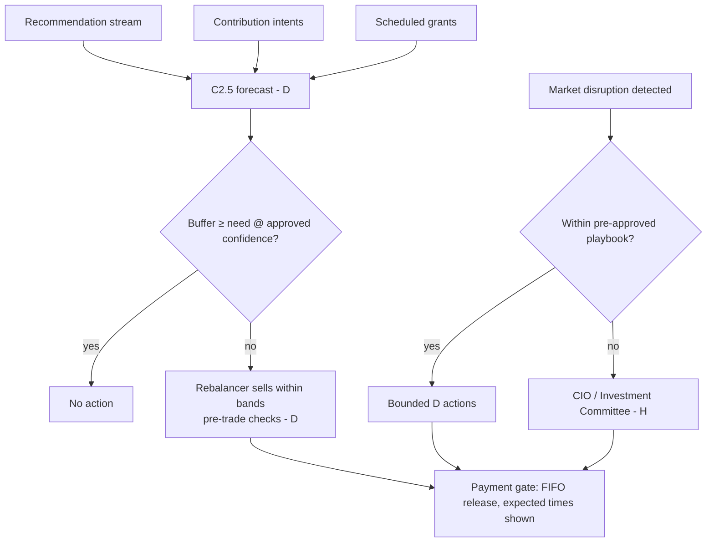

# Investment and treasury workflows (WF-17 to WF-18)

Conventions as in [`wf-contributions.md`](wf-contributions.md). DD-007 applies throughout: no autonomous discretionary investment authority.

---

## WF-17 Liquidity management for a large grant wave (and market disruption)

**Outcomes:** O-04, O-06, O-10.
**Legacy departments:** treasury, investment operations, grants processing, investment committee.

### Legacy approach [I]
- Treasury estimates grant outflows from last year's seasonality and current queues, in spreadsheets (ACT-035).
- Pool units are liquidated at batch points. In a market drawdown, forced selling coincides with year-end grant peaks.
- The committee learns about it after the fact.
- The 2026 discretionary holds ([industry report §4](../../DAF-INDUSTRY-REPORT-2026-11.md)) show how a policy event can also move grant flows abruptly.

### Redesigned approach
**Triggers:**
- the recommendation stream (`RecommendationSubmitted`, `GrantApproved`);
- `ContributionIntentDeclared`;
- `PositionChanged`, `NavStruck`;
- `PolicyBandBreached`;
- calendar events (quarter-end, year-end).

1. **Forecast (Cat 1).** C2.5 maintains a rolling cash-need forecast per pool. It combines approved-but-unreleased grants (certain), submitted recommendations (weighted by measured approval rates), scheduled grants, seasonality from the enterprise's own history, and expected contributions (intents).
2. **Buffer rule (D).** The cash or near-cash buffer is the forecast need at a committee-approved confidence level, plus a stress add-on (DEC-026 parameters are H; DEC-027 computation is D).
3. **Pre-emptive raising (D).** When the forecast exceeds the buffer, the rebalancer issues sell orders inside policy bands, with pre-trade checks (`TradeInstructed`). It prefers in-kind sources from contributions, then the most liquid holdings.
4. **Market-disruption playbook.** It is pre-approved by the investment committee and defines bounded D actions: for example, widen bands by X, or draw a pre-arranged line of credit up to Y. Anything beyond the playbook is an H decision for the CIO and committee (DEC-028). *Why human:* fiduciary judgment under uncertainty. Selling into a crash is a value-destroying, irreversible choice.
5. **Grant flow continuity.** If cash is short, the payment gate does **not** silently stall. Approved grants queue with expected release times. Policy defines the order: first-in-first-out, with no discretion by donor or size, to avoid favoritism.
6. **Board visibility.** The digital twin runs the stress scenario (11-) daily, and the committee's evidence pack (WF-24) shows coverage ratios.

**Evidence:** forecast snapshot per day; buffer computation with parameter version; pre-trade check records; playbook invocations.

**Eliminated or changed:**
- Automated: ACT-035, ACT-033, ACT-068.
- ACT-032 retained (human), with live evidence.

**Metrics:**
- Days with buffer < forecast need [T: 0].
- Forced sales below the playbook threshold [T: 0].
- Grant release delays attributable to liquidity [T: 0 outside declared disruptions].

---

## WF-18 Daily valuation (NAV), unitization and fees

**Outcomes:** O-05, O-04, O-14, O-09.
**Legacy departments:** accounting, investment operations, billing, donor services.

### Legacy approach [I]
- The recordkeeper runs a nightly or periodic batch NAV.
- Fees are accrued in spreadsheets or batch jobs, with quarterly debits (ACT-040).
- Advisor fees are billed separately (ACT-057).
- Pricing exceptions are found by staff the next morning.
- Ren claims daily unitization, with little public delivery evidence ([industry report §5](../../DAF-INDUSTRY-REPORT-2026-11.md)).

### Redesigned approach
**Triggers:** a market-close calendar event, plus `PositionChanged` and custodian price files.

1. **Prices (D).** Primary and secondary sources per instrument class, with tolerance checks: day-over-day move and source disagreement. A breach → `NavStruck` is held for that pool → controller case (H). *Why human:* choosing a price for a stale or illiquid instrument is a valuation judgment.
2. **NAV (D).** Pool NAV = Σ positions × price + cash − accruals. Invariant: Σ(account units) × NAV = pool NAV, within a rounding tolerance. A failed invariant blocks publication.
3. **Unit issuance and redemption** for the day's settled contributions and released grants, at the struck NAV (forward pricing).
4. **Fees (D).** The fee engine accrues daily from the versioned schedule (`FeeAccrued`): sponsor tiered bps, advisor fee (capped), and the partner revenue share. Each charge carries the schedule version, so a fee dispute is answered by replaying the calculation.
5. **Publication.** Read models update, and donors and advisors see same-day values.

**Human decisions:** price exceptions, and fee schedule changes (board, DEC-066).

**Eliminated or changed:**
- Automated: ACT-037, ACT-040, ACT-057.

**Metrics:**
- NAV published by [T: market close + 3 hours].
- Price exceptions per day (measured).
- Fee recalculation disputes resolved by replay [T: 100%].
