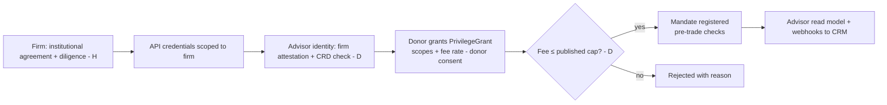
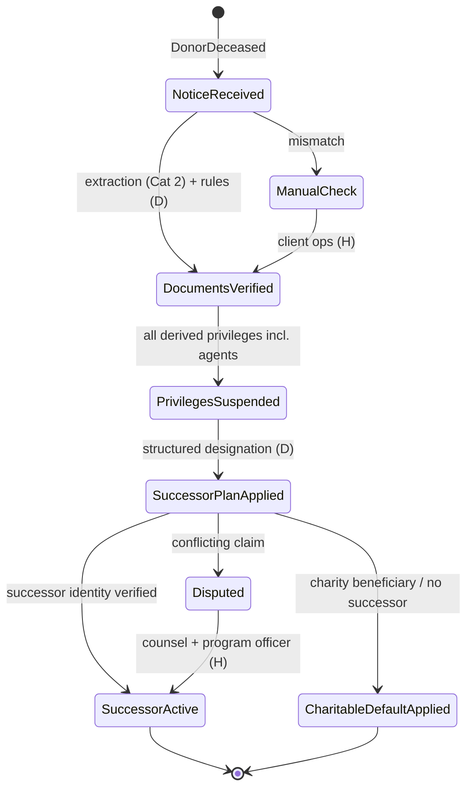

# Relationship, continuity and servicing workflows (WF-12 to WF-16)

Conventions as in [`wf-contributions.md`](wf-contributions.md).

---

## WF-12 Advisor onboarding and delegated authority

**Outcomes:** O-02, O-04, O-09, O-17.
**Legacy departments:** advisor services, operations, compliance, investment operations, IT.

### Legacy approach [I]
1. The advisor's firm signs a program agreement.
2. Each advisor-client link is set up with a paper or PDF letter of authorization (ACT-056).
3. Advisor fees are configured manually in the recordkeeper.
4. Advisor trades are reviewed after the fact (ACT-034).
5. Advisor fee caps exist only at some programs. Only MS GIFT, DAFgiving360 and TIFIN Give publish a 1.00% cap ([strategic synthesis §0 A](../../mission-2026-11-14/strategic-synthesis.md)).
6. The advisor views the account through a separate portal login or a data feed.

### Redesigned approach (DD-010)
**Triggers:** `PartyRegistered` (advisor), `IdentityVerified`, `PrivilegeGranted`.

1. **Firm-level onboarding** (`/v1/parties`, kind = institution).
   - The firm signs the institutional agreement and gets API credentials scoped to its advisors.
   - Firm-level SSO federation is optional.
   - Diligence (H, Head of Partnerships with CRCO) covers regulatory status (SEC or state registration), disciplinary history from public sources, and data-security attestations.
2. **Advisor identity.** The firm attests that the advisor is employed and registered. The sponsor verifies the CRD against public records (D).
3. **Client link.**
   - The donor grants the advisor a `PrivilegeGrant` with scopes such as `view`, `recommend_investments`, `trade_within_mandate`, `recommend_grants`, and a fee rate.
   - Consent is a donor event. Nothing is set up from an advisor's word alone.
   - The **fee rate is validated against the published cap** (D; FeeAccrued blocks above the cap).
   - The proposed §4966 rule that would treat an investment advisor as a donor-advisor ([industry report §6](../../DAF-INDUSTRY-REPORT-2026-11.md)) is modeled as a pending obligation (WF-22). The relationship type `investment advisor of` is recorded now, so the rule can be applied the day it is finalized.
4. **Mandate.** Advisor-managed accounts get a machine-readable mandate: allowed instruments, concentration limits and the liquidity floor. Trades are **pre-checked** (DEC-025), not reviewed afterwards.
5. **Visibility.** The advisor sees account state through the same read model and events as the donor. Data goes out by webhook to the advisor's CRM or wealth platform, so the advisor never re-keys data.

**Human decisions:** firm admission; exceptions to fee caps (if policy permits any; the default is none).

**Eliminated or changed:**
- Eliminated: ACT-056.
- Transformed: ACT-034.
- Automated: ACT-057.
- Reduced: ACT-004.

**Metrics:**
- Firm onboarding to first linked account [T: ≤ 10 business days].
- Advisor-client link setup [T: minutes, donor-consented].
- Fee-cap breaches [T: 0].

---

## WF-13 Donor death and successor activation

**Outcomes:** O-16, O-02, O-03, O-09.
**Legacy departments:** donor services, legal, operations, grants.

### Legacy approach [I]
1. A family member calls.
2. Staff request a death certificate by mail.
3. A legal review checks the successor designation, which may be on paper from years ago.
4. The account is frozen.
5. Pending grants are in limbo, and successors re-apply.

Bequest and legacy-DAF flows: [`../../mission-2026-11-14/b49-03-bequests-legacy-dafs.md`](../../mission-2026-11-14/b49-03-bequests-legacy-dafs.md).

### Redesigned approach
**Trigger:** `DonorDeceased`. The notice comes from a documented submission or from a death-data match service (EXT, P → confirmation).

**State machine `SuccessionCase`:**
`NoticeReceived → DocumentsVerified → PrivilegesSuspended → SuccessorPlanApplied → (SuccessorActive | CharitableDefaultApplied | Disputed) → Closed`.

1. **Document verification (D).** Rules on the death certificate's issuing authority and data match. The **document agent** (Cat 2) extracts data from the documents. A human checks only mismatches.
2. **Suspension (D).** Donor privileges are suspended immediately, and every privilege that derived from the donor is suspended with them, including any agent principals the donor delegated. Pending unreleased recommendations from the deceased donor are held.
3. **Successor plan (D).** The successor designation is a structured record, captured and versioned at onboarding (DEC-015). The plan is applied deterministically: named successors get privileges after their identity is verified, a charitable beneficiary designation triggers grants, and any split is honored.
4. **Disputes (H).** The program officer and counsel decide (DEC-072). *Why human:* conflicting claims and documents need legal judgment.
5. **Held recommendations.** Per policy they lapse, or are honored only if approved before death. The rule is explicit in the agreement.

**Eliminated or changed:**
- ACT-054 retained (human only for disputes).
- Reduced: ACT-009 and paper.

**Metrics:**
- Notice → successor active [T: P50 ≤ 10 business days, no dispute].
- Privileges active after verified death [T: 0 hours after verification].

---

## WF-14 Outbound transfer to another sponsor with full history

**Outcomes:** O-16, O-06, O-05.
**Legacy departments:** donor services, grants processing, investment operations, accounting.

### Legacy approach
- No sponsor of 12 reviewed publishes an outbound transfer policy.
- Transfers are cash after liquidation and take 10 business days to 4 weeks.
- No sponsor commits to moving grant history. AEF's own migration kept two years.

Sources: [industry report §4](../../DAF-INDUSTRY-REPORT-2026-11.md); [`../../mission-2026-11-14/queue-donor-export-cf-payments-donorsphere.md`](../../mission-2026-11-14/queue-donor-export-cf-payments-donorsphere.md).

### Redesigned approach
**Trigger:** `TransferOutRequested`. The transfer is legally a grant from this sponsor to the receiving sponsor, a §170(b)(1)(A) public charity.

1. **Receiving-sponsor eligibility (D)**, the same as any grant: listed public charity, not revoked. A sponsor-to-sponsor transfer is a routine grant with a special purpose code. It must be flagged as DAF-to-DAF so that payout statistics can be netted, a problem this repository documents ([strategic synthesis §0 G3](../../mission-2026-11-14/strategic-synthesis.md)).
2. **Asset path (D).** Cash by default. In-kind transfer of pool-eligible securities if the receiving sponsor's custodian accepts them, which avoids a forced liquidation.
3. **History export.**
   - A full-fidelity export, generated automatically: every grant in the open grant record format ([`standards/daf-grant-record/schema-v0.1.json`](../../../standards/daf-grant-record/schema-v0.1.json)), plus contributions, acknowledgments and statements.
   - Machine-readable JSON plus PDF, delivered to the donor and, with consent, to the receiving sponsor.
   - **A design commitment, not an industry norm.**
4. **Closing.** The account closes after settlement. The final statement and the export stay accessible for the retention period.

**Human decisions:** none on the routine path. Variance-power cases, where the sponsor declines the transfer, are H and rare.

**Eliminated or changed:** ACT-055 transformed.

**Metrics:**
- Request → funds sent [T: P50 ≤ 3 business days, cash].
- Export completeness [T: 100% of grants since inception].
- DAF-to-DAF flag coverage [T: 100%].

---

## WF-15 Inactive or dormant account

**Outcomes:** O-16, O-13, O-04.
**Legacy departments:** donor services, program staff, legal, grants.

### Legacy approach [I]
Inactivity policies exist in program documents, and their enforcement varies. Annual outreach letters (ACT-074). Accounts can sit dormant: 22% of accounts made no grants in 2020–22 in a voluntary sample ([industry report §1](../../DAF-INDUSTRY-REPORT-2026-11.md)), though not all of those are abandoned.

### Redesigned approach
**Trigger:** `AccountInactivityThresholdReached`. A durable clock per account restarts on any grant or advisory activity.

**States:**
`Active → Quiet (no grants in N months; gentle reminders with recipient ideas from the discovery agent, Cat 2) → Inactive (policy threshold; outreach to donor, successors and advisor through every verified channel) → Unresponsive (final notice; documented attempts) → CharitableDefault (H decision, DEC-073) → Closed or Default fund`.

- Reminders are informational and must not steer toward recipients with any sponsor financial interest (C6.1 rule: no paid placement).
- The final charitable-default distribution is an H decision. *Why human:* it overrides the donor's advisory expectation and has reputational and legal sensitivity.
- Policy thresholds are board-approved governed parameters (DEC-058).

**Eliminated or changed:** ACT-074 automated.

**Metrics:**
- Share of accounts reaching Unresponsive.
- Reactivation rate after Quiet-stage reminders. This is an O-13 outcome metric; report the evidence grade.

---

## WF-16 Documentation request (statements, tax letters, grant confirmations, audit confirmations)

**Outcomes:** O-09, O-12.
**Legacy departments:** donor services, accounting, operations.

### Legacy approach [I]
A call or email, then a staff member pulls a report and emails a PDF. Advisors request confirmations for client files. Charities and auditors ask for grant confirmations.

### Redesigned approach
**Trigger:** `DocumentationRequested`, from the portal, the API or the service agent.

1. **Authorization (D).** The requester must hold a privilege covering the document type and account.
2. **Generation (D).** The C4.4 reporting engine renders the document from the ledger as of the requested date. The document is bitemporal: it shows what is known now about that date, and notes later corrections.
3. **Delivery.** Stored with a hash, delivered, `DocumentationDelivered`.
4. **Service agent (Cat 3, supervised).** It handles conversational requests: it interprets the request into a structured `DocumentationRequested` and returns the document. It answers *about* the document only from its fields, with grounded citations (DEC-054, DEC-055).
5. **Recipient-side confirmations.** A charity can verify a grant's authenticity by grant ID and amount (`GET /v1/grants/{id}/verification`), which returns a minimal confirmation that respects donor anonymity.

**Human decisions:** none, except for unusual requests outside the templates. Those go to service recovery (H).

**Eliminated or changed:**
- Reduced: ACT-052.
- Transformed: ACT-051.

**Metrics:** request → delivered [T: < 1 minute for templated documents]; human-handled share [T: < 2%].
