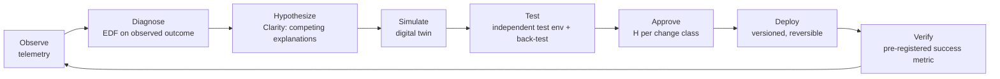

# Continuous enterprise self-evaluation (addendum §21)

**Capabilities:** C6.2 telemetry, C6.3 digital twin and C6.4 controlled change. Accountable role: the COO as Change Board chair.

**Constraint:** the enterprise must learn from operations **without autonomously weakening its safeguards**.

## 1. Telemetry produced by every process

Every durable workflow emits a standard measurement record at each state transition. Because workflows are event-sourced, the metrics are computed from events and are never self-reported.

| Measure | Definition (computed per workflow instance, aggregated per process and segment) |
|---|---|
| Processing time | `EffectiveAt(terminal) − EffectiveAt(start)`; P50, P90 and P99; wait time vs. work time split by state |
| Human intervention | Count and duration of ExceptionCase work; % of instances touched by a human; touches per instance |
| Cost per outcome | (Allocated human minutes × loaded rate [A]) + inference cost (AgentRun.cost) + rail and vendor fees + infrastructure allocation |
| Error rate | Decisions later reversed or corrected; payments returned; reconciliation breaks caused |
| Exception frequency | % of instances routed to a case, by flag code |
| Rework | Instances that re-entered an earlier state, such as a donor clarification loop or reissue |
| Customer experience | Donor- and recipient-reported effort and satisfaction (sampled); complaint codes; status inquiries per instance (target ≈0) |
| Compliance effectiveness | Control evidence completeness; sampled-decision recomputation agreement (determinism); findings |
| Financial accuracy | Breaks per 10k transactions; NAV holds; write-offs |
| AI accuracy and reliability | Per agent: precision and recall on labelled samples (CTL-040 and sampling); flag rate drift; schema failures; latency; cost |

**Labeling rule:** dashboards mark every figure as *measured* (from production events), *simulated* (from the twin) or *assumed* (model parameter). Simulated and measured figures are never mixed in one figure without the label.

## 2. Controlled improvement cycle

| Step | Who | Artifact |
|---|---|---|
| Observe | Telemetry (DET); improvement agent scans | Signal: a metric beyond tolerance or trend |
| Diagnose | Analyst plus improvement agent (AGT-A), using EDF only where an outcome is observed | Origin network, evidence vs. inference |
| Hypothesize | Analyst; Clarity challenge (competing explanations, incentives) | Change proposal with predicted effect and falsifier |
| Simulate | Digital twin (DET) | Effect on throughput, cost, staffing and risk exposure |
| Test | Independent tester (not the proposer); back-test on the historical corpus for policy changes | Test report |
| Approve | Per the change-class table (§3) | Approval record |
| Deploy | Platform (DET); feature-flagged; staged | Deployment record with version |
| Verify | Telemetry against the pre-registered metric and window | Verification record; automatic rollback trigger if guardrail metrics degrade |

## 3. Change classes and required approvals

| Change class | Examples | Independent test | Approval |
|---|---|---|---|
| **Material: financial control** | Payment gate rules, dual-control thresholds, reconciliation tolerances, NAV tolerances | Yes | Change Board + CFO + CRCO; Audit & Risk informed |
| **Material: regulatory policy** | Eligibility rules, ER rules, sanctions fuzzy policy, acknowledgment content | Yes, plus back-test | GC + CRCO; board if the policy is board-level |
| **Material: agent permissions** | New tool, write-adjacent tool, scope expansion, new data source | Yes, plus evaluation and red-team (CTL-026) | CRCO + CTO; Audit & Risk informed |
| **Material: process** | Removing a human step, changing routing between H and D | Yes, plus twin simulation | Change Board + accountable capability owner |
| **Standard** | Agent prompt refinement within the same scope that passes the frozen eval; UI copy; performance | Automated eval | Agent owner + reviewer |
| **Tightening** | Lower auto-approve threshold, more sensitive screening | Automated tests | Capability owner (fast path) |

## 4. Guarantees that learning cannot weaken safeguards

1. **Monotonic safety rule (CTL-010).** Every governed parameter has a declared *safe direction*. A change in the unsafe direction is automatically classified as material, whoever proposes it and whatever label it carries.
2. **Proposals only.** The improvement agent can propose changes but holds no deploy, parameter-write or approval capability. Its proposals enter as cases.
3. **Frozen evaluation sets.** Agent changes must match or beat a frozen baseline on accuracy *and* on the adversarial set. The evaluation set itself changes only through a material change, so the bar cannot be lowered by editing the test.
4. **Back-test against history.** A policy change that would have approved any historical grant later found ineligible, or any flagged-and-declined grant, is blocked unless explicitly justified and approved.
5. **Guardrail metrics with automatic rollback.** Examples: exception escape rate, returned payments, breaks. Deployment pipelines roll back on breach.
6. **Audit visibility.** Every change ships with its approval chain to the board pack (governance §6).

## 5. Improvement recommendation engine: eliminate before accelerating

The engine (AGT-A plus DET analytics) ranks opportunities with an explicit preference order:
1. **Eliminate the cause.** Example: a recurring donor-clarification loop caused by name-only recipient entry → change the intake to search-and-select by EIN.
2. **Prevent the exception.** Example: recipients whose bank verification repeatedly fails → enroll them proactively.
3. **Automate the decision deterministically.** Only where the H decisions show stable, rule-expressible patterns, and only via a policy change (material).
4. **Assist the human.** Better dossiers.
5. **Accelerate.** Faster tooling.

Each recommendation reports:
- instances affected per month (measured);
- human minutes saved (measured × [A] rate);
- risk delta (twin);
- the control classes touched (which sets the approval route);
- a falsifier: the metric that would show it failed.

This ordering follows the repository's own reasoned finding: redesign removes exception classes, while AI only shortens their handling ([industry report §7](../../DAF-INDUSTRY-REPORT-2026-11.md), [I]).
