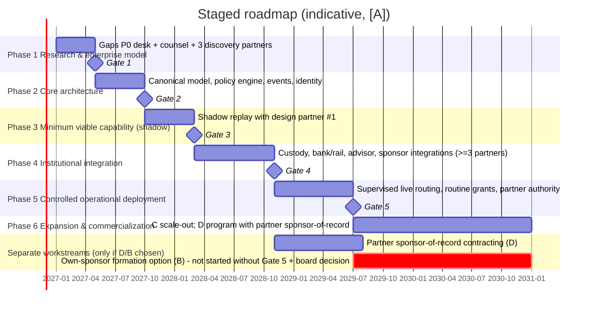

# Implementation roadmap

**Status:** plan, 2026-11-20. It is staged by model, following [`../10-market-and-business-model/models-A-B-C-D-comparison.md`](../10-market-and-business-model/models-A-B-C-D-comparison.md) §5: **enter as Model C, earn the right to Model D, and keep Model B as an option, not a commitment.**
**Machine-readable form:** [`roadmap-phases.csv`](roadmap-phases.csv).

**Labels:**
- **[A]** marks durations, budgets and team sizes. They are assumptions, sized to be consistent with the [financial model](../09-financial-models/financial-and-staffing-models.md). The C ramp has a peak capital need of about $7.4m at $300 per account with 20k-account clients. The calibrated B ramp needs about $14.8m.
- Acceptance thresholds are **design targets**, not observed benchmarks.

## 0. Ground rules that hold in every phase

1. **Instruction-only and non-custodial.** Funds stay in sponsor-titled bank and custody accounts. The platform generates payment instructions under the *sponsor's* bank agreement, or orchestrates a licensed partner. It never accepts or pools value: architecture A or B in [regulatory map §14](../08-governance-and-compliance/regulatory-applicability-map.md); DD-008. Provider custody (architecture C) would be a separate licensing program needing a board decision. It is out of scope.
2. **The sponsor decides.** In Models C and D, every grant decision is made under the *client sponsor's* board-approved policy and delegated authority (DD-003). The platform executes that policy. It never substitutes its own.
3. **No regulated function rests on an unverified component.** Echelon components are evaluated, not depended on (DD-014; [component assessment](../07-technology-architecture/echelon-component-assessment.md)).
4. **Every phase closes named gaps** from [`gap-register.csv`](../00-research-inventory/gap-register.csv). A phase that does not close its gaps does not pass its gate.
5. **Agents ship in shadow mode first.** No agent family moves from shadow to production without independent evaluation and change-board approval ([agent catalog](../05-agent-architecture/agent-catalog.csv); controls in [`controls.csv`](../08-governance-and-compliance/controls.csv)).

## 1. Timeline

Phases 1–5 take about 30 months [A], with total spend through Gate 5 of about **$5.5m–$9.5m [A]**. This brackets the $7.4m peak capital from the C ramp. The upper end assumes slow partner data access (Q-N04).

## 2. Phases

### Phase 1: Foundational research and enterprise model (about 4 months [A])

- **Objectives:** validate the assumptions that every later phase depends on, define regulatory boundaries with counsel, and select the initial business model on evidence.
- **Deliverables:**
  - Signed discovery agreements with 3 sponsors (mid-size nationals or the larger community foundations, ≥~20k accounts preferred per the 09 ramp), granting read access to de-identified historical grant, eligibility and exception data.
  - Counsel memos:
    - money transmission for the instruction-only architecture (GAP-012);
    - reliance on shared due-diligence dossiers across sponsors (API-12 question);
    - state platform-law exposure (GAP-013);
    - Investment Company Act §3(c)(10) and 1995 Act conditions on referral or revenue-share terms (regulatory map §15 item 2).
  - Policy-as-code feasibility study: what share of one partner's written grant policy encodes deterministically (GAP-026).
  - 15–20 buyer interviews using [`market-validation-plan.md`](../10-market-and-business-model/market-validation-plan.md) (GAP-014, GAP-015).
  - Update of the parameter register in [`../09-financial-models/outputs/parameter-register.csv`](../09-financial-models/outputs/parameter-register.csv) from any measured data.
- **Acceptance criteria (design targets):**
  - ≥2 of 3 partners deliver ≥12 months of historical grants with recipient EINs and decision outcomes.
  - The counsel opinion confirms the instruction-only architecture is not money transmission, or names the required partner structure.
  - ≥60% of the partner policy's rules (by grant volume affected) are encodable as decision tables.
  - ≥5 buyer interviews show a named budget holder and procurement path.
- **Dependencies:**
  - partner willingness to share data (Q-N04 / GAP-002);
  - outside counsel availability;
  - the repository research inventory (done).
- **Team [A]:** 4–5 FTE (founder/CEO, product and policy lead, engineer, research analyst, fractional counsel).
- **Budget [A]:** $0.4m–$0.8m.
- **Risks:**
  - Partners will not share data. The comparison's first falsifier says to go to D via a sponsor-of-record API partner, or stop.
  - Counsel finds licensing exposure even for instruction-only.
- **Kill/continue:** kill or pivot if 0 of 3 partners grant data access within 6 months, or if counsel requires a licensing program before any pilot.
- **Gaps closed or advanced:** GAP-002, 012, 013, 014, 015, 026, 027 (scoping), 040.
- **Decisions validated:** DD-004 (scoping), DD-008, DD-011 (feasibility), DD-016.

### Phase 2: Core operating architecture (about 5 months [A])

- **Objectives:** turn the reference models into a production-grade modular monolith, limited to the slice needed for shadow mode.
- **Deliverables:**
  - The canonical data model and event ledger (bitemporal eligibility facts, provenance on external facts), grown from [`../models/Daf.Enterprise/Domain.fs`](../models/Daf.Enterprise/Domain.fs).
  - The policy engine with versioning, back-testing and an approval workflow (grown from `Policy.fs`).
  - The continuous eligibility pipeline: IRS BMF, Pub 78 and auto-revocation, plus OFAC, with list-version pinning and a freshness SLO.
  - The single exception queue (C5.3).
  - The identity and authorization model, including agent-principal tokens (DD-017).
  - Internal API contracts written by the builder to the requirements in [`../04-enterprise-apis/api-catalog.md`](../04-enterprise-apis/api-catalog.md).
  - The evidence ledger.
  - A tenancy model with tenant = sponsor (DD-016).
  - **The DD-015 re-evaluation:** F# confirmed or replaced, based on hiring, library, vendor-SDK and auditor-tooling evidence. The reference models keep passing in either case.
- **Acceptance criteria (design targets):**
  - The authority invariants INV-A1–INV-A8 hold as automated tests on the production codebase. Today they are 59 tests in the reference solution.
  - A policy back-test replays ≥100k historical grants in under 1 hour.
  - Every external fact carries source, version, retrieval time and hash.
  - Eligibility freshness SLO ≤ 35 days, alarmed.
  - The threat model and a security architecture review are signed off.
  - A SOC 2 readiness gap assessment is complete.
- **Dependencies:** a Phase 1 partner data schema; a cloud account; an identity provider; counsel input on retention.
- **Team [A]:** 7–9 FTE (4–5 engineers, policy engineer, security lead, product, evaluation lead from month 3).
- **Budget [A]:** $0.9m–$1.4m.
- **Risks:**
  - Over-building before Phase 3 evidence. Mitigation: scope is limited to the shadow slice.
  - Language and hiring constraints (DD-015).
- **Kill/continue:** continue if the invariants and back-test targets are met. If F# hiring fails, re-platform the domain core before Phase 3, not after.
- **Gaps:** GAP-021 (retention-compliant eligibility evidence), GAP-026 (implementation), GAP-024 (human vs agent attribution in records).
- **Decisions validated:** DD-002, 005, 006, 009, 011, 012, 013, 014, 015, 017.

### Phase 3: Minimum viable operating capability, shadow mode (about 5 months [A])

**The smallest useful slice.** The policy engine, continuous eligibility and exception routing replay design partner #1's historical grants, then its live grant stream, in **shadow**. The platform decides alongside the partner's existing process. Its outputs go only to an evaluation dashboard. **No money moves, and no partner decision is changed.** This is the measurement the whole market lacks (Q-N03 / GAP-001).

- **Deliverables:**
  - The shadow pipeline on 12 months of history plus 3 months live.
  - Agent families in shadow: recipient resolution, benefit-risk flagger, sanctions near-match triage and exception dossier preparer ([agent catalog](../05-agent-architecture/agent-catalog.csv)).
  - A measured exception rate and timed reviewer minutes, with and without dossiers.
  - A QA and disagreement analysis between the shadow decisions and the partner's actual decisions.
  - A recipient-clustering analysis for determination reuse.
  - The first *measured* parameters replacing assumptions in the twin and the cost model.
- **Acceptance criteria (design targets):**
  - **Zero false clears.** No grant the partner declined or flagged is auto-approved by the shadow engine, unless the partner's own review confirms the engine was right (GAP-034, the falsification test).
  - Every disagreement is explained by a rule, a data difference or a policy ambiguity, and logged.
  - The measured routine-path share is ≥85% of grants (design target; the 09 model assumes about 92%).
  - Dossier-assisted reviewer minutes are measured with n ≥ 200 timed cases.
  - Agent recall on planted test cases is ≥ the threshold set in the agent catalog. Precision is reported, not gated.
  - The twin is back-tested on the partner's monthly backlog.
- **Dependencies:**
  - Partner #1 data feed plus the reviewer time study, which needs the partner's staff time.
  - Gate 2 passed.
- **Team [A]:** 9–11 FTE (Phase 2 team plus a grants compliance specialist and an evaluation analyst).
- **Budget [A]:** $1.0m–$1.6m.
- **Risks:**
  - The measured exception share is far higher than the proxy, which weakens the cost case.
  - The partner's policy is too discretionary to encode.
  - Partner staff will not do timed reviews.
- **Kill/continue:**
  - **Kill the AI-native cost thesis** if measured minutes per exception and exception rate imply a value pool below the C price at the partner's scale. That is the comparison's second falsifier: C becomes a feature, and the options are D or acquisition.
  - **Kill auto-approval (DD-004)** if any false clear survives root-cause analysis.
- **Gaps:** GAP-001, 004 (error baseline, partial), 006 (if the partner shares service logs), 020 (latency), 034, 003.
- **Decisions validated:** DD-004, 005, 012, 013, 018 (remittance design, review only).

### Phase 4: Institutional integration (about 8 months [A])

- **Objectives:** integrate with the external institutions that real operation requires, across ≥3 design partners.
- **Deliverables:**
  - Integrations:
    - a custodian (positions and transactions, event or file adapter);
    - bank and rail, instruction-only, under each sponsor's ODFI agreement, *or* a licensed processor partner (Chariot- or PayPal-style), with ACH CCD+ or CTX carrying the grant ID in addenda;
    - advisor platform SSO and delegated permissions;
    - sponsor recordkeeping read/write per contract.
  - Continuous three-way reconciliation running on partner data.
  - Data-portability export in the open grant record format ([`standards/daf-grant-record`](../../../standards/daf-grant-record/schema-v0.1.json)).
  - A SOC 2 Type I report.
  - Nacha third-party service provider obligations contracted.
  - Commercial terms with ≥3 partners: price per account or per event, data rights, exit assistance.
- **Acceptance criteria (design targets):**
  - ≥3 partners integrated, of which ≥2 have ≥20k accounts (the 09 ramp shows smaller clients do not carry C).
  - Contracted price ≥$250 per account per year, or equivalent event pricing (the 09 model: $150 per account never breaks even in five years).
  - Reconciliation break rate and minutes measured on ≥3 months of partner data (GAP-005).
  - Payee bank-change controls (verification plus cooling-off) operating in shadow on live payee changes.
  - Exit-readiness test passes: a full partner export restores into a cold standby schema.
- **Dependencies:**
  - Executed contracts with API and export rights (GAP-002 resolved in practice).
  - A bank or processor partner willing to accept the instruction-only model.
  - Custodian API access.
  - The counsel opinion from Phase 1.
- **Team [A]:** 12–16 FTE (adds integration engineers, payments operations, partnerships lead, security engineer).
- **Budget [A]:** $1.8m–$3.0m.
- **Risks:**
  - Incumbent vendors block integration (six of the top 20 sponsors restrict automated access; EV-122).
  - Bank partners decline.
  - Price resistance.
- **Kill/continue:**
  - If <2 partners of ≥20k accounts sign at a viable price within the phase, stop C scale-out. Re-plan as D via a sponsor-of-record API partner, or as an acquisition target.
  - If the bank or processor requires provider custody, stop until a board decision on licensing.
- **Gaps:** GAP-002, 005, 007, 014 (price evidence), 016, 025, 028, 030.
- **Decisions validated:** DD-008, 010, 016, 018.

### Phase 5: Controlled operational deployment (about 8 months [A])

- **Objectives:** move from shadow to **supervised live routing** of one design partner's *routine* grants, under that partner's sponsor authority and board-approved policy, with bounded AI and independent verification.
- **Deliverables:**
  - Live deterministic approval of routine grants (listed public charity, under the partner's threshold, no flags) under the partner's published policy version.
  - All flagged and non-routine grants routed to the partner's own reviewers, through the platform's exception queue.
  - Payments instructed under the partner's bank authority through the payment gate (caps, dual control, cooling-off).
  - Agents promoted only by the change board, after independent evaluation.
  - An independent verification function: the partner's internal audit or a third party samples deterministic approvals monthly (D-area QA falsifier).
  - Kill switches drilled.
  - A SOC 2 Type II observation period started.
- **Acceptance criteria (design targets):**
  - 0 grants paid to revoked or OFAC-listed recipients.
  - 0 payments without an approving rule or person actor (INV-A3, verified by the evidence ledger).
  - Monthly QA sample with no material false clear. ≥1 false clear triggers automatic reversion to shadow for that rule.
  - Routine grant P50 from submission to payment instruction ≤ 1 business day (design target; no sponsor publishes a baseline, GAP-020).
  - Exception SLA met outside the December surge; the surge plan exercised.
  - Measured cost per grant reported against the 09 model.
  - The 22 scenarios in [`../11-scenarios-and-validation/scenarios.md`](../11-scenarios-and-validation/scenarios.md) tabletop-tested. At least SC-09 (custodian outage), SC-11 (credential compromise), SC-12 (unauthorized payment) and SC-19 (prompt injection) run as live drills.
- **Dependencies:**
  - The partner board's approval of the auto-approval policy class (regulatory map §12: a person approves each grant, or the board approves the policy that lets a defined class be auto-approved).
  - Gate 4.
  - Insurance (E&O, cyber, crime) bound for the provider.
- **Team [A]:** 16–20 FTE (adds agent owners, service recovery, CRCO function).
- **Budget [A]:** $2.2m–$3.4m (partly offset by partner revenue).
- **Risks:**
  - An escaped error in live operation.
  - A regulator or AG inquiry about automated approval.
  - Partner reputational risk.
- **Kill/continue:**
  - Any payment to an ineligible recipient caused by platform logic triggers a halt of live routing and an incident review, and the board decides on resumption.
  - Continue to Phase 6 if 6 consecutive months meet every criterion.
- **Gaps:** GAP-004 (measured escaped-error baseline), 011, 024, 029 (fraud incidence, partial).
- **Decisions validated:** DD-002, 003, 004, 005, 007 (unchanged: no investment authority), 017, 018.

### Phase 6: Expansion and commercialization (about 18 months [A])

- **Objectives:**
  - Scale C to more sponsors.
  - If Gate 5 evidence supports it, launch D: administer a whole program, such as a new advisor-channel DAF, end to end under a **partner sponsor-of-record**.
  - Productize the highest-scoring capabilities: white-label administration, audit evidence, reconciliation and decisioning ([`capability-commercialization.md`](../10-market-and-business-model/capability-commercialization.md)).
- **Deliverables:**
  - 8–12 sponsor clients; ≥150k accounts served (the C ramp is about 180k by year 5).
  - The D program contract: fee share, liability allocation, the partner sponsor-of-record keeping exclusive legal control and board authority (GAP-027).
  - A published SOC 2 Type II.
  - Public operating metrics (P50/P90 grant latency, exception rate), which no sponsor publishes today (EV-076).
  - A submission of the open grant record for endorsement (GAP-031).
  - The improvement engine live with twin-backed change control.
- **Acceptance criteria (design targets):**
  - Positive operating result on a trailing 12-month basis (C ramp: about year 4).
  - Gross revenue retention ≥ 95% across clients.
  - D program: ≥1 partner sponsor-of-record signed on terms that keep the provider non-custodial and not the sponsor.
- **Dependencies:** Gate 5; a partner sponsor-of-record (Endaoment, Daffy for Developers, GiveClear and NPT private-label are the repository's public examples; terms unknown, GAP-027); a distribution partner for D.
- **Team [A]:** 25–40 FTE, scaling per the 09 role model.
- **Budget [A]:** funded from revenue plus a growth round; not included in the $5.5m–$9.5m through Gate 5.
- **Kill/continue:** if an incumbent (Ren, Foundation Source, TIFIN Give) ships equivalent policy-as-code, continuous eligibility and open evidence exports within 12–18 months, re-plan toward partnership or sale (comparison §6 falsifier 4).
- **Decisions validated:** DD-010, 016; Model B option assessed.

## 3. Decision gates

| Gate | At end of | Evidence required | Who decides | If it fails |
|---|---|---|---|---|
| **Gate 1: proceed to build** | Phase 1 | ≥2 partners with data access; counsel confirms the instruction-only posture; ≥60% policy encodable; buyer interviews show budget holders | Founders and board/investors, with counsel | Pivot to D via a sponsor-of-record API partner, or stop |
| **Gate 2: proceed to shadow** | Phase 2 | INV-A1–A8 automated; back-test performance; security review; DD-015 decision recorded | CTO plus independent security reviewer; CEO | Fix before any partner data runs |
| **Gate 3: proceed to integration** (the thesis gate) | Phase 3 | Zero false clears; measured exception rate and minutes; value pool ≥ price at the partner's scale; twin back-tested | Board, on evaluation-lead and CRCO reports; partner #1 consulted | Drop the auto-approval thesis, or C as a business; consider D only, or sale |
| **Gate 4: proceed to live** | Phase 4 | ≥3 partners integrated (≥2 at ≥20k accounts); price ≥$250 per account; bank/processor in instruction-only mode; SOC 2 Type I; insurance bound | Board; partner sponsor boards approve their own policy classes | Stay in shadow; renegotiate or stop |
| **Gate 5: proceed to scale and D** | Phase 5 | 6 months of live criteria met; QA clean; scenario drills passed; measured unit cost vs model | Board, with the independent verifier's report; for D, the partner sponsor-of-record's board | Remain C-only at current scale |
| *Model B option* (not a scheduled gate) | After Gate 5 | Calibrated B ramp updated with measured CAC (GAP-018); partner-of-record terms worse than the B formation cost; distribution secured | Board; separate legal-formation workstream | B is not started |

## 4. What a working demo does NOT authorize

A passing test suite, a shadow-mode result or a live pilot under a partner's authority is **not** authorization to operate a regulated charitable organization. Becoming a DAF sponsor (Model B), or a sponsor-of-record for Model D, involves separate workstreams with their own timelines and decision-makers. None of them is in Phases 1–5:

- **Legal formation:** formation of the nonprofit corporation, bylaws, conflict-of-interest and whistleblower policies (state law), and an independent board.
- **IRS recognition:** Form 1023 and a §501(c)(3) determination with public-charity classification. Public-support tests (Schedule A) apply thereafter.
- **State charitable registrations:** solicitation registration in each relevant state ([`b50-02-state-registration.md`](../../mission-2026-11-14/b50-02-state-registration.md)), plus state platform-law registration if listing charities publicly (GAP-013).
- **Banking and custody:** accounts titled to the sponsor; ODFI agreement; custodian agreements; investment policy and committee.
- **Insurance:** D&O, crime/fidelity, cyber, E&O.
- **Securities and fee structures:** counsel review of the pooled-fund exclusion and any referral or revenue-share arrangement (regulatory map §15).
- **Audit:** an independent auditor engaged; state audit thresholds.

The reference F# models in [`../models/`](../models/) demonstrate that the design's invariants are *implementable*. They do not demonstrate legal sufficiency, operational resilience or regulatory acceptance.

## 5. Traceability summary

| Phase | Gaps closed | DD validated |
|---|---|---|
| 1 | GAP-002, 012, 013, 014, 015, 026, 027 (scope), 040 | DD-004 (scope), 008, 011, 016 |
| 2 | GAP-021, 024, 026 | DD-002, 005, 006, 009, 011–015, 017 |
| 3 | GAP-001, 003, 004 (partial), 006, 020, 034 | DD-004, 005, 012, 013, 018 |
| 4 | GAP-002, 005, 007, 014, 016, 025, 028, 030 | DD-008, 010, 016, 018 |
| 5 | GAP-004, 011, 024, 029 | DD-002–005, 007, 017, 018 |
| 6 | GAP-027, 031 | DD-010, 016 |
