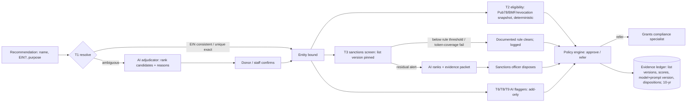

# AI for charity and grant vetting: deep dive

**Date:** 2026-11-21. **Status:** research. It is not legal advice.

**Sources:**
- the external landscape: [`landscape-and-evidence.md`](landscape-and-evidence.md), with 87 sources in [`landscape-sources.csv`](landscape-sources.csv);
- **two new experiments on public data**, V1 and V2, below;
- the repository's prior vetting research (batches 2A–2C), the AI failure-mode register, and the workflow-innovation experiments E1, E2 and E10.

**Evidence classes:**

| Label | Meaning |
|---|---|
| [X-public] | Result of an experiment on public data, reproducible |
| [preprint] / [peer-reviewed] / [vendor claim] / [survey] / [regulatory] | As in the landscape file |
| [repo V] | Validated earlier in this repository |
| [I] | Inference |

## 1. Bottom line

1. **Vetting is mostly not an AI problem.** Of the ten vetting tasks (§2), the load-bearing legal determinations are deterministic lookups against authoritative public data: IRS Pub 78, the EO BMF, the Auto-Revocation List and OFAC. The IRS lets a sponsor *rely* on those lists (Rev. Proc. 2018-32). An LLM restating them adds error and no information. **The evidence-supported AI roles are narrower:** resolving *which* organization is meant, triaging fuzzy sanctions alerts, extracting facts from documents, and *adding* risk flags.
2. **Recipient resolution, "who is this?", is the hidden first step, and it is where deterministic methods run out.** On 18,222 labeled public Schedule I lines [X-public], a deterministic cascade of normalized exact name, then state, then city or ZIP resolves 77% at 99.3% precision. Adding a conservative fuzzy step raises coverage to 82.0% at 99.05% precision. **The remaining quarter is hard:**
   - **Names shared by many organizations.** "First Baptist Church"-type names run at 88.7% precision on name and state alone.
   - **Spelling differences** (18.5% of lines). Only fuzzy matching helps, and it reaches 41% coverage at 92.7% precision.

   For the cascade's 2,876 referred cases, the right organization is among the generated candidates 60% of the time. That is the **ceiling** for an AI adjudicator choosing among candidates; the rest needs a person or more data.
3. **Fuzzy sanctions screening of charity names generates alerts that are, in practice, all false positives. Deterministic rules remove most of them before any AI is involved** [X-public]. 149,950 distinct recipient names were screened against 41,451 OFAC names and aliases:

   | Threshold | Alerts | Rate | After a token-coverage rule |
   |---|---|---|---|
   | Jaro-Winkler 0.88 | 2,106 | 1.4% | 331 |
   | 0.92 | 218 | 0.15% | 41 |
   | Exact equality | 10 | — | — |

   The 10 exact equalities are all against **vessel** names: a short charity name equals a listed ship's name. The strongest external evidence for AI in vetting is LLM disambiguation of exactly these alerts: a Federal Reserve staff paper reports −92% false positives and +11% detection against fuzzy matching, but at more than 10⁴× the latency [preprint]. **None of it has been tested on charity populations.**
4. **The documented harm in charity screening is over-screening, not AI.** De-risking has fallen on Muslim, international, small and faith grantees. Two-thirds of U.S. nonprofits working abroad reported banking-access problems [NGO report]. FinCEN's October 2026 notice reaffirmed that most U.S. nonprofits are low-risk [regulatory]. **An AI that adds hits without a calibrated, accountable way to clear them would reproduce that harm faster.**
5. **Funders barely use AI to decide.** 1% of foundations use generative AI to screen or choose grantees (Candid, n=529) [survey]. MacArthur's policy bans it. No DAF sponsor documents AI in eligibility or approval [repo V]. Grant-software AI (summaries, 990 financial scoring) is spreading, **with no published accuracy data** [vendor claim].
6. **Design conclusion:** a **cascade**.

   ```
   deterministic resolution and screening
     → documented rules clear what they can
       → AI ranks, explains and adds flags on the residue
         → a named person decides
   ```

   Every step is logged: list versions, scores, model and prompt version, and the person's disposition (OFAC 10-year records). This refines the repository's flag-only rule into an explicit reading. **Deterministic, documented rules may clear; probabilistic models may rank, explain and add; only people dispose.**

## 2. What vetting actually consists of

| # | Vetting task | Legal or risk basis | Nature of the decision | Authoritative source | AI role (evidence) |
|---|---|---|---|---|---|
| T1 | **Recipient resolution** (which legal entity?) | Prerequisite to every check below | Deterministic when the EIN is given and consistent; ambiguous when free text | IRS EO BMF; donor-supplied EIN | **Adjudicate among candidates, for donor or staff confirmation** (V1: the truth is among the cascade's candidates in 60% of referred cases) |
| T2 | Eligibility class (public charity, private foundation, Type III, government unit, church) | §4966; Rev. Proc. 2018-32 reliance | Deterministic | Pub 78, BMF foundation code, Auto-Revocation List | **None.** Restating lists adds error [repo V F01] |
| T3 | Sanctions | OFAC strict liability; 10-year records (REG-036/037) | Deterministic screen; human disposition of true potential matches | SDN plus consolidated lists | **Rank and explain fuzzy alerts; never close a potential match** ([preprint] LS-048/049; V2) |
| T4 | Foreign grantees: equivalency determination or expenditure responsibility | §4966, §4945(h); REG-002/020 | Legal judgment | Grantee documents; NGOsource-type EDs | **Extract and translate documents with citations; human judges** (no evidence of AI in EDs) |
| T5 | Fiscal-sponsor grants | Charitable-purpose control; earmarking | Judgment on the hosted project | Sponsor agreements | Extract and flag; host-level diligence reusable across sponsors (E7b: 82% of host reviews avoidable) |
| T6 | Prohibited benefit and related parties (§4967, §4958) | Personal excise tax on knowing managers | Judgment | Purpose text; relationship graph | **Add flags** (pledges, tickets, tuition, related parties); never clear (E2: injection reduces recall) |
| T7 | Payee verification (the right bank account) | Fraud control | Deterministic plus out-of-band | Bank account-validation services | None needed; AI anomaly flags on change requests |
| T8 | Adverse media and reputation | Sponsor discretionary policy (REG-055) | Judgment | News, court records | **Retrieval plus summary with sources; separate allegation from finding**; never auto-deny (weak evidence; de-risking harm) |
| T9 | Sham charities and fraud | Fraud control | Probabilistic | Registration age, filing history, patterns | Flag anomalies (new organization plus new payee plus unusual amount) |
| T10 | Post-grant monitoring (ER reports, status changes) | §4945(h) reports; revocations | Deterministic triggers plus judgment | IRS diffs; grantee reports | Extract report content; status changes stay deterministic (E1) |

## 3. Experiment V1: recipient resolution on public Schedule I lines [X-public]

**Why this matters.** A donor or advisor recommends "Pathways for Children" or "First Baptist Church". Before any eligibility or sanctions check, someone must decide *which* legal entity is meant. The industry does not report how often this step is ambiguous or wrong.

**Dataset (new, public, labeled).**
- FY2023 Schedule I Part II lines from 48 top-50 DAF sponsors' IRS e-file XML: 282,247 lines, of which 280,443 carry a 9-digit EIN.
- Each line has the recipient's free-text name and US address **and the EIN the sponsor filed**, so it is a labeled pair.
- A seeded sample of 20,000 lines is committed: [`data/charity-vetting-ai/resolution-eval-sample.csv`](../../../data/charity-vetting-ai/resolution-eval-sample.csv). Extraction script: [`scripts/charity_vetting_extract_labeled_lines.py`](../../../scripts/charity_vetting_extract_labeled_lines.py).
- **This is, to our knowledge, the first public labeled benchmark for charity-recipient resolution** [I]. It can serve as the golden set the agent architecture said did not exist.

**Index.** The IRS EO BMF: 1,984,891 records (eo1–eo4, downloaded 2026-11-21).

**Label quality** ([`results/v1-label-consistency.csv`](results/v1-label-consistency.csv)):
- In 1,778 of 20,000 lines (8.9%), the filed EIN is **not a current BMF record**. Causes include revoked or terminated organizations, government units (public schools and universities are valid recipients but absent from the EO BMF), and filing errors.
- In 448 of the 18,222 lines whose EIN is in the BMF (2.5%), **the BMF name shares no distinguishing word with the filed name.** Causes include DBAs, a parent organization's EIN, and errors.
- So sponsors' own filed recipient identities are imperfect. Scores below use the 18,222 lines whose EIN is current, and they treat the filed EIN as truth, which slightly *understates* precision where the filing itself is wrong.

**Methods** (F#: [`models/Daf.Experiments/Vetting.fs`](../models/Daf.Experiments/Vetting.fs), tested in `VettingTests.fs`):
- normalized exact name, nationally;
- normalized exact name + state;
- the same with a city/ZIP tie-break;
- TF-IDF fuzzy matching with acceptance threshold and margin;
- a **cascade**.

"Referred" means ambiguous, passed to a person or an AI adjudicator with candidates.

**Results** ([`results/v1-resolution.csv`](results/v1-resolution.csv); 18,222 labeled queries):

| Method | Coverage (resolved automatically) | Precision | Referred | Truth among referred candidates |
|---|---|---|---|---|
| Exact name, national | 71.3% | 98.9% | 1,870 | 1,275 (68%) |
| Exact name + state | 74.8% | 99.4% | 570 | 433 (76%) |
| **Exact name + state + city/ZIP tie-break** | **77.0%** | **99.3%** | 172 | 93 |
| Fuzzy TF-IDF ≥0.85, margin ≥0.10 | 68.2% | 98.3% | 5,382 | 4,191 (78%) |
| Fuzzy TF-IDF ≥0.95, margin ≥0.20 | 51.4% | 99.3% | 8,441 | 7,134 (85%) |
| **Cascade** (deterministic → fuzzy 0.95/0.20 → refer) | **82.0%** | **99.05%** | 2,876 | 1,728 (60%) |

**By difficulty** (the stratum is the number of BMF organizations sharing the normalized name):

| Stratum | Share of lines | Best deterministic precision / coverage | Fuzzy 0.85 precision / coverage |
|---|---|---|---|
| Name unique nationally | 71.2% | 99.7% / 96.4% (name + state) | 99.4% / 78.7% |
| Name shared by 2–5 organizations | 6.0% | 97.7% / 84.2% (tie-break) | 96.1% / 57.8% |
| Name shared by 6+ organizations | 4.3% | **93.2% / 76.3%** (tie-break); 88.7% / 33.2% on name + state | 86.0% / 23.9% |
| Exact name absent from the BMF (spelling or format differs) | 18.5% | 0% (exact cannot match) | **92.7% / 41.4%** |

**Reading:**
- **Deterministic methods are excellent where a name is unique, and they say so.** They don't guess when ambiguous; they refer.
- **The hard cases are common names and spelling variants: about a quarter of lines.** Here fuzzy matching either declines or makes 7–14% errors.
- **That residue is where an AI adjudicator is evidenced in general entity-resolution research** (OpenSanctions Pairs: GPT-4o F1 99.0% vs 91.3% rule-based) [preprint]. On this data the **upper bound** for any adjudicator that chooses among the generated candidates is the "truth among candidates" share: 68–85% depending on method. The remainder needs better candidate generation or a human with outside information.
- **Not done:** an LLM adjudicator was **not run** (no model API in this environment). The protocol in §7 specifies how to run it against this benchmark, and what result would justify using it.

## 4. Experiment V2: sanctions name-screening alert volume on charity names [X-public]

**Dataset:**
- 149,950 distinct normalized recipient names from all FY2023 lines.
- Screened against OFAC SDN plus the consolidated non-SDN list, including aliases: 41,451 names, downloaded 2026-11-21.
- Candidates share a distinguishing token; scoring uses Jaro-Winkler on the normalized full name.
- **Deterministic secondary rule:** every distinguishing token of the list name must appear in the recipient name (token coverage).

**Results** ([`results/v2-sanctions-screening.csv`](results/v2-sanctions-screening.csv)):

| Jaro-Winkler threshold | Alerts | Alert rate | On entity-type list entries | After token-coverage rule |
|---|---|---|---|---|
| 0.88 | 2,106 | 1.40% | 1,484 | **331** (−84%) |
| 0.92 | 218 | 0.15% | 137 | **41** (−81%) |
| 0.95 | 21 | 0.01% | 7 | 12 |
| 0.98 | 10 | 0.01% | 0 | 10 |
| 1.00 (exact) | 10 | 0.01% | 0 | 10 |

**Alerts by list entry type:**

| Threshold | Entity | Vessel | Individual | Aircraft | Recipient name is person-like (2–3 tokens, no organizational word) |
|---|---|---|---|---|---|
| 0.88 | 1,484 | 584 | 37 | 1 | 652 |
| 0.92 | 137 | 77 | 4 | 0 | 87 |
| 0.95 | 7 | 14 | 0 | 0 | 14 |
| 1.00 | 0 | **10** | 0 | 0 | 10 |

**Reading:**
- **For a domestic charity population, nearly every fuzzy alert is a false positive.** These are U.S. charities that are mostly BMF-listed. **This experiment does not adjudicate any alert, and no recipient is named.** A name match is not a finding about any organization.
- **Alert volume is governed by the threshold and by deterministic secondary rules far more than by AI.** One token-coverage rule removes 81–84% of alerts at the operational thresholds.
- **The workload is real but small at scale.** At 0.92, about 41 alerts per 150k names would need a person *before* any AI. That is a few hours a year at sponsor scale, which matches the repository's finding that the operations-AI value pool is thin (EV-107).
- **Exact name equalities happen.** All 10 are against **vessel** entries: short charity names equal to a listed ship's name. Vessel entries also produce 28% of alerts at 0.88. **Secondary identifiers** (entry type: a vessel cannot be a grantee; country; address) are deterministic and remove these outright.
- **Where AI would add value:** ranking and explaining the residual alerts, with an evidence packet (list entry, programme, addresses and identifiers against the recipient's BMF record) for the sanctions officer. **Not closing them.**

## 5. Where AI helps, where it must not be used

**Use (with the stated role):**
1. **T1 resolution adjudication** for referred cases: candidates plus donor confirmation, logged.
2. **T3 alert ranking and explanation:** the cascade from the Fed paper; deterministic rules clear documented false-positive classes; LLMs rank the residue; the officer disposes.
3. **T4, T5, T10 document extraction** with span-level citations and cross-checks against reported totals.
4. **T6, T8, T9 flag generation:** add-only, with reasons and sources.

**Do not use:**
- **AI for T2 eligibility.** The deterministic source *is* the answer, and reliance attaches to it.
- **AI to close sanctions alerts or deny grants** on adverse media.
- **Agents that read charity web content while holding tools.** The prompt-injection risk is real (OWASP LLM01; in E2, prompt injection reduced AI recall to the level of having no AI).
- **AI ranking built on licensed ratings data** whose terms bar AI use (Candid, Charity Navigator) [repo V].

## 6. Reference architecture: the vetting cascade



- **Deterministic checks run first and are authoritative.**
- **Models run only on the residue that rules cannot settle.** Their outputs are rankings, explanations and flags.
- **Every disposition belongs to a named person.**
- **The parent architecture's controls apply:** flag-only (DD-005), canaries for each rule (FP-04), and no tools for document-reading steps.

## 7. Evaluation protocol: what would justify deploying each AI role

| Role | Golden set | Metric and acceptance target [A] | Adversarial set | Fairness stratification |
|---|---|---|---|---|
| T1 adjudicator | V1 referred cases (public, labeled) | Precision ≥ 99% on accepted picks; abstains otherwise; gain over deterministic coverage reported | Near-duplicate names; conflicting addresses; injected misleading text | Churches, schools, chapters, small organizations |
| T3 alert ranker | V2 alerts plus OpenSanctions Pairs plus seeded true matches | Recall of seeded true matches = 100% in the top tier; officer minutes per alert | Transliteration variants; alias spoofing; planted biographies | Arabic, Persian and other non-Latin-origin names: false-positive rate parity |
| Document extractor | 990s and audits with known values (public e-file XML gives ground truth for 990 fields) | Field accuracy against XML; citation validity | Scanned and low-quality documents; contradictory pages | Small organizations' filings (990-EZ/N) |
| Flaggers (benefit, related party, fraud) | Seeded synthetic grants (E2-style) | Recall by defect class; false-flag rate | Prompt injection in purpose text and charity web pages | Faith, international and advocacy grantees |

**Deployment rule:**
1. **Shadow mode first.** The AI output is logged but not shown to decision-makers.
2. **Then decision support.** It is shown to people.
3. **Never autonomous disposition** for T2, T3 or T6.

Results feed the parent change-control process: back-test, independent test, human approval.

## 8. Economics

- **Inference is cheap.** About $0.45 per heavy review (EV-106).
- **The labor at stake in vetting is small per grant.** Exception routing affects about 7–8.5% of grants (EV-081). V2 shows sanctions alerts, after deterministic rules, number in the tens per 150k names.
- **The economic case for AI in vetting is therefore not labor replacement.** It rests on:
  - fewer wrong-entity grants (T1);
  - consistent, documented evidence;
  - faster turnaround on referred cases;
  - lower false-hold harm to legitimate grantees.

  These value terms are unmeasured. GAP-004, the cost of an escaped error, is decisive. This agrees with the workflow-innovation finding that AI in approval is not robustly superior on labor and control (07-adversarial-reviews).

## 9. Updates to the repository from this deep dive

1. **The Benevity "30% → <3%" figure** in `ai-governance-failure-modes.md` (F02) measures employee match-request declines, not charity vetting. It should be relabeled (landscape §10).
2. **Model risk:** SR 11-7 / OCC 2011-12 were replaced on 2026-04-17, and generative and agentic AI are out of scope (landscape §4). Use NIST AI RMF / AI 600-1 as the baseline.
3. **FinCEN:** the 2024 program NPRM was superseded by the April 2026 NPRM (not final; binds banks, not charities). Notice FIN-2026-NTC2 (2026-10-30) is new.
4. **Golden datasets now exist:** OpenSanctions Pairs (public), plus the V1 benchmark created here. `agent-architecture.md`'s "no public datasets" is out of date for sanctions and resolution.
5. **Flag-only clarification:**
   - Documented deterministic rules may clear below-threshold sanctions false positives (REG-036).
   - Probabilistic models may rank, explain and add, but not dispose.
6. **Sponsor filing quality:** 2.5% of filed recipient EINs carry names that share no word with the BMF record, and 8.9% are not current BMF records. This is a data-quality signal for any analysis built on Schedule I, including this repository's own recipient research.

## 10. Next experiments

1. **Run an LLM adjudicator on the V1 referred set** (and on a held-out sample) under the §7 protocol. Report precision on accepted picks, abstention, and gain over the deterministic cascade. This needs model API access.
2. **Improve candidate generation** (nickname and abbreviation maps; address normalization) to raise the "truth among candidates" ceiling before adding AI.
3. **Seeded true-match recall for V2:** insert transliterated list names into the recipient set and measure the recall of deterministic and AI ranking.
4. **Fairness check of V2 false-positive rates** by name origin. This needs a careful, privacy-preserving design, and no individual organization is named.
5. **Extraction accuracy on 990 fields** using e-file XML as ground truth against the PDF renderings.
