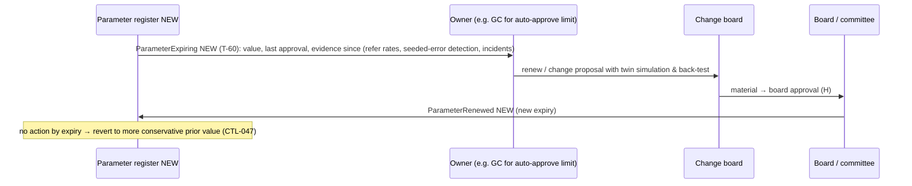

# Cross-enterprise workflows: governance, evidence, learning and lifecycle (XW-24 to XW-30)

Notation as in [xw-shared-capabilities.md](xw-shared-capabilities.md).

---

## XW-24 Policy compiler change: from law change to deployed, back-tested rule

- **Legacy departments spanned:** legal, compliance, grants operations (procedure updates), training, IT (configuration), board.
- **Trigger:** `ComplianceObligationChanged`, for example from the regulatory change monitor, final §4966 guidance, a board policy decision, or an improvement proposal.
- **Linked innovations:** INN-21, INN-36. **Maturity:** L3 partial. The parent `Policy.decide` is pure and replayable; back-test tooling is specified, and E2 exercises it. **Experiments:** E2.

```mermaid
sequenceDiagram
  participant M as AG-14 regulatory monitor
  participant GC as General Counsel
  participant PE as Policy engineer
  participant C as Policy compiler NEW
  participant BT as Back-test (history replay)
  participant CB as Change board
  M->>GC: candidate change + citations (Cat. 2)
  GC->>GC: ComplianceObligationChanged (H: interpretation)
  PE->>C: author rule change (decision table) + tests
  C->>C: compile → rules + generated prose + test vectors
  C->>BT: replay historical decision contexts
  BT-->>CB: diff report (grants that would change outcome) + AG-13 impact summary
  CB->>CB: approve (H; author ≠ approver; loosening = material, CTL-010)
  CB->>C: PolicyPublished (effective time)
```

**Sequence:**

| # | Event | Decision | State change | API | Agent | Controls |
|---|---|---|---|---|---|---|
| 1 | Monitor finds a change | P | Candidate | API-22 | AG-14 (Cat. 2) | CTL-008 |
| 2 | `ComplianceObligationChanged` | **H**: counsel interprets the law | Obligation vN | `/v1/policies/obligations` **NEW** | — | CTL-037 |
| 3 | Rule authored, then `PolicyCompiled` **NEW** | D: compile, tests | Candidate policy | `POST /v1/policies/{id}/compile` **NEW** | AG-13 drafts (Cat. 2) | CTL-006 |
| 4 | `PolicyBackTestCompleted` **NEW** | D: replay | Diff report | `POST /v1/policies/{id}/backtest` **NEW** | — | CTL-009 |
| 5 | `PolicyPublished` | **H**: change board; board if material | Active at effective time | `/v1/policies` | — | CTL-009, CTL-010, CTL-047 |

**Human interventions:** interpretation of law, approval of publication, and board approval of material changes (H).

**Eliminated:** ACT-045 prose-only manuals; ACT-050 newsletter monitoring; ACT-072 retraining staff on procedure changes.

**Moved:** rule authorship needs scarcer skills, policy engineering plus counsel. The risk shifts to faithful compilation of a *wrong* interpretation, which the diff review and the expiry rule mitigate.

---

## XW-25 Continuous audit package and external audit

- **Legacy departments spanned:** finance, controller, internal audit, compliance, external auditor.
- **Trigger:** an auditor requests a population and samples. Evidence already exists.
- **Linked innovations:** INN-20, INN-22. **Maturity:** L3 partial (parent evidence records and coverage test). **Experiments:** E11.

**Sequence:**

| # | Event | Decision | State change | API | Agent | Controls |
|---|---|---|---|---|---|---|
| 1 | Auditor scoped read access granted | H: CFO approves the scope | Auditor principal | `/v1/privileges` | — | CTL-031 |
| 2 | Population query → `AuditPackageGenerated` **NEW**: decisions, source stamps, approvals, ledger entries, reconciliations | D | Package (hash-sealed) | `POST /v1/evidence/packages` **NEW** | AG-19 narrates (Cat. 2) | CTL-037, CTL-019 |
| 3 | Re-performance: the auditor replays decisions against the policy version | D (replay) | Results | `/v1/decisions/{id}/replay` **NEW** | — | CTL-009 |
| 4 | Findings → `ExceptionCaseOpened` (remediation) | H | Remediation | `/v1/cases` | — | CTL-016 |

**Human interventions:** audit judgment (H, external) and remediation approval (H).

**Eliminated:** ACT-041 PBC pulls; most audit-support labor in ACT-042 (the audit itself is retained).

**Moved:** auditors must adopt system-evidence methodology. Re-performance via replay is new auditor work, but potentially less of it.

---

## XW-26 Board oversight with expiring governed parameters

- **Legacy departments spanned:** board secretary, CEO office, CRCO, CFO, CTO (agent permissions), investment committee.
- **Trigger:** a parameter nears expiry (`ParameterExpiring` **NEW**), a quarterly board meeting, or a material incident.
- **Linked innovations:** INN-32, INN-30, INN-20. **Maturity:** L1. CTL-047 was added from the Clarity review (FM-08). **Experiments:** desk.



**Sequence:**

| # | Event | Decision | State change | API | Agent | Controls |
|---|---|---|---|---|---|---|
| 1 | `ParameterExpiring` **NEW** | D | Renewal task | `GET /v1/parameters` **NEW** | — | CTL-047 |
| 2 | Evidence pack for the parameter (effects since approval) | D generation; P narration | Pack | API-20 | AG-19 (Cat. 2) | — |
| 3 | Renew or change | **H**: owner, change board, board if material | `ParameterRenewed` **NEW** / `PolicyPublished` | `/v1/parameters/{id}` **NEW** | — | CTL-009, CTL-010 |
| 4 | Expiry without action | D: revert to conservative value | Parameter reverted | — | — | CTL-047 |

**Human interventions:** all approvals (H). These are governance acts.

**Eliminated:** ACT-061 manual board packs; ACT-073 annual-only risk review.

**Moved:** board members must engage with evidence more frequently. There is a risk of information overload, so deltas are shown, not raw data.

---

## XW-27 Twin-driven staffing and surge planning

- **Legacy departments spanned:** HR, operations management, finance (budget), grants compliance, complex assets.
- **Trigger:** a monthly twin forecast, or a stress signal such as forecast exceptions or a regulatory change.
- **Linked innovations:** INN-30, INN-28, INN-37. **Maturity:** L3 (simulated). The parent twin is deterministic and tested; its parameters are assumed. **Experiments:** E6.

**Sequence:**

| # | Event | Decision | State change | API | Agent | Controls |
|---|---|---|---|---|---|---|
| 1 | Telemetry: `ExceptionCaseOpened` / `Resolved` timings → measured parameters | D | Parameter estimates (measured vs assumed labels) | API-22 | — | — |
| 2 | `TwinForecastPublished` **NEW**: backlog and SLA forecast per queue, 90 days | D: simulation | Forecast | `GET /v1/twin/forecasts` **NEW** | — | — |
| 3 | `StaffingRecommendationIssued` **NEW**: pool requests, cross-training, deferrals | P: AG-16 proposes | Proposal | — | AG-16 (Cat. 2) | CTL-010 |
| 4 | Approve staffing, pool use or windows | **H**: COO; CFO for budget | Plan | `/v1/cases` | — | — |
| 5 | Back-test the forecast against actuals monthly | D | Forecast error metric | — | — | — |

**Human interventions:** staffing and budget decisions (H).

**Eliminated:** headcount-ratio budgeting and surge firefighting (part of ACT-071 and ACT-072).

**Moved:** model-risk management of the twin moves to the COO and CRCO. The twin must never be trusted beyond its back-test error.

---

## XW-28 Regulatory inquiry evidence pull

- **Legacy departments spanned:** legal, compliance, grants, finance, IT (data extraction), executive office.
- **Trigger:** an IRS examination, state AG letter or other regulator inquiry. Parent scenario SC-13; the 2026 multistate AG letter on SPLC holds is the real precedent (industry report §4).
- **Linked innovations:** INN-20, INN-21. **Maturity:** L2 (decision records with policy and data versions exist in the parent PoC). **Experiments:** E11.

**Sequence:**

| # | Event | Decision | State change | API | Agent | Controls |
|---|---|---|---|---|---|---|
| 1 | Inquiry logged → `RegulatoryInquiryOpened` **NEW**; legal hold applied | H: GC | Hold on records | `/v1/cases` | — | CTL-019 |
| 2 | Scope translated into evidence queries (subjects, period) | P: AG-13 drafts the query plan; GC approves | Query plan | API-20 | AG-13 (Cat. 2) | CTL-008 |
| 3 | `InquiryEvidenceExported` **NEW**: decisions with policy and data versions, holds with board basis, approvals | D | Export (hash-sealed) | `POST /v1/evidence/packages` **NEW** | — | CTL-045, CTL-037 |
| 4 | Response drafted | P draft; **H** counsel signs | Response | `/v1/documents` | AG-13 | — |

**Human interventions:** scope, privilege review, and the response (H, counsel).

**Eliminated:** ACT-079 manual data gathering. The response judgment is retained.

**Moved:** nothing is moved materially. The quality of answers depends on evidence designed in at build time (XW-05).

---

## XW-29 Always-migrated: system-of-record change by event-log replay

- **Legacy departments spanned:** IT, finance, donor services (history requests), vendor management, compliance.
- **Trigger:** a platform change decision, or the quarterly exit-readiness test (CTL-035).
- **Linked innovations:** INN-18, INN-17. **Maturity:** L2. Replay is a property of the event ledger. In the parent PoC, projections derive from the journal and the ledger identity holds after replay-like sequences; a full replay into a second system is untested. **Experiments:** E8, E9.

```mermaid
sequenceDiagram
  participant OLD as Current platform
  participant EX as Event-log export NEW
  participant NEW as Target platform
  participant V as Replay verifier NEW
  OLD->>EX: continuous signed export (events + documents + policy versions)
  EX->>NEW: replay events in order (idempotent, effect markers suppressed)
  NEW->>V: projections (balances, grant states, history)
  OLD->>V: projections at same cut-off
  V->>V: D: compare (balances to the cent; grant states; counts)
  V-->>V: ReplayVerified NEW or ReplayMismatch NEW → case
```

**Sequence:**

| # | Event | Decision | State change | API | Agent | Controls |
|---|---|---|---|---|---|---|
| 1 | Continuous export | D | Export stream | `GET /v1/exports/event-log` **NEW** | — | CTL-035 |
| 2 | Replay into the target with side-effect suppression | D | Target projections | target-side import | — | CTL-019 |
| 3 | `ReplayVerified` **NEW** / `ReplayMismatch` **NEW** | D: invariant comparison | Cut-over readiness | — | AG-06 triages mismatches (Cat. 2) | CTL-018 |
| 4 | Cut-over | **H**: CFO, COO, CTO; board informed | New system of record | — | — | CTL-036 |

**Human interventions:** the cut-over decision and mismatch resolution (H).

**Eliminated:** one-off migration projects and history truncation (EV-037).

**Moved:** the target platform must accept an event stream. If it is an incumbent recordkeeper, a mapping layer is still required, so this is partly moved, not eliminated.

---

## XW-30 Sponsor wind-down or program exit

- **Legacy departments spanned:** board, legal, finance, donor services, grants, investments, regulators (AG notice).
- **Trigger:** a board decision to wind down a program or the sponsor (community-foundation exits are documented in `cf-exits-schedule-n-2021-2026.csv`), or a white-label partner exit.
- **Linked innovations:** INN-17, INN-18, INN-19. **Maturity:** L1. **Experiments:** E8.

**Sequence:**

| # | Event | Decision | State change | API | Agent | Controls |
|---|---|---|---|---|---|---|
| 1 | `WindDownPlanApproved` **NEW** | **H**: board; AG notice where required (state law) | Plan | `/v1/cases` | — | CTL-042 |
| 2 | Donor notices with options (transfer via XW-20, grant out, successor sponsor) | D generation; P explanations | Notices | notifications | AG-09 (Cat. 3, templated) | CTL-039 |
| 3 | Donor elections → transfers or grants | D / H per policy | Grants or transfers | `/v1/transfers` **NEW**, `/v1/grants` | — | CTL-001 |
| 4 | Non-responders → default successor sponsor per agreement | **H**: board-approved | Bulk transfer | — | — | CTL-045 |
| 5 | Final history packages to donors and the successor; ledger closed and attested | D; H attestation | Closed | `/v1/exports/event-log` **NEW** | — | CTL-048, CTL-035 |

**Human interventions:** board decisions, default successor selection, and the final attestation (H).

**Eliminated:** ad hoc wind-down projects. It is replaced by the transfer protocol plus replay export.

**Moved:** successor sponsors must accept protocol transfers.
