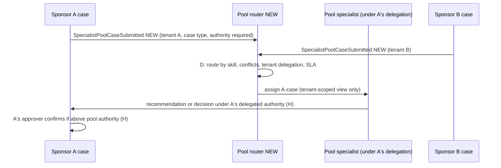

# Cross-enterprise workflows: grants, recipients and verification (XW-06 to XW-10)

Notation as in [xw-shared-capabilities.md](xw-shared-capabilities.md).

---

## XW-06 Pre-verified recipient universe: verification happens before the request

- **Legacy departments spanned:** grants operations, grants compliance, donor services, payments.
- **Trigger:** a scheduled universe build, plus `RecommendationSubmitted` at request time.
- **Inversion applied:** *what if the process began before the donor submitted a request?*
- **Linked innovations:** INN-03, INN-01, INN-34, INN-05. **Maturity:** L2. IRS bulk files cover listed public charities, and past payees are known. Request-time latency is untested until E1. **Experiments:** E1, E2.

```mermaid
sequenceDiagram
  participant U as Universe builder (nightly)
  participant PP as Passports
  participant D as Donor/advisor/agent
  participant I as Intake (C3.2)
  participant P as Policy engine
  participant G as Payment gate
  U->>PP: refresh all Pub 78 public charities + all past payees (RecipientPassportRefreshed NEW)
  D->>I: RecommendationSubmitted (EIN or name)
  I->>PP: lookup (no research at request time)
  PP-->>I: passport@now (class, revocation, OFAC, payee ref)
  I->>P: Evaluate(grant-policy@v, passport)
  P-->>I: Approve(Rule) | Refer(flags) | Deny
  I->>G: PaymentInstructed (or netted, XW-11)
  Note over P: passport missing or stale → Refer(StaleEligibilityData); never approve on missing data
```

**Sequence:**

| # | Event | Decision | State change | API | Agent | Controls |
|---|---|---|---|---|---|---|
| 1 | Universe refresh → `RecipientPassportRefreshed` **NEW** (×~1.9m records) | D: load checks | Passport versions | batch, internal | — | CTL-050, CTL-011 |
| 2 | `RecommendationSubmitted` | D: privilege, idempotency | Recommendation(Submitted) | `POST /v1/recommendations` | — | CTL-001 |
| 3 | `RecipientResolved` | D on exact EIN; P (AG-01) on free text → donor confirms | bound | `/v1/recipients:resolve` | AG-01 | CTL-008 |
| 4 | `EligibilityEvaluated` + `ScreeningCompleted`, read from the passport | D | Decision records | `/v1/eligibility` | — | CTL-011, CTL-012 |
| 5 | `GrantApproved` (Rule) or `GrantFlagged` + `ExceptionCaseOpened` | D / H | Grant(Approved / AwaitingHumanDecision) | `/v1/grants` | AG-02, AG-04 on referral | CTL-001, CTL-007 |
| 6 | `PaymentInstructed` | D: gate | Released | internal | — | CTL-003 |

**Human interventions:** only on flags, such as a foreign recipient, a new organization, a related party, an amount above the limit, or a benefit flag.

**Eliminated:** ACT-017 manual review of every grant; ACT-018; ACT-019; ACT-028 batching; ACT-031 data entry. *Replaced by* lookup plus policy.

**Moved:**
- Data maintenance moves to an always-on platform job (compute, not people).
- Name-resolution confirmation moves to the donor, as one click.

---

## XW-07 Cross-sponsor verification network: join, contribute, consume

- **Legacy departments spanned:** grants compliance at *every participating sponsor*, plus each sponsor's payments and vendor-management teams.
- **Trigger:**
  - a sponsor joins (`NetworkMemberAdmitted` **NEW**);
  - a member publishes evidence (`NetworkEvidencePublished` **NEW**);
  - a member consumes evidence at decision time.
- **Linked innovations:** INN-02, INN-01, INN-04, INN-36. **Maturity:** L1. It becomes L2 only if E7 shows material cross-sponsor overlap. Legal reliance on shared due diligence is unresolved (API-12 issue; GAP-012-adjacent). **Experiments:** E7, E11.

```mermaid
sequenceDiagram
  participant S1 as Sponsor A (member)
  participant N as Network ledger (neutral operator) NEW
  participant S2 as Sponsor B (member)
  S1->>N: NetworkEvidencePublished NEW (recipient facts, source stamps, determination artifact, evidence hash; NO donor data)
  N->>N: D: schema, provenance, signature; contributor reputation
  S2->>N: GET /v1/network/evidence/{recipient} NEW
  N-->>S2: evidence set + provenance + freshness
  S2->>S2: own Policy.decide (own policy version) — reuse is an input, not a decision
  S2->>N: NetworkEvidenceAccepted / Disputed NEW
  Note over N: disputed evidence → quarantine; contributors notified; consumers re-evaluate (block, never release)
```

**Sequence:**

| # | Event | Decision | State change | API | Agent | Controls |
|---|---|---|---|---|---|---|
| 1 | `NetworkMemberAdmitted` **NEW** | H: network governance board admits members; each member's counsel signs the data-sharing terms | Member | `/v1/network/members` **NEW** | — | CTL-034, CTL-042 |
| 2 | `NetworkEvidencePublished` **NEW**: recipient facts, determination artifacts, payee-verification attestations (never donor identity) | D: schema, signature, provenance | Evidence(published) | `POST /v1/network/evidence` **NEW** | — | CTL-050 |
| 3 | Consumer decision reads network evidence plus its own sources | D (own policy) | Decision referencing network evidence ID | `GET /v1/network/evidence/{id}` **NEW** | — | CTL-001, CTL-011 |
| 4 | Conflict between sources → `NetworkEvidenceDisputed` **NEW** | P: AG-04 summarizes the conflict → H at the disputing member | Evidence quarantined | — | AG-04 | CTL-008, CTL-014 |
| 5 | Quarterly provenance audit | H: network auditor | Reputation scores | — | — | CTL-035 |

**Human interventions:**
- Admission and governance (H).
- Each member's compliance officer accepts or overrides reused evidence. Liability is not transferable.
- Disputes go to a person (H).

**Eliminated:** duplicate verification across sponsors (a cross-organization form of ACT-018/019/021/023). It is replaced by verify-once, reuse-many with provenance.

**Moved:**
- Verification work concentrates at the first verifier, which motivates contribution credits.
- New governance work is created: a network board, an auditor and dispute handling.

**Kill criteria:** E7 shows low overlap; counsel says reliance is unavailable; or sponsors refuse to share.

---

## XW-08 Reusable non-routine determinations lifecycle

- **Legacy departments spanned:** grants compliance (foreign, ER, fiscal sponsors), legal, post-grant monitoring, donor services.
- **Trigger:** the first non-routine grant to a recipient or arrangement, an expiry approaching, or a facts change.
- **Linked innovations:** INN-04, INN-28, INN-02. **Maturity:** L2. The clustering premise rests on repeat grants per recipient; the reuse factor is unmeasured (GAP-001 adjacent). **Experiments:** E2, E6, E11.

```mermaid
sequenceDiagram
  participant G as Grant decisioning
  participant DS as Determination store NEW
  participant AG as AG-04 dossier preparer
  participant S as Grants compliance specialist
  participant M as Expiry monitor
  G->>DS: determination exists for (recipient, type, scope) and unexpired?
  alt valid
    DS-->>G: DeterminationApplied NEW → policy proceeds (often D)
  else none / expired
    G->>AG: prepare dossier (documents, prior grants, sources)
    AG-->>S: draft + flags (Cat. 2)
    S->>DS: DeterminationIssued NEW (H; scope, expiry, conditions)
    DS-->>G: apply
  end
  M->>S: DeterminationExpiring NEW (T-30)
  S->>DS: renew / revoke (H)
```

**Sequence:**

| # | Event | Decision | State change | API | Agent | Controls |
|---|---|---|---|---|---|---|
| 1 | Grant referred (`ForeignRecipient`, `RequiresExpenditureResponsibility`, `FiscalSponsorIntermediary`) | D | Case(open) | `/v1/cases` | — | CTL-001 |
| 2 | Determination lookup → `DeterminationApplied` **NEW** | D: scope match, unexpired | Grant continues | `GET /v1/determinations` **NEW** | — | CTL-047 |
| 3 | No valid determination: dossier → `DeterminationIssued` **NEW** | H: equivalency determination, ER agreement terms, fiscal-sponsor review | Determination(v1, expiry) | `POST /v1/determinations` **NEW** | AG-04, AG-08 (Cat. 2) | CTL-005, CTL-007 |
| 4 | ER reporting obligations tracked | D tracking; AG-12 drafts reminders (Cat. 3, templated sends only) | Obligation | `/v1/cases` | AG-12 | CTL-038 |
| 5 | `DeterminationExpiring` **NEW** / facts change | H renew or revoke | Determination(v2 / revoked) → dependent grants re-evaluated | — | — | CTL-014 |

**Human interventions:** every determination is issued, renewed or revoked by a specialist (H). These are the legal judgments that the regulatory map keeps human.

**Eliminated:** per-grant repetition of ACT-020 and ACT-021. ER and equivalency judgment is retained, but made once per arrangement and reused.

**Moved:** the expiry-monitoring burden becomes a deterministic job. Determination *quality* work increases per case, because each determination is reused.

---

## XW-09 Universe sanctions rescreen on list change

- **Legacy departments spanned:** compliance (sanctions), grants, payments, onboarding, vendor management.
- **Trigger:** `SanctionsListUpdated`, from OFAC list publication.
- **Linked innovations:** INN-34. **Maturity:** L2. Mechanism and controls are specified (CTL-012), and list changes are rarer than transactions. **Experiments:** E1.

**Sequence:**

| # | Event | Decision | State change | API | Agent | Controls |
|---|---|---|---|---|---|---|
| 1 | `SanctionsListUpdated` (list hash vN+1) | D | Screening index vN+1 | internal | — | CTL-012 |
| 2 | Rescreen the universe: parties, recipients, payee profiles, network evidence | D: matching under the fuzzy-threshold policy | Screening results | internal | — | CTL-012 |
| 3 | Near-matches | P: AG-03 triages and *adds* context (never clears) | Flag(raised) | `/v1/cases` | AG-03 (Cat. 2) | CTL-008 |
| 4 | Potential true match | H: sanctions officer decides; blocking report if required | Party or recipient blocked; in-flight grants held | `/v1/cases/{id}` | — | CTL-013 |
| 5 | Transactions read the pinned screening result at decision time | D | — | `/v1/eligibility` | — | CTL-011 |

**Human interventions:** the sanctions officer decides every potential true match (H). This is a legal requirement under the regulatory map.

**Eliminated:** ACT-019 per-transaction manual searches, *replaced by* a rescreen on change plus pinned results.

**Moved:** the residual risk window, between list publication and rescreen completion, becomes a measured SLO rather than a hidden one.

---

## XW-10 Shared specialist pool across sponsors

- **Legacy departments spanned:** grants compliance and complex-asset teams at multiple sponsors; HR (surge hiring).
- **Trigger:** `ExceptionCaseOpened` at any participating sponsor when the case type is pool-eligible (foreign, ER, complex asset).
- **Linked innovations:** INN-28, INN-37, INN-04. **Maturity:** L1. The twin shows surge breaches and the single-specialist concentration; pooling is untested until E6. **Experiments:** E6, E11.



**Sequence:**

| # | Event | Decision | State change | API | Agent | Controls |
|---|---|---|---|---|---|---|
| 1 | `SpecialistPoolCaseSubmitted` **NEW** | D: eligibility for pool; tenant delegation exists | Pool case | `POST /v1/pool/cases` **NEW** | — | CTL-006 |
| 2 | Routing | D: skill, conflict check across tenants, SLA | Assigned | — | — | CTL-007, CTL-041 |
| 3 | Specialist works with a tenant-scoped dossier | P: AG-04 / AG-07 drafts | — | `/v1/cases` | AG-04, AG-07 | CTL-008 |
| 4 | `ExceptionCaseResolved` under the tenant's delegation; escalation if above the pool limit | H | Tenant grant or asset decided | `/v1/cases/{id}` | — | CTL-005 |
| 5 | Seeded-error cases injected into the pool | D | QA metrics | — | — | CTL-046 |

**Human interventions:** all decisions remain H, under each sponsor's delegation of authority. The pool supplies people, not authority.

**Eliminated:** idle specialist capacity and surge hiring (part of ACT-071). It is replaced by pooled utilization.

**Moved:** confidentiality and consistency risk moves to the pool operator, which needs tenant isolation and calibration reviews.
