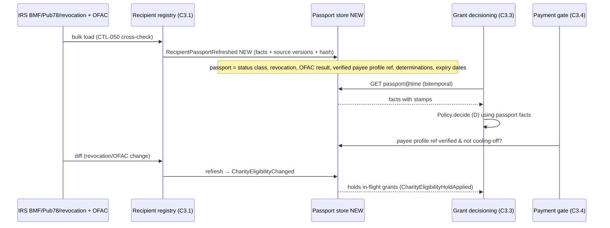

# Cross-enterprise workflows: shared one-to-many capabilities (XW-01 to XW-05)

These five workflows implement the brief's §6 principle: **one verified thing serves many functions**. Each replaces several legacy departmental processes with a single capability whose output many workflows consume.

The notation is the same across all `xw-*` files:

| Notation | Meaning |
|---|---|
| D / P / H | Decision types from [the outcome model](../../01-enterprise-outcomes/outcome-model.md) |
| Event names | Taken from [`events.csv`](../../06-data-and-knowledge/events.csv). Events not yet in the catalog are marked **NEW** |
| `/v1/...` | API families from [`api-catalog.csv`](../../04-enterprise-apis/api-catalog.csv). Endpoints not yet in the catalog are marked **NEW** |
| AG-nn | Agents from [`agent-catalog.csv`](../../05-agent-architecture/agent-catalog.csv); Category 2 analyses, Category 3 supervised execution |
| CTL-nnn | Controls from [`controls.csv`](../../08-governance-and-compliance/controls.csv) |
| ACT-nnn | Legacy activities from [`legacy-activity-classification.csv`](../../01-enterprise-outcomes/legacy-activity-classification.csv) |
| L0–L3 | [Maturity ladder](../00-methodology/methodology.md#5-maturity-ladder-never-skipped-never-overstated). Nothing here is L4 |

---

## XW-01 One verified identity, many authorized interactions

- **Legacy departments spanned:** onboarding, donor services, advisor services, fraud, compliance (KYC), IT access management.
- **Trigger:** the first contact from a person or an institution, through a direct portal, an advisor platform, a donor agent, or a successor notice.
- **Linked innovations:** INN-24, INN-25, INN-16, INN-26. **Maturity:** L1. Parts of the delegation model are L3 (INV-A6 in the parent PoC). **Experiments:** E5.

**Sequence:**

| # | Event / action | Decision | State change | API | Agent | Controls |
|---|---|---|---|---|---|---|
| 1 | `PartyRegistered` | D: schema and dedupe | Party(unverified) | `POST /v1/parties` | — | CTL-033 |
| 2 | Upstream attestation offered (custodian KYC or identity wallet) → `IdentityAttestationAccepted` **NEW** | D: signature, issuer allow-list, freshness | Party assurance = attested | `POST /v1/attestations/identity` **NEW** | — | CTL-034 |
| 2b | If no attestation: identity provider check → `IdentityVerified` | D on the provider result; P forgery score feeds a D threshold | Party assurance = verified | `/v1/parties/{id}/verification` | — | CTL-033 |
| 3 | Relationship edges declared → `RelationshipDeclared`; AG-17 proposes undeclared edges → `RelationshipInferred` | P (flag only) → H if contested | Relationship graph | `/v1/parties/{id}/relationships` | AG-17 (Cat. 2) | CTL-008, CTL-041 |
| 4 | The same Party is reused for: account opening (XW-17), advisor delegation (XW-18), agent delegation (XW-19), successor activation, and staff conflict checks | D | PrivilegeGrant(s) | `/v1/privileges` | — | CTL-007 |
| 5 | Risk trigger (device change, payout-relevant change) → step-up challenge | D | Session assurance raised | API-01 | AG-18 explains the anomaly (Cat. 2) | CTL-033 |

**Human interventions:**
- An identity mismatch or synthetic-identity score above the threshold goes to client operations (H). It is a fraud judgment.
- A contested inferred relationship goes to compliance (H). A disqualified-person status has §4958/§4967 consequences.

**Eliminated:**
- ACT-005 paper forms and ACT-006 re-keying. *Replaced by* one Party record written once.
- ACT-007 manual ID review of every applicant. *Replaced by* attestation or provider evidence with exception routing.
- ACT-056 paper LOAs. *Replaced by* scoped delegations.
- ACT-059 multiple copies of donor data. *Replaced by* canonical Party plus projections.

**Moved, not eliminated:**
- Identity proofing moves upstream to the custodian or identity provider that issued the attestation. The sponsor carries reliance risk; liability allocation must be contractual.
- Relationship disclosure stays with the donor.

---

## XW-02 One contribution event drives custody, accounting, investments, reporting and liquidity

- **Legacy departments spanned:** contributions operations, fund accounting, investment operations, donor services (letters), compliance (screening), treasury, tax reporting.
- **Trigger:** the custodian or bank reports settlement of a transfer that carries a per-donor reference.
- **Linked innovations:** INN-23 (per-donor references), INN-27 (liquidity), INN-22. **Maturity:** L3 for the fan-out logic (parent `Journey.fs`, `SettleContribution`); L1 for custodian sub-account references. **Experiments:** E4, E9.

```mermaid
sequenceDiagram
  participant C as Custodian
  participant IN as Intake (C2.1)
  participant SC as Screening (C5.2)
  participant L as Ledger (C4.1)
  participant INV as Investments (C2.4)
  participant LQ as Liquidity (C2.5)
  participant DOC as Documents
  participant EV as Evidence (C4.5)
  C->>IN: settlement (reference = intent's virtual account / unique ref)
  IN->>IN: D match by key (no fuzzy matching on the main path)
  IN->>SC: screen donor + source (pinned list vN)
  SC-->>IN: pass
  IN->>L: ContributionSettled
  L->>L: JournalPosted (rule vK); units at NAV
  L-->>INV: standing allocation → TradeInstructed (pre-trade D checks)
  L-->>LQ: forecast update
  L-->>DOC: AcknowledgmentIssued (schema-tested §170(f)(18) text)
  L-->>EV: evidence: match, screen, posting, acknowledgment
  Note over IN: unmatched → Suspense + ReconciliationBreakDetected; AG-05 proposes, never posts
```

**Sequence:**

| # | Event | Decision | State change | API | Agent | Controls |
|---|---|---|---|---|---|---|
| 1 | `ContributionIntentDeclared`, assigning a unique reference or custodian sub-account | D: asset class acceptable | Intent(open) | `POST /v1/contribution-intents` | — | CTL-021 (if complex) |
| 2 | `ContributionReceived` (from file or webhook) | D: match by reference | Receipt | API-05 (ingestion) | — | CTL-015 |
| 3 | `ContributionSettled` | D: completed-gift date rule; sanctions screen | Contribution(completed); units issued | — | — | CTL-012, CTL-002 |
| 4 | `JournalPosted` | D: posting rule | Ledger | API-15 (internal) | — | CTL-018, CTL-019 |
| 5 | `TradeInstructed` (standing allocation) | D: pre-trade checks | Positions(pending) | API-08 (internal) | — | CTL-023 |
| 6 | `AcknowledgmentIssued` | D: template plus schema test | Document | `/v1/documents` | — | CTL-020 |
| 7 | `NoncashAssetDisposed` (later, if noncash) → 8282 obligation | D | Obligation | `/v1/reports` | — | CTL-022 |
| 8 | Unmatched receipt → Suspense + `ReconciliationBreakDetected` | P: AG-05 proposes a match → D: donor confirms, or H | Suspense | `/v1/reconciliation` | AG-05 (Cat. 2) | CTL-016 |

**Human interventions:**
- A sanctions potential match is decided by the sanctions officer (H). OFAC is strict liability.
- A residual unmatched receipt after donor contact goes to the controller (H), for attribution or return.

**Eliminated:**
- ACT-010 manual orphan matching, mostly. *Replaced by* unique references.
- ACT-011 letters done by hand. *Replaced by* the generated acknowledgment.
- ACT-037 batch unitization. *Replaced by* event-driven units.
- ACT-058 nightly batch dependence. *Replaced by* event ingestion; files are still ingested where that is all a custodian offers.

**Moved:** the donor or advisor must use the issued reference. That moves a small burden upstream, but it removes a matching loop downstream.

---

## XW-03 Recipient passport: one reusable evidence record serves many grants

- **Legacy departments spanned:** grants compliance (due diligence), payments (payee setup), donor services (charity questions), compliance (sanctions), finance (escheat contacts).
- **Trigger:** either a recipient's first appearance (a recommendation, an enrollment, or the bulk universe load), or a refresh trigger: an IRS file diff, an OFAC list change, a bank-detail change, or a determination expiry.
- **Linked innovations:** INN-01, INN-03, INN-34, INN-07. **Maturity:** L2. The premise is supported by repeat-grant concentration: about 12.5 grants per recipient at Fidelity; top-1,000 recipients take about 49–54% of top-50 dollars. Cross-sponsor overlap is under measurement in E7. **Experiments:** E1, E7.



**Sequence:**

| # | Event | Decision | State change | API | Agent | Controls |
|---|---|---|---|---|---|---|
| 1 | Bulk load or diff → `RecipientPassportRefreshed` **NEW** | D: load reconciliation and diff limits | Passport version n+1 (bitemporal) | `GET /v1/recipients/{id}/passport` **NEW** | — | CTL-050, CTL-011 |
| 2 | Name-only request → resolution | P: AG-01 proposes the EIN → D: donor confirms | Recommendation bound to Recipient | `/v1/recipients:resolve` | AG-01 (Cat. 2) | CTL-008 |
| 3 | Grant evaluation reads the passport at decision time | D | Decision referencing passport version | `/v1/decisions` | — | CTL-001 |
| 4 | Status change → `CharityEligibilityChanged` → `CharityEligibilityHoldApplied` | D: block, never release | Grants held | — | — | CTL-014 |
| 5 | Payee profile change → `PaymentProfileChanged` (see XW-12) | D: cooling-off | Passport payee reference pending | `/v1/payee-registry` **NEW** | AG-18 (Cat. 2) | CTL-004 |
| 6 | Determination attached or expiring (see XW-08) | H issues, D enforces expiry | Passport determinations | `/v1/determinations` **NEW** | AG-04 | CTL-047 |

**Human interventions:** none on the routine path. Specialists act only when a passport fact is ambiguous (two entities, church without filings) or contradicts another source.

**Eliminated:**
- ACT-018 per-grant IRS lookups. *Replaced by* source-change-driven refresh.
- ACT-019 per-grant manual OFAC searches. *Replaced by* universe rescreen (XW-09).
- ACT-023 calling charities. *Replaced by* a verified payee profile on the passport.

**Moved:** churches and other recipients without e-filed 990s cannot be passported from bulk data. Their verification moves to recipient enrollment (XW-12) or remains manual. That is a known residual: church-status recipients without e-filed 990s take 8.3% of top-50 DAF dollars.

---

## XW-04 One policy evaluation service across onboarding, grants, payments and compliance

- **Legacy departments spanned:** onboarding (eligibility of account types), grants (approval), payments (limits), investments (mandates), compliance (attestations), servicing (explanations).
- **Trigger:** any decision point. The same engine receives a context and a policy reference.
- **Linked innovations:** INN-05, INN-21, INN-36. **Maturity:** L3 for grants (`Policy.decide`, deterministic and tested); L1 for the multi-domain generalization. **Experiments:** E2.

**Sequence (one engine, many callers):**

| # | Caller → call | Policy set | Decision | API | Controls |
|---|---|---|---|---|---|
| 1 | Onboarding: can this party hold this privilege? | `privileges@v` | D | `POST /v1/policies/{id}/evaluate` **NEW** | CTL-006 |
| 2 | Grants: approve / refer / deny | `grant-policy@v` | D (flags → H) | API-13 | CTL-001, CTL-011 |
| 3 | Payments: gate checks, caps, dual control | `payment-gate@v` | D | internal | CTL-003, CTL-005, CTL-029 |
| 4 | Investments: mandate and band checks | `ips@v` | D | internal | CTL-023 |
| 5 | Agents: may this tool call proceed? | `agent-scope@v` | D | tool broker | CTL-008, CTL-026 |
| 6 | Servicing: explain why a grant was referred | (same decision record) | — | `/v1/decisions/{id}` | CTL-039 |
| 7 | Compliance: obligation coverage | `obligations@v` | D | API-20 | CTL-037 |

Each evaluation returns a Decision with policy version, inputs hash and rule IDs. The service agent (AG-09) explains decisions by reading the decision record, never by re-deciding.

**Human interventions:** H only for policy versions (CTL-009, author ≠ approver) and for referred cases.

**Eliminated:**
- ACT-045 prose-only manuals. *Replaced by* compiled rules with generated prose.
- ACT-046 staff attestations. *Replaced by* decision evidence.
- ACT-069 two-person approval of routine payments. *Replaced by* deterministic gates plus sampled assurance (CTL-049).
- ACT-075 per-grant purpose review. *Replaced by* AG-02 flags plus rules.

**Moved:** policy drafting becomes engineering-adjacent work for counsel and a policy engineer. It is new work, smaller in volume but higher in skill.

---

## XW-05 One operational evidence system serves audit, governance, reporting and improvement

- **Legacy departments spanned:** internal audit, external audit liaison, finance (990), compliance (attestations), board secretary (packs), operations management (KPIs).
- **Trigger:** every control operation emits `Evidence`. Consumers query; nothing is assembled after the fact.
- **Linked innovations:** INN-20, INN-32, INN-30. **Maturity:** L3 partial (evidence records in the parent PoC; coverage test specified). **Experiments:** E11.

**Sequence:**

| # | Consumer | Query | Output event | API | Controls |
|---|---|---|---|---|---|
| 1 | External auditor | Sample population, decisions, evidence | `AuditPackageGenerated` **NEW** | `POST /v1/evidence/packages` **NEW** | CTL-037 |
| 2 | Board | Control health, parameter ages, incidents, agent evals | Board pack snapshot (approved) | API-20 / reports | CTL-047; AG-19 narrates (Cat. 2) |
| 3 | Form 990 Schedule D | Aggregates from ledger | `DocumentationDelivered` | `/v1/reports` | CTL-018 |
| 4 | Improvement | Time, cost, error and intervention per outcome | `ImprovementProposed` **NEW** | API-22 | AG-16 (Cat. 2); CTL-010 |
| 5 | Regulator inquiry | Decision records for a subject | see XW-28 | API-20 | CTL-037 |

**Human interventions:**
- Auditors and directors judge the evidence (H). The system narrates but does not conclude.
- The CRCO owns coverage gaps.

**Eliminated:**
- ACT-041 PBC sample pulling. *Replaced by* auditor read access.
- ACT-061 manual board packs. *Replaced by* approved snapshots.
- ACT-046 survey attestations.
- ACT-073 annual-only risk workshop. *Replaced by* continuous telemetry plus an annual review.

**Moved:** evidence *design* work moves to control owners at build time. Every new control needs an evidence specification before release.
