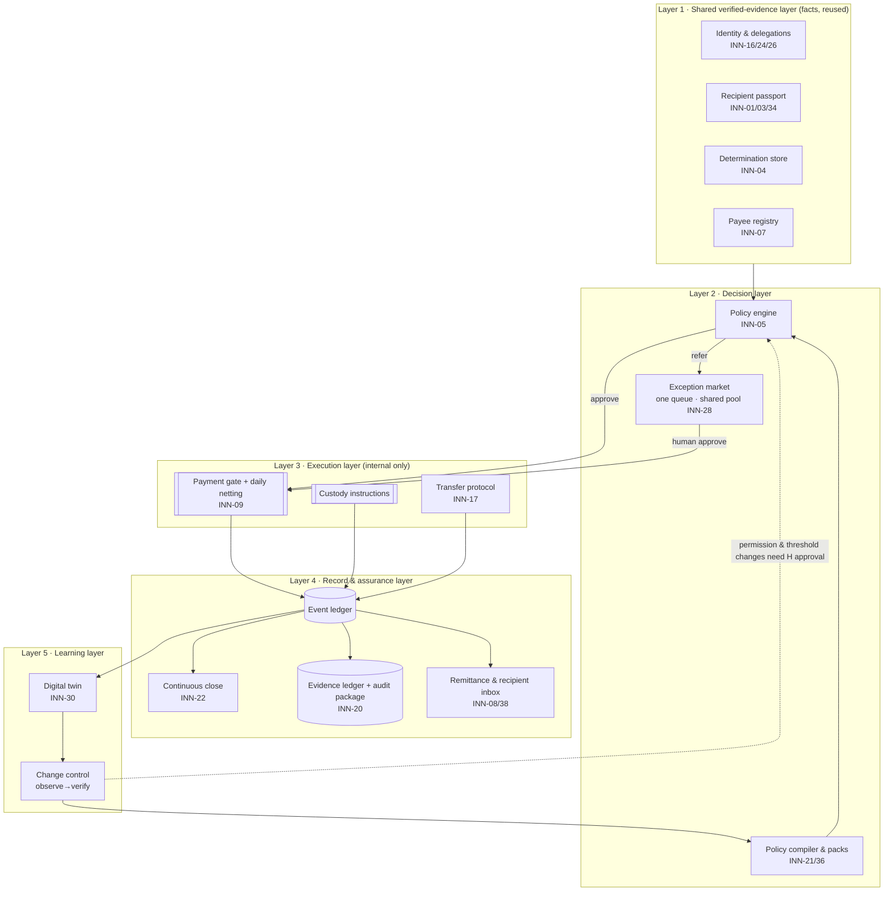
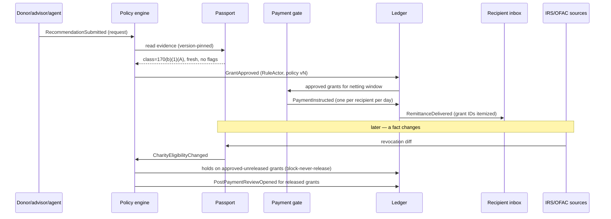

# Integrated enterprise process architecture (reinvented organization)

**Status:** design (maturity L1 overall). Components inherited from the parent and exercised by the F# model are L3 *in the model only*.
**Inputs:**
- [innovation register](../02-creative-hypotheses/innovation-register.csv)
- [API opportunities](../05-api-opportunities/api-opportunity-catalog.md)
- [agent opportunities](../06-agent-opportunities/agent-opportunity-catalog.md)
- parent [technology architecture](../../07-technology-architecture/technology-architecture.md)
- parent [event catalog](../../06-data-and-knowledge/event-catalog.md)

## 1. The architectural idea

**Conventional DAF operations organize work by transaction:** each grant, contribution or transfer is researched, approved and reconciled on its own.

**The reinvented enterprise organizes work by reusable verified facts:**
- the recipient's status;
- a determination about a foreign or fiscal-sponsor arrangement;
- a payee's verified account;
- a donor's identity and delegations;
- a policy version.

Transactions *consume* these facts. Work then scales with the number of **facts that change**, not with the number of transactions. That is the mechanism behind INN-01, -03, -04, -07, -16, -21 and -34.

## 2. Layer view



**Layer responsibilities:**

| Layer | Owns | Work scales with | Human role |
|---|---|---|---|
| 1. Verified evidence | Facts about parties, recipients, arrangements, payees | Fact changes (IRS and OFAC diffs, payee changes, determination expiry) | Decide disputed facts: sanctions true matches, determinations |
| 2. Decision | Policy versions; evaluating requests; routing exceptions | Requests (deterministic, near-zero marginal cost) plus exceptions (human) | Approve policy; decide exceptions |
| 3. Execution | Instructions to banks and custodians; transfers | Payments after netting | Dual control above threshold |
| 4. Record and assurance | Ledger, reconciliation invariants, evidence, remittance | Events | Controller attestation (CTL-048) |
| 5. Learning | Measurement, simulation, controlled change | Changes proposed | Change board; board for material changes |

## 3. Event flow: one routine grant and one fact change



The parent F# model already implements the core of the second half. `ChangeEligibility` holds approved-but-unreleased grants, reverses the commitment, and opens post-payment reviews (`AuthorityInvariantTests`).

## 4. Multi-sponsor and network view

```mermaid
flowchart LR
  subgraph Neutral["Candidate neutral operator (separately governed)"]
    NET[(Cross-sponsor verification network<br/>AO-02 · evidence + provenance, no donor data)]
    REG[(Payee registry AO-07)]
    INBOX[Recipient inbox AO-08]
    XP[Transfer protocol spec AO-11]
  end
  subgraph Op["Operator platform (multi-tenant; tenant = sponsor)"]
    T1[Sponsor A tenant<br/>own policy · own decisions]
    T2[Sponsor B tenant]
    T3[Partner sponsor-of-record tenant (Model D)]
    POOL[Shared specialist pool AO-14<br/>acts under each tenant's delegation]
    PACKS[Policy packs AO-05]
  end
  subgraph Ext["External"]
    BANKS[Sponsor-titled bank & custody accounts]
    NPO[Nonprofits]
    ADV[Advisor & wealth platforms]
  end
  T1 & T2 & T3 <--> NET
  T1 & T2 & T3 --> REG
  T1 & T2 & T3 --> BANKS
  PACKS --> T1 & T2 & T3
  POOL --- T1 & T2 & T3
  INBOX --> NPO
  NPO --> REG
  ADV --> T1 & T3
  T1 <--> XP <--> T2
```

### Attachment rules for ecosystem components

| Component | Attaches as | Why that form | Who could operate it |
|---|---|---|---|
| Verification network (AO-02) | External, separately governed service; tenants contribute and consume evidence records with provenance | Competitors will share evidence only with a neutral steward. No donor data enters it | A neutral consortium or nonprofit utility; the operator only if sponsors accept that governance |
| Payee registry (AO-07) and recipient inbox (AO-08) | External, two-sided | Recipients enroll once for all sponsors. It **resolves endpoints only and never holds funds** (money transmission) | A neutral operator, or federation with existing rails (Chariot, PayPal) |
| Transfer protocol (AO-11) | Open specification plus reference implementation | Adoption needs a standard, not a product | A standards body or open-source project |
| Shared specialist pool (AO-14) | A multi-tenant function inside the operator | Each decision stays under the client sponsor's delegated authority | The operator |
| Policy packs (AO-05) | A versioned library adopted per tenant | Each board approves its own adoption | The operator, with counsel |

## 5. Trust boundaries

1. **Requester ↔ decision layer.** Donors, advisors and agents create requests only (DD-003).
2. **Decision ↔ execution.** Only rule or person actors with a policy version reach the payment gate (INV-A1, INV-A3).
3. **Tenant ↔ tenant.** Data, policy and evidence are tenant-scoped. The shared pool sees only redacted, delegated cases (AGO-10 must show zero leakage).
4. **Operator ↔ neutral network.** Only recipient evidence with provenance crosses. Each tenant decides whether to rely on any record, and records its reliance in its own evidence ledger.
5. **Platform ↔ money.** The operator instructs only sponsor-titled accounts. No pooled operating accounts.
6. **Agents ↔ everything.** Agents use the broker with the closed scope set. A Category 5 action is unreachable by type.

## 6. Organizational architecture (zero-based)

The organization is designed around the layers, not around legacy departments:

| Team | Owns (layer) | Decision rights | Size driver |
|---|---|---|---|
| **Evidence stewardship** | L1: passport, determinations, payee registry, identity exceptions | Disputed facts; determinations; sanctions true matches (sanctions officer) | Fact changes and non-routine recipients, *not* grants |
| **Policy** | L2: compiler, policy versions, thresholds (with expiry) | Draft (policy engineer) → approve (GC) → publish (change board). Author ≠ approver | Regulatory change rate |
| **Exception resolution** | L2: the single queue and shared pool | Exception decisions within delegated authority | Exception rate × reuse (the economic lever) |
| **Money and record** | L3 and L4: gate operations, continuous close, attestation | Dual control; write-offs; controller attestation | Breaks and payment exceptions |
| **Relationships** | Advisors, institutions, recipients, donor recovery | Service recovery; partner terms | Partners and recovery cases |
| **Platform and agents** | Runtime, agent owners, evaluation | Agent permission proposals (approved by the change board with CRCO sign-off) | Agent families (6 per owner) |
| **Assurance** | CRCO line 2; internal audit line 3 (independent) | Control design, sampling, model-risk sign-off | Controls and sampling |
| **Learning** | L5: telemetry, twin, improvement | Proposes changes only | Constant |

**What disappears:**
- the grants-processing department, replaced by evidence stewardship plus exception resolution;
- the donor call center, replaced by shared state plus recovery;
- the reconciliation team, replaced by invariants plus attestation;
- compliance-as-checklist, replaced by policy plus assurance.

**What concentrates, and is therefore controlled:**
- the policy team's authority, through SoD, parameter expiry (CTL-047) and back-testing;
- the evidence layer's correctness, through cross-provider ingestion checks (CTL-050) and network curator flags (AGO-12).

## 7. Open questions

- **Neutral operator viability.** Who governs AO-02 and AO-07, and how are they funded?
- **Reliance.** Can a tenant's evidence ledger record "relied on network record X version Y" in a way that satisfies its own diligence obligations?
- **Concentration risk.** Does netting (INN-09) create unacceptable dependence on one daily payment per recipient? A failure delays every grant in the batch, so this needs E3-type simulation.
