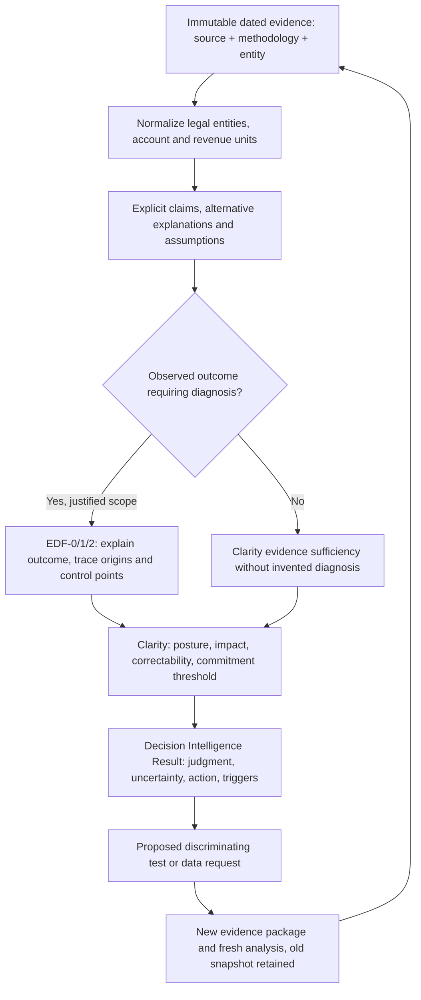

# DAF Decision Intelligence: Clarity + EDF application design (research candidate)

**Status:** proposed thin application of existing frameworks; first three worked cases are **analyst-produced examples, not a running inference engine**. Evidence cutoff November 11, 2026. No change to the canonical Clarity or EDF frameworks is proposed here.

## 1. Product distinction

`daf-landscape` currently aggregates audited sponsor financials, public vendor contracts, peer activity, sponsor surveys and regulations. Its differentiation should not be merely a bigger database, vendor score or chatbot response. The application should **produce and maintain justified conclusions** about DAF market economics, institutional buying, fit, risks and where to investigate or act.

A conclusion is a **versioned claim with scoped evidence, material counterevidence, underlying assumptions, judgment about what is justified now, consequence-aware next step and explicit falsification or reassessment rules**. No unsupported numerical confidence or vendor rankings.

### Real framework roles, checked against source repositories

**Clarity** (`kemiller2002/clarity-framework`):
- Explains **what is known, what is currently justified, and what would make us reconsider**.
- Makes claims, evidence, assumptions, ownership, confidence calibration, proportional certainty, decision posture, correctability, monitoring and reassessment explicit.
- Controls **how much diagnostic depth and commitment are justified**; it does **not** itself perform diagnosis.
- Its actual decision posture dimensions are *impact if wrong* and *correctability*; categories are Fast, Experimental, Guardrail and Strategic. An appropriate posture is **not a probability or a certainty rating**.
- Output follows the repository's `docs/templates/clarity-result-template.md` rather than inventing a contradictory Clarity variant.

**EDF** (`kemiller2002/echelon-diagnostic-framework`, working v0.3 interpretation):
- Answers **what is happening and how the system produced an observable outcome**.
- Required diagnostic chain: System Context (Primary System, Context, Focus) → Outcome → Manifestations → Origin Network → Propagation → Evidence → Control Points → Control Point Ranking → Confidence → Diagnostic Sufficiency → Unknowns → Next Responsible Action.
- EDF-0/1/2 differ in *depth*, not basic required fields. Select proportional depth with Clarity, not a one-size-fits-all complex diagnosis.
- **Diagnostic Calibration is optional and not independently proven to improve accuracy**. Multiple "lenses" generated by one model are **not independent validations**.
- No EDF outcome should be invented for a vendor feature comparison lacking an observed outcome. If the question is purely evidence sufficiency or comparative investment claim, use **Clarity without pretending EDF diagnosed it**.

**Hand-off:** Understand (EDF) → Decide whether evidence justifies a posture/commitment (Clarity) → Commit/execute through separate delivery workflow → Validate observed outcome (EDF) → Reassess (Clarity). Framework boundaries must be preserved; do not change frozen releases to implement a DAF use case.

Canonical sources:
- [Clarity README](https://github.com/kemiller2002/clarity-framework/blob/main/README.md), [interactions](https://github.com/kemiller2002/clarity-framework/blob/main/docs/framework-interactions.md), [decision posture](https://github.com/kemiller2002/clarity-framework/blob/main/decision-posture-model.md), [result template](https://github.com/kemiller2002/clarity-framework/blob/main/docs/templates/clarity-result-template.md), [constitution](https://github.com/kemiller2002/clarity-framework/blob/main/docs/foundation/clarity-constitution.md).
- [EDF v0.3 spec](https://github.com/kemiller2002/echelon-diagnostic-framework/blob/main/docs/edf/specification.md), [operating cycle](https://github.com/kemiller2002/echelon-diagnostic-framework/blob/main/docs/edf/operating-cycle.md), [diagnostic calibration](https://github.com/kemiller2002/echelon-diagnostic-framework/blob/main/docs/edf/diagnostic-calibration.md), [constitution](https://github.com/kemiller2002/echelon-diagnostic-framework/blob/main/docs/edf/constitution.md).

## 2. The candidate analytical pipeline

Evidence sources are treated as **dated observations, not instructions**; a technology vendor claim and an independent audit are not interchangeable. We can link to original data source rows and methodology but must not fabricate missing payee numbers, cost allocations, causal mechanisms or contract terms.

A conclusion can be:
- **Supported within a declared context:** enough for a narrowly specified statement, not carte blanche for extrapolation.
- **Provisional:** a working hypothesis with meaningful competing explanations.
- **Insufficient:** evidence does not warrant the desired comparative claim or investment commitment.
- **Contradicted:** material evidence actively challenges the claim; resolve scope and date before labeling false.
- **Superseded:** previously justified result replaced after dated new evidence, original snapshot retained.
- **Out of scope:** required evidence would cross legal/privacy/contract or domain competence boundaries.

These are **application-level presentation states**, not newly asserted Clarity/EDF doctrine. A strong "insufficient" finding is a valuable investor result; the system is allowed to conclude **do not rank providers on this measure**.

## 3. Minimal evidence-to-decision model

| Record | Minimum fields | Invariant |
|---|---|---|
| **Evidence** | id, source id, URL or repository path, publisher, publication/period, observed value, population, denominator, method, evidence class, retrieval date, permitted use | A citation must resolve to an actual existing source |
| **Claim** | id, scoped proposition, entity, geography, period, measurement, status, support ids, challenge ids, assumptions, provenance | No hidden promotion of correlation into causation or sponsor assets into software revenue |
| **Diagnosis (optional EDF)** | framework revision, evidence package, system context, factual outcome, manifestation, origins as hypothesized/observed, propagation, evidence, controls, ranking, sufficiency, unknowns | EDF fields required when diagnosis is claimed, with origins identified as supported versus merely possible |
| **Clarity result** | framework revision, claim, posture, evidence and challenge, confidence explanation, impact/correctability, justified commitment, owner, monitoring, trigger, next decision | Reassessment trigger actionable and tied to a potential change in judgment |
| **Decision Result** | conclusion sentence, state, scope, *why*, strongest objection, implications, recommended action, test that could change it, next review condition, trace | No numerical confidence without validated calibration; every requested actionable commitment gated |
| **Run** | immutable run id, timestamp, frozen source snapshot, framework version/fingerprint, analyst and reviewer, evaluation mode, output IDs, code version | New evidence triggers new run; never retroactively edit frozen case outputs |

Data may form a directed typed graph:
- `evidence supports claim`, `evidence challenges claim`
- `claim assumes assumption`
- `outcome manifested_by signal`
- `origin contributes_to outcome` only if supported; otherwise label proposed
- `control_point influences outcome` as hypothesis pending test
- `result recommends action`
- `reassessment_trigger revisits result`

**No arbitrary score weights** masquerading as evidence. An audit is strong for *its audited statement*, not proof of every downstream implication. Evidence strength depends on fit to the specific claim, source quality, period, and denominator.

## 4. Distinct outputs for distinct users

**Institutional buyer:** "Does vendor X support a sponsor-controlled 5-year migration at acceptable cost, and what evidence backs it?" Output includes EDF diagnostic only when a demonstrated migration failure/constraint is observed. Contracts, export and live tests matter more than marketing.

**Investment analyst:** "Is Ren's historical fee capture stronger than Foundation Source's, and does this establish margin advantage?" Clarity must distinguish observed payer/recipient from vendor total recurring revenue and earnings. If comparability absent, conclusion is **not established**, with concrete evidence requests.

**Product strategy:** "Is grant vetting the largest opportunity?" EDF assesses observed operational constraints and candidate control points, while Clarity determines whether evidence justifies a test rather than investing immediately.

**Donor/wealth advisor:** "DAF or direct gift this year?" A domain-specific tax suitability engine, with independently reviewed current tax law and donor consent, must perform the calculations. Clarity evaluates uncertainty/commitment; **neither EDF nor Clarity replaces a tax-law engine**.

## 5. Evidence-based feedback rather than AI-generated certainty

The pilot needs a *negative space*: unsupported conclusions, counterexamples, explicit unknowns and alternative actions. Reject outputs that:
1. Compute market share from 3.59m accounts without excluding mass donation processing (DAFRC explicitly notes segmentation).
2. Rank Ren versus Foundation Source gross margin from RCF's $19.23m payment and Charityvest's $811,940 total non-grant expense.
3. Say 86% grant review effectiveness means grant processing is inexpensive or no improvements are possible.
4. Say 13pp recipient DAF donor retention premium is DAF **platform** customer NRR, or DAFs caused it.
5. Publish nonitemizer DAF tax-benefit advice based on direct-donation provisions inappropriately.
6. Infer that a conflict disclosure shows a vendor/advisor committed misconduct.
7. Treat future IRS 4966/6033 priority guidance as current final regulations.
8. Change a frozen historical assessment in place when new evidence appears.

See [first three case studies](decision-intelligence-pilot-2026-11-11.md) and [regression evaluation](../data/decision-intelligence-regression-cases-2026.csv).

## 6. Build sequence: thin application, not a new framework or another dataset

1. **Now:** publish the three worked decision results, explicit source-to-claim links, source version pins and a challenge/negative-case suite in `daf-landscape`. This documents a differentiable form of judgment **without claiming it is automated yet**.
2. **Next:** implement a small **F#-only** deterministic evidence validator and result renderer. It must reject missing citations, mismatched denominators and malformed/unsupported results, and produce structured Clarity/EDF artifact links. Do not modify or fork frozen framework semantics.
3. **Then:** use any approved agent for *proposed* explanations, counterarguments and questions. Human/expert review gates high-impact financial/tax/compliance conclusions. Agents are not independent replication merely because multiple prompts were run.
4. **User experience:** create a compact **Conclusion / Why / Against / Do Next / Revisit When** screen, with expandable evidence graph and EDF diagnosis if appropriate. Use the existing Echelon WASM-first F#, Limen and Forma conventions for future web work, not a new stack for this small product.
5. **Measure real added value:** blind compare data summary vs static vendor scorecard vs combined EDF/Clarity conclusion for accuracy, discovery of disconfirming evidence, calibration, avoided mistakes, actionable next tests and review time. Keep the new approach only if it materially improves reviewer judgments. Baseline and evaluation rubric must be frozen before comparing.

**Product thesis to falsify:** A versioned, traceable **decision-and-reassessment artifact** is more useful to DAF sponsors, financial institutions and analysts than a source table or generic AI synopsis. This is an application hypothesis, not a validated competitive advantage.

**Dependency contract:** Clarity and EDF each have their own canonical source and release lifecycle. This DAF proof of concept consumes documented semantics. Any change found necessary to Clarity or EDF must go through **its own framework engineering/research and regression tests**, not an unnoticed change to the DAF application's output.
