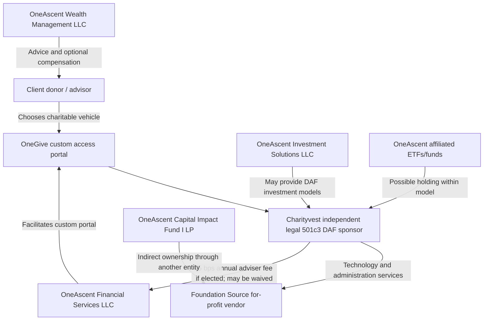

# OneAscent OneGive: documented DAF incentive and revenue-distribution structure
**Research dated November 11, 2026 | Public adviser disclosure as of August 11, 2026**

## Primary discovery

OneAscent Wealth Management LLC's **August 11, 2026 Form ADV Part 2A**, in **Item 10, printed pp. 20–21**, contains an unusually detailed breakdown of its **OneGive** channel to Charityvest [G17]. This gives concrete distribution and incentive evidence that most marketing material leaves out.

The OneGive structure disclosed in the ADV is:

**Status warning:** This is a **conceptual role diagram**, not a verified transaction settlement sequence, ownership percent or production architecture. In particular, the ADV says OneAscent Capital Impact Fund I **owns a share of another entity that itself owns an interest in Foundation Source**, not that OneAscent Wealth Management directly owns the vendor.

### Five specific disclosed incentives

| Mechanism | What the August 2026 ADV says | What it does NOT establish |
|---|---|---|
| **Vendor equity economics** | OneAscent-affiliated Impact Fund holds indirect investment in Foundation Source, creating an incentive to recommend OneGive [G17] | Investor's equity percentage, distributions, net worth, or an adviser personally owning Foundation Source stock |
| **Adviser fee** | OneAscent advisers may choose a **55-basis-point** fee for OneGive investment advice or waive it. Charityvest calculates it and sends remittances to OneAscent for adviser allocation [G17] | Amount actually charged to any donor, 2026 aggregate checks paid, or all-in account fee |
| **Affiliated portfolio management** | OneAscent Investment Solutions prepares some model portfolios; Charityvest has discretion whether to offer them [G17] | Which accounts use these models or the total investment-management revenue realized |
| **Fund-management economics** | Those models may contain funds and ETFs managed by OneAscent affiliates, potentially adding assets and revenue at the underlying fund level [G17] | Whether donors receive less suitable allocations or the returns/costs of such funds |
| **Adviser award incentives** | OneAscent's "Summit Club" trip qualification metrics include **OneGive accounts and contributions** [G17] | Whether that metric changed a particular recommendation or how many people qualified |

OneAscent itself explicitly calls these conflicts and says it seeks to address them through disclosure, fiduciary duties, investigating alternatives and allowing donors to use other providers [G17]. **This is not evidence of unsuitable recommendations or regulatory noncompliance.**

### Fee illustration: one component only

A **55-basis-point annual advisory rate** would mathematically represent:
- $10,000 invested DAF balance: **$55/year**, if elected and assessed for a full year on a constant balance.
- $100,000: **$550/year**.
- $500,000: **$2,750/year**.

The fee can be **waived**. There may be additional Charityvest sponsor administration fees, underlying fund costs and other contracted charges, but the OneGive **signed program schedule** has not been verified, so **do not automatically add Charityvest's standard retail 60bps sponsor rate to 55bps and call that a confirmed OneGive price**. The above figures are **synthetic one-component arithmetic**, not paid invoices or predicted revenue.

### New business-model questions

1. Is OneGive advisor compensation borne by sponsor-owned DAF assets and is the recipient **OneAscent Financial Services** or a different signed payee? ADV describes billing department/allocations but does not name every legal bank account.
2. Does Charityvest accept a **cash account** that avoids asset-management fees under OneGive, and is a direct gift recommended when donor tax/economic interest demands it?
3. What data and approval rights does the charity have to accept or reject affiliate-managed portfolio models?
4. What fraction of OneGive accounts use the 55bps advisory fee, which are waived, and what is the donor count and balance? **All unknown**.
5. How is the indirect Foundation Source investment disclosed and evaluated under Charityvest's own director conflict policy and adviser fiduciary rules? No recusal minutes or charity contract approvals obtained.
6. Do advisor performance awards create a measured bias in recommendations? No evidence; audit with independent advisor suitability data and rejected prospects.
7. If an individual donor wants to make an irrevocable donation, is the advisor's comparative proposal clear about **direct charities, DAF cash accounts, invested DAFs and no giving** and the 2026 nonitemizer/QCD restrictions?

## Relationship to other channels

OneAscent joins **TIAA Wealth Management** as a separate wealth channel using **Charityvest sponsorship and Foundation Source technology**. This does not create additional DAF sponsors or independent software stacks. OneAscent differs because its published ADV goes beyond generic advisor fee disclosure to an **indirect equity link to the for-profit technology provider** and explicit adviser incentive program details [G17]. Different terms and governance structures mean its disclosures should not be generalized to TIAA, Ren, TIFIN or all wealth advisors.

**Important scale caveat:** The OneAscent ADV states **$475,574,303 AUM across 2,616 accounts as of Dec. 31, 2025**, referring to **OneAscent's overall advisory business**, **NOT the OneGive DAF program** [G17]. Never assign that AUM to Charityvest DAFs.

## Suitability and governance test protocol (unexecuted)

| Case | Synthetic fact | Expected output |
|---|---|---|
| OG01 | Donor has no philanthropic intent but substantial invested assets | No DAF sales recommendation; record no-gift preference |
| OG02 | 2026 married nonitemizer giving $1,500 directly to eligible charity | Compare direct qualifying cash gift against DAF, show excluded DAF nonitemizer deduction |
| OG03 | Donor wants charity to receive funds today rather than later | Compare direct cash/securities transfer with invested DAF fees and grant delays |
| OG04 | DAF cash account and invested portfolio both eligible | Show all available options, fees and constraints without privileging advisory-fee-bearing account |
| OG05 | OneAscent 55bps adviser fee elected vs waived | Show annual fee and exact compensation recipient, confirm advisor elected/waived status |
| OG06 | Model portfolio includes OneAscent managed ETF | Present cost, sponsor approval and alternatives; enforce donor restrictions |
| OG07 | Impact Fund indirect FS ownership | Disclose interest, ensure independent review against alternative sponsors |
| OG08 | Adviser incentive trip metrics include OneGive contributions | Record neutral suitability and prevent reward eligibility from entering donor recommendation model |
| OG09 | Sponsor has not accepted proposed asset/contribution | No completed charitable gift/tax benefit or investment action without sponsor approval |
| OG10 | Advisor recommends an alternative DAF sponsor | Preserve legitimate competition and rationale; record no retaliation or forced route |
| OG11 | Advisor uses another client's tax/account data | Reject unauthorized access and log, never leak donor information |
| OG12 | Sponsor or platform migrates away from Foundation Source | Reconcile asset ownership, historical grants, fee payments, revocation and full lawful export |

**All test statuses: NOT EXECUTED.** No customer data, restricted production account or independent tax-professional model was used.

## Diligence and commercial implications

- **Multiple revenue incentives, not necessarily multiple realized revenues:** advisor income, embedded fund fees and indirect investment stake can coexist. A detailed fee waterfall must show actual legal recipient, signed rates and which components are active.
- **Channel retention isn't vendor retention:** OneAscent client and charity relationship can persist if a tech vendor changes; an equity link creates economic alignment but does not prove contractual exclusivity or switching impossibility.
- **Fee disclosures can be more granular than sponsor IRS returns:** Here the adviser independently disclosed an exact potential 55bps rate and sponsor-to-adviser remittance path even though Foundation Source vendor payment is still unknown from the charity's accessible audit records.
- **Disclosed conflict does not equal bad client outcome:** The proper evidence is independent suitability review, audited alternatives and outcomes by donor segment and an actual executed control.
- **Public source**: [OneAscent ADV August 11, 2026, Item 10, printed pages 20–21](https://oneascent.com/wp-content/uploads/sites/25/2025/11/20260811-OAWM-ADV-Part-2A.pdf) [G17]. Also see [governance source register](../data/sponsor-governance-sources-2026.csv) and the [parent sponsor oversight assessment](sponsor-governance-and-fee-transparency-2026-11-11.md).

No pricing was inferred for TIAA, Ren, TIFIN, or other institutions. Actual OneGive fund counts, AUM, paid advisory income and Foundation Source fee revenue remain **unverified**.

## Validation correction (2026-11-14, independent validation wave 1)
Source: [validation-wave1-report.md](mission-2026-11-14/validation-wave1-report.md), register `data/mission-2026-11-14/validation-register.csv`. Original text above is preserved for traceability; where it conflicts with this note, this note governs.

- **V1-22 confirmed:** IAPD submission date 2026-08-14; the same disclosure text appears in both the OneAscent Financial Services and OneAscent Family Offices brochures.
