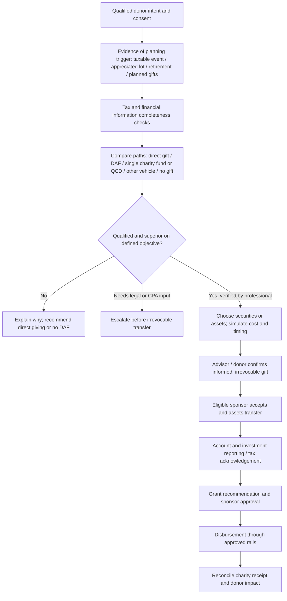

# Donor identification and tax-planning journey: Ren vs TIFIN Give vs Chariot
**Evidence cut-off: November 11, 2026 | U.S. federal tax context | Public-source desk research**

## Executive judgment

**TIFIN Give has a stronger *publicly documented claim* to automatic tax-opportunity discovery.** Its September 10, 2025 launch of Tax Intelligence explicitly says that the product analyzes a client's holdings to identify tax-efficient security contributions, considers **portfolio deviation and restricted security lists**, and helps advisors identify which clients might benefit from opening a DAF [D01]. The vendor says this product is available to advisors using TIFIN Give; the announcement is **not** an independent verification of recommendation quality, precision, penetration into customers, calculations, or actual data availability.

**Ren has substantive charitable tax-planning tools and advisor materials, not merely administrative functions.** Its publicly accessible **DAF Benefit Estimator** accepts gift fair market value, basis, capital gains tax rate, ordinary tax rate, expected growth, grant rate and duration [D03]. The 2026 advisor roadmap addresses taxable events, high-income years, rebalancing and time-sensitive asset funding [D04,D05]. Ren's Giving Platform also documents account opening, funding, planned contributions, grant recommendations and receipts [D06]. **We did not locate publicly documented automated account-wide opportunity detection or lot-ranking** comparable to TIFIN's Tax Intelligence claim. This is **unknown**, not a finding that Ren lacks such a capability.

**TIFIN also markets a second vehicle:** its February 19, 2025 announcement says **Single-Charity Funds** can be viewed alongside DAFs and positioned for IRA charitable planning [D07,D08]. This is a potentially material distinction for older donors, but **do not infer that every single-charity-fund implementation can receive a QCD**. Recipient legal classification, actual fund governing documents and IRA trustee-to-charity transaction must be verified; QCDs cannot go to a DAF [D09,D10].

**Chariot belongs downstream**: its DAFpay checkout lets donors initiate grants from DAF accounts, and donor/DAF provider identity and grant-decision APIs help move a specific recommendation, rather than calculate which tax lot or contribution vehicle is best [D11,D12,D13]. Chariot's current documentation also markets donor-balance-aware donation recommendations, which are about grant amount/checkout rather than the donor's taxable contribution [D14]. Its 2026 Donor Accounts flow was launched in beta; general availability as of this review has not been independently confirmed [D15]. The previously documented TIFIN–GiveClear–Chariot Disbursements operating partnership is covered separately in the [core deep dive](ren-tifin-chariot-deep-dive-2026-11-11.md).

**Commercially important conclusion:** A DAF software sale should not be equated with a successful tax-planning decision. A better benchmark is **qualified philanthropic intent → correct charitable vehicle recommendation → properly executed, legally accepted contribution → sponsor-approved grants → reconciled outcomes**, with the donor's benefits compared with direct charitable giving.

## Tax opportunity lifecycle (illustrative, not a reverse-engineered vendor architecture)

**Control boundary:** The sponsor's legal control begins at accepted contribution, and an AI recommendation must not become unilateral authorization to transfer private securities, make an irrevocable gift or approve a DAF grant. Direct and DAF donations can have similar income-tax and capital-gain treatment in many situations; the platform must prove what *incremental* value it adds [D09,D10,D16].

## Vendor evidence by donor journey

| Stage | Ren documented public evidence | TIFIN Give documented public evidence | Chariot | What is **not** established |
|---|---|---|---|---|
| Detect appreciated tax lots or high-gain contributors | Advisor guidance on stock, tax events and portfolio rebalancing [D04,D05]; no verified automatic detection | **Tax Intelligence** announced 2025: portfolio holdings, restrictions, deviations, real-time contribution proposals [D01] | No asset/tax-lot discovery capability reviewed [D11] | Whether Ren can detect opportunities privately; TIFIN's production coverage/precision |
| Detect bonus, business-sale and income events | Advisor year-end guidance and exit planning [D04,D17] | Tax Intelligence markets event-driven opportunities; specific payroll/business-sale data feeds not established [D01] | No such public feature reviewed | Actual trigger feeds and consent |
| Estimate tax impact | Public **DAF Benefit Estimator** takes FMV, basis, stated tax rates, growth, grant rate, duration [D03] | Marketed advisor tax intelligence and contribution proposals [D01,D02] | No DAF contribution tax model reviewed | Neither has been independently verified against actual 2026 returns |
| Compare direct cash gift vs DAF for nonitemizer | Public Ren calculator has **no visible AGI, filing status, itemization, or direct-gift comparator input** [D03] | No exposed public algorithm proving such comparison [D01,D02] | Not a contribution-planning product | Correct application of 2026 new nonitemizer deduction, which excludes DAF contributions [D16] |
| Calculate 2026 0.5%-AGI floor, limits and top-bracket adjustment | Ren advisor 2026 FAQ *explains* floor and 35% cap [D05]; estimator inputs are not sufficient to establish complete tax-return modeling [D03] | Not disclosed at algorithm/data level | Not disclosed | No independent calculation benchmark |
| Select long-term appreciated stock / restricted assets | Planning service and asset acceptance discussion [D04,D06] | Tax Intelligence explicitly says holding-level selection with portfolio restrictions [D01] | Not a contribution-selection product | Correct basis, holding, cost, execution and exception treatment |
| Choose DAF vs other charitable vehicle | Ren supports DAF, charitable remainder trusts and other vehicles; public model advice [D18] | Single-Charity Fund and DAF presented together [D07,D08] | No vehicle recommendation claimed | Neutral comparative objective, minimums, QCD eligibility, fee treatment |
| Advisor execution workflow | Planned contributions, funding and donor account reporting [D06] | Markets AI-assisted donor exploration and in-platform funding/grant actions [D02] | DAFpay grant initiation and provider review [D11,D12] | End-to-end source-of-truth, operator permissions, cancellation/reversal |
| Post-funding grant and reconciliation | Ren grant recommendations/recurring grants, tax receipts and status [D06] | TIFIN sponsor and Chariot payments in documented partner model [D19] | Grant initiation and payment/receipt infrastructure [D11,D19] | Tax deduction applies to **contribution**, not later DAF grant; payment status clocks |

**Evidence-state conventions:** `vendor_launch` = specifically announced product availability, still untested; `public_feature` = observable or described official feature; `vendor_marketing` = untested positioning; `education` = advisor guidance, not software; `not_verified` = not found in public sources, never a proven absence.

## Key analytical distinction: identify the tax *event*, not just the DAF prospect

A model scoring donors simply because they have high AUM, high income or an appreciated stock position will create **false-positive DAF recommendations**.

A correct opportunity needs, at minimum:
1. **Documented charitable intent.** Donating $100,000 to save a fraction of that in taxes is not a net increase in personal wealth.
2. **A source of funds and effective date.** Stock donation requires eligible in-kind transfers; private-business donations need specialist pre-sale evaluation; ordinary income and gains have different tax characteristics.
3. **Tax context.** Filing status, AGI, other deductions, prior charitable carryovers, 2026 0.5%-AGI floor, direct-gift nonitemizer deduction, applicable caps, actual tax brackets, and state/NIIT interactions.
4. **Correct counterfactuals.** Compare donating the **same asset to an eligible charity directly**, giving cash, contributing to a DAF now and granting later, and not accelerating a gift. A DAF cannot claim capital gains avoidance as unique.
5. **Total economics.** Administrative/investment/advisor fees, contribution minimums, lost liquidity, restrictions on donor control, execution and acceptance timing.
6. **Legal/tax escalation.** Assignment-of-income, restricted securities, pre-arranged sales, appraisals, and QCD recipient eligibility require a qualified professional.

The essential donor question is **“Given that I intend to give, what is the right vehicle, asset and year?”** rather than **“How much tax can I avoid by opening a DAF?”**

## Risks of treating a savings estimate as a tax calculation

Ren's public estimator [D03] asks for asset FMV, basis, capital gains rate, ordinary income rate, growth, grant payout rate and horizon. Those variables can support a *scenario illustration*, but **the visible form does not ask for filing status, AGI, other itemized deductions, carryovers, eligibility for the 2026 nonitemizer deduction, or the exact recipient of the gift**. It cannot substantiate a customized, complete federal 2026 deduction comparison **from the visible inputs alone**. We have not inspected its implementation or run a numerical validation, so we cannot conclude whether or how it handles missing values internally.

TIFIN's announcement [D01] explicitly addresses **which part of the portfolio to donate** and **who might benefit**, which is a distinct, more proactive task. However, it does **not** disclose the exact assumptions behind taxes saved, whether 2026 law is incorporated, or how it compares against direct giving. Neither vendor has supplied public independent accuracy reports, audited model outputs or representative false-positive rates.

### “Tax-gain harvesting” terminology

TIFIN's own text associates tax-gain harvesting with donating appreciated assets, portfolio concentration and intentionally realizing gains [D01]. These are different transactions with different potential consequences. For evaluation, require a clear choice among **gift appreciated shares in kind**, **sell then donate cash**, **realize a gain then repurchase/rebalance**, and **gift to charity directly**. Never present all routes as tax-equivalent.

## Persona-by-persona fit and required next evidence

| Earlier persona | Expected best next product question | Vendor evidence | Hard-stop / alternatives |
|---|---|---|---|
| P01. Founder pre-exit | Flag sale timing and direct-to-specialist handoff before irrevocable agreement | Ren advisor guidance and trust/complex-asset service; TIFIN feed not established [D17,D18] | No unsupervised “donate company shares now” |
| P02. Appreciated public equity | Which long-term lots can be given **in kind**, with restriction/concentration impact? | TIFIN Tax Intelligence explicitly targets this [D01] | Compare direct stock gift, carryovers, trading restriction |
| P03. Bonus/vesting year | Does it correctly model high-income year, other deductions and gift year? | Ren guidance [D04,D05]; no verified complete tax simulator | Marginal-rate and deduction-limit assumptions |
| P04. Itemization/bunching | Does model compare direct annual cash gifts vs DAF prefunding under **2026 rules**? | No public full comparator established | 2026 nonitemizer direct deduction [D16] |
| P05/P06. Real estate/private equity | Sponsor acceptance, qualified appraisal, assignment-of-income and execution workflow | Ren service/education [D17,D18]; TIFIN asset type acceptance requires proof | Specialist and sponsor approval |
| P07. Pre-retirement | Is taxable income year truly higher than later year after 2026 floor and cap? | Both market planning; no tested return-level model | Avoid assumed future brackets |
| P08/P09. Multi-charity/family | Can counsel simplify giving across generations without overstating tax advantage? | Both have grant/family donor experiences [D02,D06] | Fees vs direct giving |
| P10. Retiree with IRA QCD | Does it avoid recommending a DAF for QCD and validate single-charity eligibility? | TIFIN markets **Single-Charity Funds** [D07,D08] | QCD-to-DAF disallowed; recipient eligibility case by case [D09,D10] |
| P11. Standard-deduction cash donor | Does it say **direct** qualified cash giving may win? | Not demonstrated by either vendor's public tax engine | DAF excluded from nonitemizer deduction [D16] |
| P12/P13. No genuine giving / prohibited benefits | Does the system suppress DAF sale and escalate prohibited gift? | Not tested | No product pitch or execution |
| P14. Loss asset | Does it avoid treating all donated stock as appreciated stock? | TIFIN lot-selection claim [D01], no adverse-lot validation | Compare sale-loss/cash-gift alternative with tax professional |

## Provisional competitive takeaway

- **Opportunity identification and securities selection: TIFIN has the stronger *public product evidence*, not proven higher accuracy** [D01].
- **Human advisor orchestration, donor operations and complex planning: Ren has extensive public workflow/education evidence**, including a publicly visible estimator [D03,D04,D06,D17,D18].
- **Retirement giving vehicle optionality: TIFIN clearly markets a Single-Charity Fund**, which deserves deeper legal/operational inquiry [D07,D08].
- **Grant initiation after funding: Chariot has clearer public API documentation**, and its function belongs downstream of the donor's tax decision [D11,D12].
- **Winner on suitability, incremental federal tax outcomes, false positives, privacy, 2026 law, fees, and auditability: undetermined.** The next gate is a controlled evaluation with identical synthetic clients and independent professional review.

See the [machine-readable phase comparison](../data/tax-opportunity-capability-matrix-2026.csv), [synthetic case tests](tax-opportunity-evaluation-protocol-2026.md), and [primary evidence register](../data/tax-opportunity-sources-2026.csv).

## Security and commercial implications

This capability may require sensitive cross-system data beyond traditional DAF account records: tax lots, cost basis, realized gains, household planning, brokerage holdings, compensation and charity intent. Demand source mapping, lawful consent, role-based permissions, tenant separation, deletion controls, purpose limits and audit logs. A SOC 2 claim does not establish that an AI tax recommendation is accurate or a custodian integration is authorized.

For an investor, the most revealing due-diligence KPIs are **qualified opportunities with affirmative donor intent**, **advisor acceptance and conversion to an accepted gift**, **incorrect recommendations prevented**, **completed contributions**, **verified actual-tax outcome vs modeled outcome**, **time to sponsor acceptance**, **advisor time saved**, and **retained/retained-in-firm AUM** (if relevant). Measure without treating all DAF assets as client-owned after an irrevocable gift.

## What would change the conclusion

- An official Ren product specification or live demonstration of automated tax-lot screening and ranking that rebuts the current evidence gap.
- Independent validation of TIFIN Tax Intelligence accuracy, availability, rate of automated donor segmentation, and fee-adjusted benefit.
- Evidence that either provider correctly handles 2026 nonitemizer rules, the 0.5% AGI floor, appreciated-asset alternatives and QCD paths.
- Contracts and system diagrams proving end-to-end integration of data/approval paths, not just separate marketing features.

Do not place NDA material, expert network invitations, nonpublic employer/client information or personally identifying tax/wealth records into this research repository.
