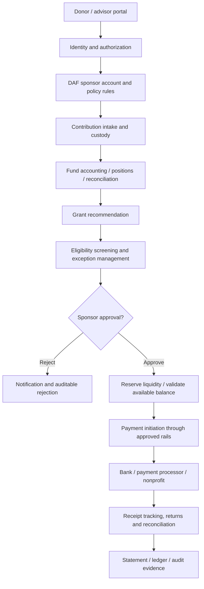

# Technology and control map: a DAF transaction

**Reference model** only; implementations differ by sponsor, custodian and vendor. This diagram is a conceptual responsibility map, not reverse-engineered architecture.

## Responsibility is not inferred from UI ownership

| Control boundary | Who is typically accountable | Key evidence to request |
|---|---|---|
| Donor/advisor account permissions | Sponsor sets policy; platform implements access | SSO/MFA, authorization, role reviews and revocation |
| Contributions and complex gifts | Sponsor acceptance; custodians and service vendors may execute | Valuation, legal acceptance, custody proof and exception handling |
| Investment/position records | Sponsor oversight; custodian/administrator provide data | Feed completeness, timestamps, reconciliation, corrections |
| Grant recipient eligibility | Sponsoring charity, with vendors supporting research/screening | Eligibility rules, sanctions checks, override approvals |
| **Grant approval** | Sponsoring charity retains decision authority | Delegation, dual control, decision log, audit policy |
| Payment and settlement | Sponsor authorizes; financial rails/service provider executes | Maker/checker approvals, idempotency, returns, bank reconciliation |
| Reporting | Sponsor accountable; platform may generate statements | Completeness and accuracy, SOC 1 relevance, retention and audit lineage |
| Third-party risk | Sponsor and institutional customer each manage obligations | Contracts, subcontractors, SOC report coverage, CUECs |

## Three concrete public observations

1. **AEF and Ren:** [AEF describes its platform migration](https://engage.aefonline.org/dc-sunset/) to a Ren-powered DAF portal. This is a sponsor–technology dependency, not identical legal entities or transferable attestations.
2. **Chariot's DAFpay:** [Documentation](https://docs.givechariot.com/guides/dafpay/integrating-dafpay/transactions) distinguishes the status **Initiated** from **Received**. A successfully created grant recommendation must not be represented as settled payment. [Donor Accounts](https://docs.givechariot.com/guides/dafpay/donor-accounts/overview) places grant decision actions with the integrated DAF provider.
3. **Greater Horizons:** [Advisor FAQ](https://www.greaterhorizons.org/professional-advisors/charitable-giving-solutions/daf-financial-advisor-managed-account-faqs/) explicitly describes monthly reconciliation for advisor-managed investments and payment from a separate liquidity account. Portal balances and custodial balances can therefore differ for operational reasons.

## Failure-mode tests for platform diligence

- Double submission or replay of a grant request; idempotency key and state transitions.
- Charity becomes ineligible between recommendation and settlement.
- Sponsor rejects a recommendation after third-party initiation; donor/nonprofit notifications.
- Missing or stale custody file, corporate action, pricing adjustment or transfer reversal.
- Grant is initiated but not received; missing tracking ID, returned ACH, uncashed check.
- Donor account is terminated, advisor privileges revoked or MFA compromised mid-workflow.
- Statement generation before reconciliation; audit reconstruction from raw transactions.
- Vendor downtime, bank outage, failed webhooks, retries and replay after recovery.
- Tenant isolation, cross-program data leakage, sensitive fields in logs.
- Monitoring does not establish accountability: specify the actor and authoritative ledger at each step.

## Analytical hypothesis, not a market finding

Designing complete inputs and deterministic exception pathways **could** yield more value than using generative AI to make grant-vetting decisions. Test this by measuring incomplete requests, exception volume, analyst time, rework, settlement delay, control failures, and cost per successfully settled grant. Do not assume the result.
