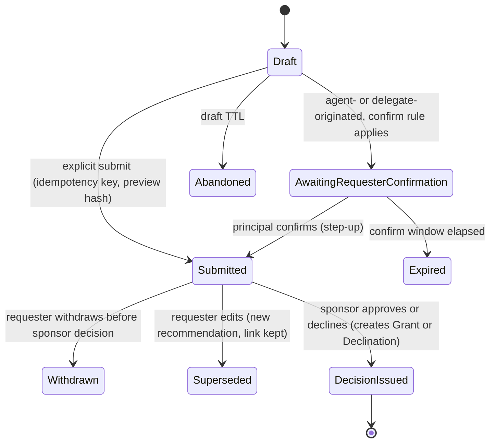
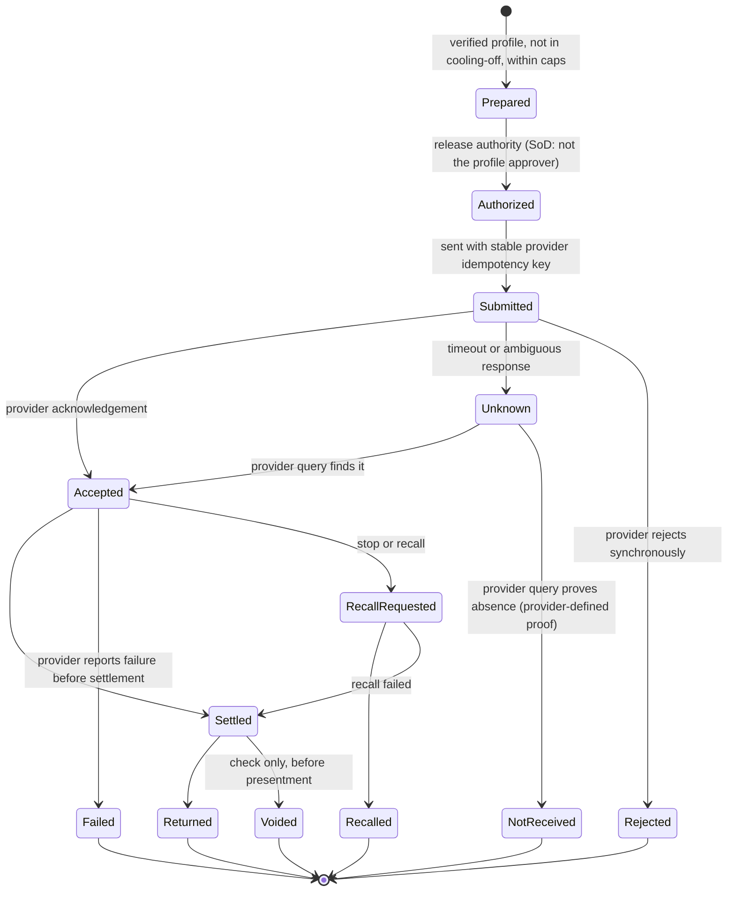
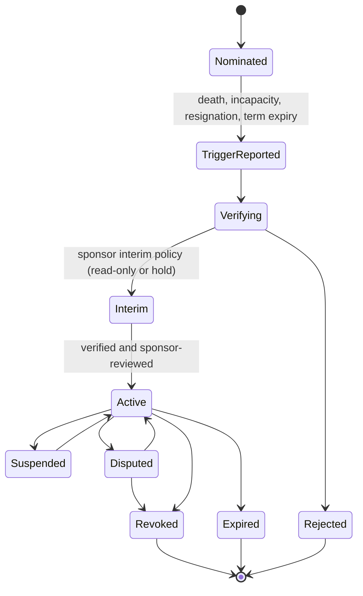

# State models

**Status:** theoretical specification [T]. These models restate and correct the baseline state machines. They are **proposals**, not decisions. Where a proposal changes a baseline rule, the change is listed in the [contradiction register](../16-registers/contradiction-register.md) and needs an owner decision.

Notation: `→` legal transition; **bold** = terminal for ordinary commands. "Terminal" never means "immutable forever": a terminal record can still receive *linked correction records* (reversal, adjustment, recovery case) without changing its state (rule SM-0 below).

## 0. Cross-cutting rules

| ID | Rule | Why |
|---|---|---|
| SM-0 | Terminal states reject ordinary commands. Later facts about a terminal object (return, refund, restatement, discovered ineligibility) create a **linked child record** with its own lifecycle. They never reopen or edit the parent. | Baseline WF-01 makes `Reconciled` terminal, yet returns, custodian corrections and post-payment reviews can arrive after it ([TVF-004](../16-registers/findings.csv)). |
| SM-1 | Every transition records: actor (person, rule ID or model run), authority reference, policy version, input snapshot hash, effective time, recorded time, causation ID. | Baseline DATA-03, data model principle 3. |
| SM-2 | Every command carries an expected revision. A stale revision is rejected, never merged silently. | Baseline financial core command envelope. |
| SM-3 | A transition that depends on an external party has an explicit **Unknown** state. Timeout never maps to failure. | Financial core invariant 7. Missing from the baseline grant machine ([TVF-003](../16-registers/findings.csv)). |
| SM-4 | Holds are *orthogonal flags*, not states. An object can be `Approved` and `Held`. A hold blocks forward transitions that move money or legal state. It never blocks cancellation, investigation or recording external observations. | The baseline mixes "Held" as a state (financial core lifecycle) and as a flag (WF-09). As a state, a hold erases where the object was. |
| SM-5 | A hold can be added by any authorized rule, person or model (flag-only, DD-005). It can be released only by a rule whose inputs have changed or by an authorized human. A model never releases. | DD-005. |
| SM-6 | Irreversible transitions (payment submission, trade submission, acknowledgment issuance, successor activation) re-check authority, eligibility, holds and data freshness **at the moment of the transition**, not at the earlier decision. | AUTH-06; WF-09 revocation between approval and payment. |

## 1. Grant recommendation (donor/advisor side)

The baseline merges the request and the sponsor's grant into one machine that starts at `Submitted` ([WF-01](../ai-native-daf-enterprise/03-workflow-redesign/wf-contributions.md)). The recommendation needs its own lifecycle, because withdrawal, donor confirmation, expiry and duplicate detection belong to the requester, not the sponsor.

| Invariant | Statement |
|---|---|
| REC-1 | A recommendation never moves money and never reserves capacity. It may create a **soft pending claim** that lowers the *displayed* recommendable amount for the same fund. A soft claim has no financial effect. |
| REC-2 | `Withdrawn` is allowed only before `DecisionIssued`. After approval, the requester can only *ask* for cancellation; the sponsor decides (Grant §2). |
| REC-3 | A recommendation is attributed to: requesting principal, acting principal (for an agent or delegate), capacity, authority revision. If the requesting principal's authority ends before decision, the recommendation goes to `Submitted+AuthorityLapsed` review. It is not decided under authority that no longer exists. |
| REC-4 | Duplicate detection is a flag, never a silent merge. Two identical recommendations from two advisors are two requests. |

## 2. Grant (sponsor side)

Baseline: `Submitted → Resolved → Approved → Released → Paid → Reconciled`, with `AwaitingHumanDecision` and `Returned`. Missing from it (findings in brackets):
- reservation and liquidation (funding) [TVF-001];
- the gap between payment instruction and provider acceptance, including **Unknown** [TVF-003];
- `Paid → Returned`: ACH and other rails can return after settlement [TVF-002];
- cancellation after approval, although `GrantCanceled` exists in the event catalog [TVF-005];
- check void, stale-date, reissue and escheat;
- recipient refund of a paid grant;
- the effect of fund suspension or authority dispute on an approved grant.

Proposed:

```mermaid
stateDiagram-v2
  [*] --> UnderReview: recommendation accepted for decision
  UnderReview --> AwaitingHumanDecision: refer or flag
  AwaitingHumanDecision --> UnderReview: evidence supplied, rules re-run
  UnderReview --> Approved: D policy pass (routine) 
  AwaitingHumanDecision --> Approved: authorized human
  UnderReview --> Declined
  AwaitingHumanDecision --> Declined
  Approved --> Reserved: capacity encumbered (may be atomic with approval)
  Reserved --> Funding: liquidation ordered, or cash already free
  Funding --> Funded: cash settled and allocated to this grant
  Funding --> FundingShortfall: proceeds below amount / source unavailable
  FundingShortfall --> Funding: policy re-plan (other source, top-up)
  FundingShortfall --> Canceled: sponsor cancels; reservation released
  Funded --> PaymentInProgress: payment attempt created (see §3)
  PaymentInProgress --> Disbursed: attempt Settled
  PaymentInProgress --> Funded: attempt Failed or Rejected (definitively)
  Disbursed --> Final: return window elapsed (rail-specific)
  Disbursed --> Returned: return received
  Final --> Returned: late return (rail allows, e.g. unauthorized-debit class)
  Returned --> Funded: re-pay to verified profile
  Returned --> Canceled: sponsor cancels; funds back to fund
  Final --> Reconciled: three-way match
  Approved --> Canceled
  Reserved --> Canceled
  Funded --> Canceled: no attempt outstanding
  Declined --> [*]
  Canceled --> [*]
  Reconciled --> [*]
```

Not drawn but required: `Escheated` (check never presented, after state dormancy period) [C]; `Voided` and `Reissued` are payment-attempt states (§3), not grant states.

| Invariant | Statement |
|---|---|
| GR-1 | `Approved` records a **fixed currency amount**. A percentage recommendation is converted ("fixed") exactly once, at a defined fixing event, using a recorded valuation snapshot. After that, the grant amount does not move with the market (see [FI-10](../07-financial-invariants/financial-invariants.md)). |
| GR-2 | No transition from `Funded` toward payment while any hold is active (SM-4). |
| GR-3 | `Canceled` is impossible while a payment attempt is in `Submitted`, `Unknown` or `Accepted`. The attempt must resolve first (stop-payment or recall is an attempt-level action). |
| GR-4 | Reservation release happens only on `Canceled`, `Declined` (if reserved) or consumption at `Disbursed`. It is never released on timeout, on `Unknown`, or because a projection disagrees. |
| GR-5 | `Final` is rail-specific and time-based. The UI must not say "complete" or "paid" before `Final` without a qualifier (see [status vocabulary](../09-ux/status-vocabulary.md)). |
| GR-6 | A flag raised after `Disbursed` (for example by the benefit-risk agent that was still running) opens a **post-payment review** child case. It does not change the grant's state. Recovery from the recipient is a separate case with human authority. |
| GR-7 | Fund `Suspended`, `Frozen` or authority `Disputed` places a hold on all of the fund's grants not yet `PaymentInProgress`. Grants already in `PaymentInProgress` follow the attempt to resolution; they cannot be "un-sent". |
| GR-8 | Donor death does **not** cancel an approved grant automatically. The sponsor approved it under its own authority. Whether to complete it is a sponsor policy decision (OD-03). Recurring *recommendations* (standing templates) are suspended until authority is re-established. |

## 3. Payment attempt

A grant may need several attempts (return, reissue, rail change). The baseline `PaymentInstruction / Payment` entity has one lifecycle.

| Invariant | Statement |
|---|---|
| PA-1 | Per grant, at most one attempt is in {Authorized, Submitted, Unknown, Accepted, RecallRequested, Settled-not-returned}. A new attempt can be created only when all earlier attempts are in {NotReceived, Rejected, Failed, Recalled, Voided, Returned}. This is the double-payment invariant. |
| PA-2 | `Unknown → NotReceived` requires positive evidence from the provider that the instruction was not received **and will not be processed later**. If no provider can give that proof, `Unknown` can only resolve by observation, or by a human decision accepting duplicate-payment risk with a recovery plan. [C: provider contracts, GAP-002] |
| PA-3 | The provider idempotency key is fixed per attempt and never reused across attempts. A retry of the *same* attempt reuses it. |
| PA-4 | A check is `Settled` for cash purposes only when presented and cleared. "Issued" is `Accepted`. Uncashed checks age (`CheckAged`) toward void and escheat [C: state unclaimed-property law; [queue-batch34-escheat-terms](../mission-2026-11-14/queue-batch34-escheat-terms.md)]. |

## 4. Reservation (encumbrance)

| State | Meaning |
|---|---|
| Active | Encumbers a currency amount on the fund and on every constrained ancestor (pool, custodial account, legal entity). |
| PartiallyConsumed | Some of the amount has been disbursed (split payments, if policy allows them). |
| Consumed | Fully matched to settled disbursement (financial core settlement conservation invariant). |
| Released | Grant canceled or declined. |
| Stranded | The grant reached a terminal state but the reservation did not: a defect state. It must raise an exception. It exists so that monitoring can name the defect. |

Invariant RES-1: Σ Active reservations on any constrained resource ≤ that resource's reservable capacity **at the time each was created**. Market moves after creation can make the sum exceed current value. That condition (**over-commitment**) is legal but must be detected and handled ([FI-12](../07-financial-invariants/financial-invariants.md)).

## 5. Contribution

The baseline issues units on `ContributionSettled`. For reversible rails, "settled" is not "final" ([TVF-006](../16-registers/findings.csv)).

| State | Notes |
|---|---|
| Intended | Optional intent with reference. |
| Observed | Custodian or bank reports receipt. An observation, not settled value (financial core). |
| Proposed (non-cash) | Gift-acceptance case open. |
| Accepted (non-cash) | Sponsor acceptance decision. Distinct from receipt and from transfer. |
| Received | Asset under sponsor control at custodian. |
| Provisional | Units issued, or value credited, but the rail still allows reversal (ACH debit return window, card chargeback, check return). |
| Final | Reversal window elapsed, or rail is irrevocable (wire, in-kind DTC delivery). |
| Valued | Valuation method and value recorded (may precede Final for securities). |
| Liquidated / Held in kind | Disposition. |
| Reversed | Returned debit, rejected delivery, or a gift void for legal reasons [C]. A linked reversal record (SM-0). |
| Acknowledged | Acknowledgment issued. A separate document lifecycle: Draft → Issued → Corrected/Withdrawn [C]. |

Invariants:
- CON-1: `Provisional` value cannot fund a `Reserved` grant beyond a sponsor-set **provisional credit limit** per donor or fund. The default proposed is zero [P] (OD-04).
- CON-2: An acknowledgment for a reversible contribution is issued only after `Final`, or carries a correction path that is tested [C].
- CON-3: A `Reversed` contribution whose value already funded a disbursed grant creates a **sponsor receivable from the donor** and a fund deficit case. It never creates a negative fund silently.

## 6. Fund (account)

Baseline states (Prospect, Application, UnderReview, Approved, Active, Suspended, AmendmentPending, ClosurePending, Closed, Terminated/Rejected) are kept. Additions:

| Addition | Reason |
|---|---|
| `Frozen` (distinct from Suspended) | Sanctions or legal order: nothing moves, including fees, unless a legal authority permits it [C]. Suspended is a sponsor policy hold. |
| Orthogonal `AuthorityState` = Normal / Interim / Disputed / Vacant | Succession and disputes affect who may recommend, not whether the fund exists (AUTH-09). The baseline encodes neither. |
| `ClosedWithResidualRecovery` | Trailing dividends, class-action proceeds and late returns arrive after closure. The fund needs a defined destination for them ([TVF-021](../16-registers/findings.csv)). |
| `Active-Unfunded` | The baseline lists approved-not-funded and funded-not-active as exception states (EST-13). This makes them explicit. |

Invariants:
- FUND-1: `ClosurePending → Closed` requires: zero active reservations; no payment attempt outside a terminal attempt state; no provisional contributions; fees assessed through closure date; reconciliation matched; legal holds recorded.
- FUND-2: A fund cannot leave `Frozen` through any automated path.

## 7. Authority grant and succession

| Invariant | Statement |
|---|---|
| AUTH-I1 | An authority change takes effect at command execution. Sessions, widget instances, cached projections, partner tokens and delegated agent privileges derived from the old authority are invalidated, or re-checked on next use. The maximum staleness window is a stated requirement, not an emergent property ([TVF-015](../16-registers/findings.csv)). |
| AUTH-I2 | Delegated grants (advisor, agent, partner user) derive from a parent authority. When the parent ends, the children end at the same effective time. |
| AUTH-I3 | When the triggering fact is effective in the past (date of death reported two weeks later), actions taken in between under the dead principal's authority are **flagged for review**, not reversed automatically. Approved grants are governed by GR-8 [C]. |
| AUTH-I4 | Two successors with joint authority: the policy must define quorum. Without it, recommendations require all. |

## 8. Flag and exception case

| Flag state | Allowed transitions |
|---|---|
| Raised | → UnderReview; → Superseded (a rule re-ran on new data and no longer fires, recorded) |
| UnderReview | → Cleared (human with authority, or rule with changed inputs); → Confirmed (becomes a decline, hold or report) |
| Cleared | Terminal. If the same condition recurs on new evidence, a **new** flag is raised. |

Invariant FLAG-1: a flag never expires by time alone. An unreviewed flag past its SLA escalates; it does not disappear.

## 9. Widget session (embedded)

Baseline [W01](../../docs/ui/widgets/01-platform-runtime-and-trust-contract-v0.2.md) states are kept. Added invariant WS-1: `Active` requires that the session's `EffectiveAuthorityRevision` equals the current revision **at each command**. The baseline requires this for commands (item 8). It does not say what the *displayed* data does when the revision changes while idle. See [widget model](../10-widgets/widget-integration-model.md).

## 10. Transition defects to test (theoretical)

| Class | Example | Required behavior |
|---|---|---|
| Impossible | `Declined → Funded` | Rejected by state machine. |
| Missing (baseline) | `Paid → Returned`; `Approved → Canceled`; `Submitted → Unknown` | Added above. |
| Unauthorized | Advisor cancels a grant after sponsor approval | Becomes a cancellation *request*; sponsor decides. |
| Concurrent | Cancel and payment release race | Serialize on grant revision; GR-3 decides. |
| Repeated command | Same approval twice | Idempotent: same key and hash returns the original result. |
| Delayed external | Settlement report three days late | Remains `Accepted`; aging alert; no retry. |
| Compensation | Wrong recipient paid | Recovery case plus a new grant if needed. The original is never edited. |
