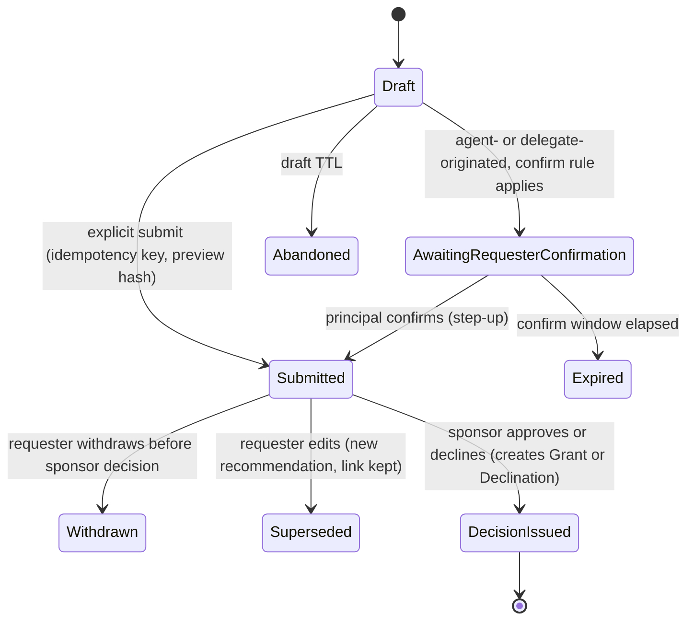
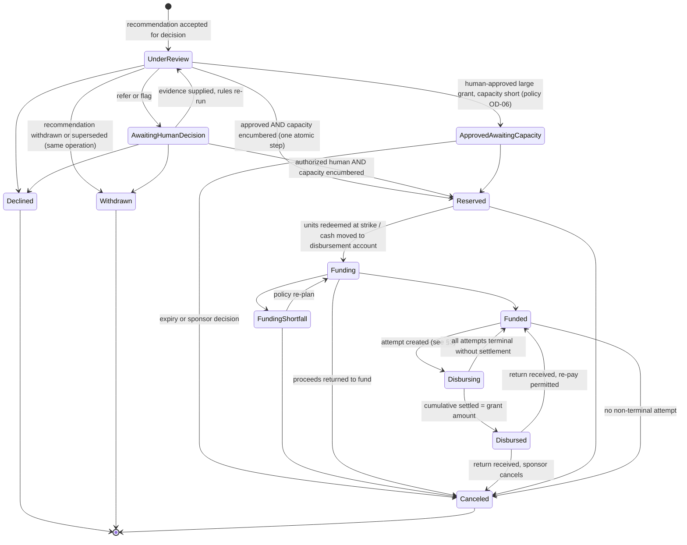
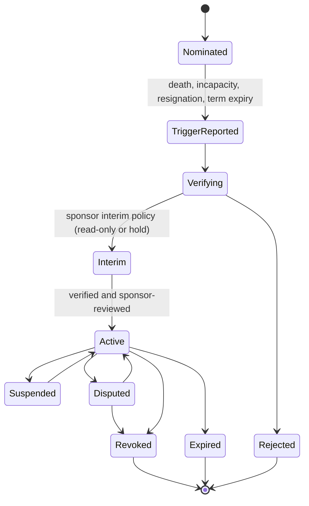

# State models

**Status:** theoretical specification [T]. These models restate and correct the baseline state machines. They are **proposals**, not decisions. Where a proposal changes a baseline rule, the change is listed in the [contradiction register](../16-registers/contradiction-register.md) and needs an owner decision.

Notation: `→` legal transition; **bold** = terminal for ordinary commands. "Terminal" never means "immutable forever": a terminal record can still receive *linked correction records* (reversal, adjustment, recovery case) without changing its state (rule SM-0 below).

## 0. Cross-cutting rules

| ID | Rule | Why |
|---|---|---|
| SM-0 | Terminal states reject ordinary commands. Later facts about a terminal object (return, refund, restatement, discovered ineligibility) create a **linked child record** with its own lifecycle. They never reopen or edit the parent. | Baseline WF-01 makes `Reconciled` terminal, yet returns, custodian corrections and post-payment reviews can arrive after it ([TVF-004](../16-registers/findings.csv)). |
| SM-1 | Every transition records: actor (person, rule ID or model run), authority reference, policy version, input snapshot hash, effective time, recorded time, causation ID. | Baseline DATA-03, data model principle 3. |
| SM-2 | Every command carries an expected revision. A stale revision is rejected, never merged silently. | Baseline financial core command envelope. |
| SM-3 | A transition that depends on an external party has an explicit **Unknown** state. Timeout never maps to failure. | Financial core invariant 7. Missing from the baseline grant machine ([TVF-003](../16-registers/findings.csv)). |
| SM-4 | Holds are *orthogonal flags*, not states. An object can be `Approved` and `Held`. A hold blocks forward transitions that move money or legal state. It never blocks cancellation, investigation or recording external observations. | The baseline mixes "Held" as a state (financial core lifecycle) and as a flag (WF-09). As a state, a hold erases where the object was. |
| SM-5 | A hold can be added by any authorized rule, person or model (flag-only, DD-005). It can be released only by a rule whose inputs have changed or by an authorized human. A model never releases. | DD-005. |
| SM-6 | Irreversible transitions (payment submission, trade submission, acknowledgment issuance, successor activation) re-check authority, eligibility, holds and data freshness **at the moment of the transition**, not at the earlier decision. | AUTH-06; WF-09 revocation between approval and payment. |

## 1. Grant recommendation (donor/advisor side)

The baseline merges the request and the sponsor's grant into one machine that starts at `Submitted` ([WF-01](../ai-native-daf-enterprise/03-workflow-redesign/wf-contributions.md)). The recommendation needs its own lifecycle, because withdrawal, donor confirmation, expiry and duplicate detection belong to the requester, not the sponsor.



| Invariant | Statement |
|---|---|
| REC-1 | A recommendation never moves money and never reserves capacity. It may create a **soft pending claim** that lowers the *displayed* recommendable amount for the same fund. A soft claim has no financial effect. |
| REC-2 | `Withdrawn` is allowed only before `DecisionIssued`. After approval, the requester can only *ask* for cancellation; the sponsor decides (Grant §2). |
| REC-3 | A recommendation is attributed to: requesting principal, acting principal (for an agent or delegate), capacity, authority revision. If the requesting principal's authority ends before decision, the recommendation goes to `Submitted+AuthorityLapsed` review. It is not decided under authority that no longer exists. |
| REC-4 | Duplicate detection is a flag, never a silent merge. Two identical recommendations from two advisors are two requests. |
| REC-5 | Withdrawal or supersession closes the linked grant (`Withdrawn`) in the same operation. A specialist cannot approve a grant nobody is recommending (TVF-089). |
| REC-6 | A recurring template instance has the idempotency key (template, period). The missed-run policy (catch up or skip) is stated per template [P]. Template amendment and resumption follow REC-3 authority checks. An agent-created template requires the principal's confirmation at creation and at each amendment (TVF-095, TVF-098). |
| REC-7 | **Delayed execution re-confirms.** A pre-cleared plan item (giving plan, alternative 2D) or a recurring instance whose recipient was **added within a look-back window** [P] needs fresh step-up confirmation at execution. Additions of recipients across many funds in a short window raise a cross-fund flag. This answers the red-team counterexample B1 ([reviews](../13-adversarial-reviews/role-reviews.md)). |

## 2. Grant (sponsor side)

Revision 2 (2026-11-22). It incorporates the role-separated reviews and round-2 scenarios (round-2 findings TVF-078 onward; see the [findings register](../16-registers/findings.csv)). The grant machine below records the **decision and funding** lifecycle only. **Payment status is derived** from the attempts (§3). **Finality and reconciliation are facts, not grant states.** An earlier draft placed `Reconciled` after `Final`, which merged matching with the return window and duplicated attempt facts (architecture review A5; round 2 G-30).

Baseline gaps this closes:
- reservation and funding [TVF-001];
- payment Unknown [TVF-003];
- returns after settlement [TVF-002];
- cancellation [TVF-005];
- orphaned grants after a withdrawal [TVF-089].



Derived facts (not states):
- `PaymentStatus` is computed from the attempts.
- `Final(rail)` is true when the rail's return window for every settled attempt has elapsed.
- `Reconciled` is true when ledger, bank and provider agree for every attempt.

`Escheated` is a disposition of a check attempt (§3), not a grant state [C].

| Invariant | Statement |
|---|---|
| GR-1 | The grant's amount is a **fixed currency amount at reservation**, with three exceptions:<br>- *residual sweep* (FI-15): fixed after the last settlement;<br>- *proceeds-linked* grants, such as "the proceeds of my stock gift": fixed at the contribution's sale settlement;<br>- split disbursement where policy allows partial payment (FI-13).<br>A percentage recommendation is fixed exactly once (FI-10). A NAV later restated does **not** re-fix an approved grant; the correction is borne by the fund (FI-28). Round 2 G-29 asks the owner to confirm this (OD-07). |
| GR-2 | No attempt may be created while any hold is active (SM-4). |
| GR-3 | Cancelling a grant **abandons its pre-submission attempts (Prepared/Authorized) in the same operation**. Cancellation is impossible while an attempt is in Submitted, Unknown, Accepted or StopRequested; there it becomes a recall or stop request (GR-9). |
| GR-4 | A reservation is released only on Canceled or Declined, or is consumed at settlement. Any **difference** between the reserved and the consumed amount is released at consumption with a recorded reason (FX buffer, liquidation buffer, provider fee policy). Without that rule such residue becomes Stranded by design (financial review A-8; round 2 G-10). |
| GR-5 | Donor copy: "Payment sent on D" when cumulative settlement is observed. "Paid" may be used only once `Final(rail)` holds, or with a qualifier ([status vocabulary](../09-ux/status-vocabulary.md)). This resolves the round 2 G-24 conflict. |
| GR-6 | A flag raised after any attempt is Submitted opens a **post-payment review** child case. It does not change grant state. Recovery from the recipient is a separate case with human authority. |
| GR-7 | Fund `Suspended`, `Frozen` or authority `Disputed` holds every grant without a live attempt. That **includes re-payment after a return** (round 2 G-14). Attempts already submitted resolve normally. |
| GR-8 | After sponsor approval, the requester's later loss of authority (death, revocation) does **not** cancel the grant. The sponsor approved it under its own authority, and completing it is the default [P][C] (OD-03). Standing recommendations are suspended until authority is re-established. |
| GR-9 | A cancellation request has its own lifecycle: Requested → Granted (grant Canceled) / Refused (with reason) / Overtaken (settlement arrived first). Each outcome has a label (round 2 G-22). |
| GR-10 | **One ordering key.** Capacity contention is decided by the reservation sequence number alone. "Approval order", "FIFO" and client-supplied `effective_at` are not ordering keys. This resolves the financial review A-4 and round 2 G-17. Routine approval and reservation are one atomic step. Human-approved grants that fail capacity wait in `ApprovedAwaitingCapacity`, with an expiry and the label "Approved – waiting for funds" (OD-06). |
| GR-11 | Returned money re-reserved for re-payment **restores a prior commitment**. It is exempt from FI-12's refusal of new reservations, but not from fund holds (GR-7) or closure (FUND-1). This resolves the round 2 G-15 conflict. |
| GR-12 | Who funds a replacement grant after a misdirected or forged payment is a sponsor error-cost decision (OD-20). It is never silently charged to the donor's fund (round 2 G-27; cross X-15). |

## 3. Payment attempt

Revision 2. Corrections from review:
- check void (red team B2; financial review A-1; architecture review A6; round 2 G-11);
- abandon exits (G-4);
- contradicting evidence (G-5);
- dedup windows (G-6);
- PA-2 decision state and Unknown deadline (G-2; red team B9);
- two-source NotReceived (cross X-17);
- provider failure (X-18);
- cumulative PA-1 (G-3);
- in-transit funds (G-8).

```mermaid
stateDiagram-v2
  [*] --> Prepared: verified profile, not in cooling-off, within caps
  Prepared --> Authorized: release authority (≠ profile approver)
  Prepared --> Abandoned: grant canceled / re-check failed
  Authorized --> Abandoned: grant canceled / re-check failed at submission
  Authorized --> Submitted: stable provider key; re-check grant state, reservation, holds, eligibility
  Submitted --> Accepted: provider acknowledgement
  Submitted --> Rejected: synchronous rejection
  Submitted --> Unknown: timeout or ambiguous response
  Unknown --> Accepted: provider query or bank debit observed
  Unknown --> NotReceived: provider proof AND bank shows no debit
  Unknown --> ResolvedByDecision: PA-2 human decision with recovery plan
  Accepted --> Settled: funds left sponsor account and settlement observed
  Accepted --> Failed: provider reports failure before settlement
  Accepted --> StopRequested: stop or recall
  StopRequested --> Voided: bank confirms stop (checks) / recall confirmed
  StopRequested --> Settled: stop or recall failed
  Accepted --> Lost: provider insolvent or unreachable beyond deadline (human decision, claim opened)
  Settled --> Returned
  Abandoned --> [*]
  Rejected --> [*]
  NotReceived --> [*]
  ResolvedByDecision --> [*]
  Failed --> [*]
  Voided --> [*]
  Lost --> [*]
  Returned --> [*]
  Settled --> [*]
```

| Invariant | Statement |
|---|---|
| PA-1 | **Cumulative double-payment invariant.** For each grant: Σ amounts of attempts in {Authorized, Submitted, Unknown, Accepted, StopRequested, Settled-not-returned} ≤ grant amount. Exceptions are allowed only through PA-2 decisions and `Lost` claims, which carry an explicit duplicate-risk acceptance. This permits split disbursement and per-payment rail caps (round 2 G-3). |
| PA-2 | `Unknown → NotReceived` requires **two sources**: provider proof of non-receipt, and the bank statement showing no debit by the provider's settlement horizon (cross X-17; ontology §3). If neither is obtainable, only `ResolvedByDecision` remains: two approvers, the releaser excluded, a recorded duplicate-risk acceptance and a recovery plan. |
| PA-3 | A retry of the *same* attempt reuses its key, but only **within the provider's contracted deduplication window**. After the window, a retry is a new attempt and must pass PA-2 first (round 2 G-6). |
| PA-4 | Checks: issued and unpresented = `Accepted`. The reservation is **consumed at issue into an outstanding-check liability**, so capacity is not reduced twice by FI-21 and GR-4 (financial review A-2). Void is `Accepted → StopRequested → Voided`, and only after the **bank confirms** the stop (positive pay). Reissue is possible only after `Voided`. Dormant checks follow the unclaimed-property process [C: REG-045 is unverified]. |
| PA-5 | `Unknown` and `Accepted` have aging deadlines [P]. When a deadline passes, the attempt goes to the exception queue with a named owner. No attempt waits indefinitely (red team B9; round 2 G-2). |
| PA-6 | **Contradicting evidence.** If a terminal attempt (Failed, NotReceived, Returned, Voided, ResolvedByDecision) later meets evidence of settlement, or a return arrives before its settlement notice, a **double-payment case** opens and further attempts on the grant are blocked until it is resolved. A table of which observations imply which must be part of each provider adapter's contract (round 2 G-5). |
| PA-7 | Batch files: a file-level submission has its own idempotency key and its own Unknown. Partial acceptance is recorded per item. A file Unknown makes every item Unknown (round 2 G-7). |
| PA-8 | **Funds in transit.** Once the sponsor's bank is debited and before the recipient is credited (an intermediary or a pre-funded provider), the amount is a **receivable from the provider**, not fund cash. `Lost` converts it to a claim. Which party bears the loss is OD-20 (round 2 G-8; cross X-18). |
| PA-9 | Late return edge: returns of **outbound credits** after the normal return window are rail-specific and limited [I]. The earlier draft's "unauthorized-debit class" example applies to debits, i.e. contributions, not to grant payments (red team B3; financial review A-6). |

## 4. Reservation (encumbrance)

| State | Meaning |
|---|---|
| Active | Encumbers a currency amount on the fund and on every constrained ancestor (pool, custodial account, legal entity). |
| PartiallyConsumed | Some of the amount has been disbursed (split payments, if policy allows them). |
| Consumed | Fully matched to settled disbursement (financial core settlement conservation invariant). |
| Released | Grant canceled or declined. |
| Stranded | The grant reached a terminal state but the reservation did not: a defect state. It must raise an exception. It exists so that monitoring can name the defect. |

Invariant RES-1: Σ Active reservations on any constrained resource ≤ that resource's reservable capacity **at the time each was created**. Market moves after creation can make the sum exceed current value. That condition (**over-commitment**) is legal but must be detected and handled ([FI-12](../07-financial-invariants/financial-invariants.md)).

## 5. Contribution

The baseline issues units on `ContributionSettled`. For reversible rails, "settled" is not "final" ([TVF-006](../16-registers/findings.csv)).

| State | Notes |
|---|---|
| Intended | Optional intent with reference. |
| Observed | Custodian or bank reports receipt. An observation, not settled value (financial core). |
| Proposed (non-cash) | Gift-acceptance case open. |
| Accepted (non-cash) | Sponsor acceptance decision. Distinct from receipt and from transfer. |
| Received | Asset under sponsor control at custodian. |
| Provisional | Units issued, or value credited, but the rail still allows reversal (ACH debit return window, card chargeback, check return). |
| Final | Reversal window elapsed, or rail is irrevocable (wire, in-kind DTC delivery). |
| Valued | Valuation method and value recorded (may precede Final for securities). |
| Liquidated / Held in kind | Disposition. |
| Reversed | Returned debit, rejected delivery, or a gift void for legal reasons [C]. A linked reversal record (SM-0). |
| Acknowledged | Acknowledgment issued. A separate document lifecycle: Draft → Issued → Corrected/Withdrawn [C]. |

Additions (round 2 cross-domain):
- `Migrated` entry state for contributions imported from an incumbent; they keep their external references (TVF-111).
- `AcceptanceInvalidated` child case for a gift tainted after the fact (forged instruction, sanctioned source, tainted crypto) (TVF-113).
- Receipt before fund activation stays in suspense until activation or rejection; the rejection disposition is [C] (TVF-112).
- The **gift date and value rule per rail** (check mailbox rule, ACH, card, wire, crypto, deed, FX) is [C] and is reconciled to the book date (TVF-115).
- A late-reported receipt is priced at the recorded-date NAV, not a backdated NAV, to avoid giving the donor option value [P] (TVF-116).
- Standing contribution debits are suspended on a death notice (TVF-120).

Invariants:
- CON-1: `Provisional` value cannot fund a `Reserved` grant beyond a sponsor-set **provisional credit limit** per donor or fund. The default proposed is zero [P] (OD-04).
- CON-2: An acknowledgment for a reversible contribution is issued only after `Final`, or carries a correction path that is tested [C].
- CON-3: A `Reversed` contribution whose value already funded a disbursed grant creates a **sponsor receivable from the donor** and a fund deficit case. It never creates a negative fund silently.

## 6. Fund (account)

Baseline states (Prospect, Application, UnderReview, Approved, Active, Suspended, AmendmentPending, ClosurePending, Closed, Terminated/Rejected) are kept. Additions:

| Addition | Reason |
|---|---|
| `Frozen` (distinct from Suspended) | Sanctions or legal order: nothing moves, including fees, unless a legal authority permits it [C]. Suspended is a sponsor policy hold. |
| Orthogonal `AuthorityState` = Normal / Interim / Disputed / Vacant | Succession and disputes affect who may recommend, not whether the fund exists (AUTH-09). The baseline encodes neither. |
| `ClosedWithResidualRecovery` | Trailing dividends, class-action proceeds and late returns arrive after closure. The fund needs a defined destination for them ([TVF-021](../16-registers/findings.csv)). |
| `Active-Unfunded` | The baseline lists approved-not-funded and funded-not-active as exception states (EST-13). This makes them explicit. |
| `Migrated-Unvalidated` | A fund imported from an incumbent. Grants and authority changes are held until signed-agreement and authority validation (MIG-04, AG-03) completes. In-flight incumbent items are mapped into these state machines, with external references and a routing agreement for events that arrive after cutover (TVF-110, TVF-111). |

Invariants:
- FUND-1 (revised): `ClosurePending → Closed` requires all of the following:
  - zero active reservations;
  - every attempt in a terminal attempt state;
  - `Final(rail)` for every settled attempt (cross X-20: in revision 1 `Settled` was not terminal, so FUND-1 could never be met);
  - no provisional contributions;
  - fees assessed through the closure date;
  - reconciliation matched;
  - legal holds recorded;
  - a lineage routing table for late events.
  
  A return after closure goes to the `ClosedWithResidualRecovery` destination (FI-35). Re-payment then needs a new sponsor decision.
- FUND-3: merge, split and transfer produce a **lineage routing table**. Late events, templates, flags, holds and successor plans are routed or explicitly ended (TVF-128).
- FUND-4: sponsor succession (merger, dissolution, revocation of the sponsoring organization) is a separate workflow (W-NEW, TVF-130) [C].
- FUND-2: A fund cannot leave `Frozen` through any automated path.

## 7. Authority grant and succession



| Invariant | Statement |
|---|---|
| AUTH-I1 | An authority change takes effect at command execution. Sessions, widget instances, cached projections, partner tokens and delegated agent privileges derived from the old authority are invalidated, or re-checked on next use. The maximum staleness window is a stated requirement, not an emergent property ([TVF-015](../16-registers/findings.csv)). |
| AUTH-I2 | Delegated grants (advisor, agent, partner user) derive from a parent authority. When the parent ends, the children end at the same effective time. |
| AUTH-I3 | When the triggering fact is effective in the past (date of death reported two weeks later), actions taken in between under the dead principal's authority are **flagged for review**, not reversed automatically. Approved grants are governed by GR-8 [C]. |
| AUTH-I4 | Two successors with joint authority: the policy must define quorum. Without it, recommendations require all. |
| AUTH-I5 | **Death or incapacity notice from an unauthenticated channel** is a flag, not a fact (red team B7). The immediate effect is limited to holding *new* recommendations and template instances from the named person. The person is notified through their verified channel. Approved grants continue (GR-8). A false notice therefore delays at most the person's own new requests, and the false notice is itself recorded. |
| AUTH-I6 | **Third-party authority registers** (custodian trading authorizations, bank-portal approvers, provider user lists) are in scope for AUTH-I1, with a revocation SLA and evidence (TVF-123). |
| AUTH-I7 | **Authority-relevant credential changes** need step-up and a cooling-off period, plus notice to the prior channel. Examples: enrolling a new authenticator or passkey, changing email or phone, changing a recovery factor. Grants to recipients added during that cooling-off period need sponsor-direct confirmation (red team B1; round 2 S-7). |
| AUTH-I8 | Partner identity mapping uses a permanent identifier (issuer plus subject, or the SCIM external ID), never an email or reusable login ID. A mapping change needs dual control and notice to the donor (TVF-138). |

## 8. Flag and exception case

| Flag state | Allowed transitions |
|---|---|
| Raised | → UnderReview. → Superseded **only for rule-raised flags** (the rule re-ran on new data and no longer fires; recorded). A **model-raised** flag never supersedes itself: re-runs add evidence for the human reviewer (red team B6; round 2 G-28). |
| UnderReview | → Cleared (human with authority, or rule with changed inputs); → Confirmed (becomes a decline, hold or report) |
| Cleared | Terminal. If the same condition recurs on new evidence, a **new** flag is raised. |

Invariant FLAG-1: a flag never expires by time alone. An unreviewed flag past its SLA escalates; it does not disappear.

## 9. Widget session (embedded)

Baseline [W01](../../docs/ui/widgets/01-platform-runtime-and-trust-contract-v0.2.md) states are kept. Added invariant WS-1: `Active` requires that the session's `EffectiveAuthorityRevision` equals the current revision **at each command**. The baseline requires this for commands (item 8). It does not say what the *displayed* data does when the revision changes while idle. See [widget model](../10-widgets/widget-integration-model.md).

## 10. Time basis (round 2 G-19, G-20; S-20)

| ID | Rule |
|---|---|
| TIME-1 | Every deadline (cooling-off, freshness SLO, return window, aging, due date) names its calendar: business days per the rail's calendar, or calendar days. It also names its time zone: the sponsor's legal-entity zone for donor-facing dates, UTC for system ordering. |
| TIME-2 | Effective time and recorded time are both kept (SM-1). Ordering and freshness use **recorded time from an authoritative time source**. Detected clock skew beyond tolerance fails closed for money movement. |
| TIME-3 | Year-end attribution: the period and tax-year attribution of a late-observed settlement, a cross-year return or void, and an Unknown at year-end are set by a reporting recognition policy [C] (OD-19). |

## 11. Transition defects to test (theoretical)

| Class | Example | Required behavior |
|---|---|---|
| Impossible | `Declined → Funded` | Rejected by state machine. |
| Missing (baseline) | `Paid → Returned`; `Approved → Canceled`; `Submitted → Unknown` | Added above. |
| Unauthorized | Advisor cancels a grant after sponsor approval | Becomes a cancellation *request*; sponsor decides. |
| Concurrent | Cancel and payment release race | Serialize on grant revision; GR-3 decides. |
| Repeated command | Same approval twice | Idempotent: same key and hash returns the original result. |
| Delayed external | Settlement report three days late | Remains `Accepted`; aging alert; no retry. |
| Compensation | Wrong recipient paid | Recovery case plus a new grant if needed. The original is never edited. |
