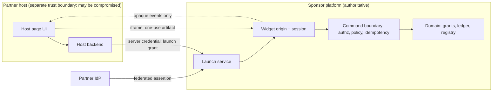

# Embedded widget and partner integration model

**Status:** theoretical [T]. Baseline:
- [widget platform v0.1](../../docs/ui/embedded-widgets-platform-v0.1.md), superseded in part by TVC-031;
- [W01 runtime and trust contract v0.2](../../docs/ui/widgets/01-platform-runtime-and-trust-contract-v0.2.md);
- [W02 grant recommendation](../../docs/ui/widgets/03-grant-recommendation-widget-contract-v0.2.md);
- [identity and partner federation](../ai-native-daf-enterprise/08-governance-and-compliance/identity-and-partner-federation.md).

The baseline trust contract is strong: one-use launch artifact, exact CSP frame-ancestors, validated postMessage, opaque host events, server-side reauthorization of every command. This model looks for what it leaves unspecified.

## 1. Trust boundaries

| Boundary | Trusted for | Not trusted for |
|---|---|---|
| Partner IdP | Authentication assertion (with contract attestation + `amr`, DD-021) | Fund privileges; assurance level without attestation |
| Partner backend | Requesting a launch for a mapped subject | Choosing the fund or capability beyond its registration |
| Host page | Placement and sizing | Anything displayed around the widget; any message content |
| Widget origin | Rendering sponsor-authoritative data and collecting user intent | Authority. Every command is reauthorized server-side. |

## 2. Unspecified behaviors found

| ID | Gap | Why it matters | Proposed requirement |
|---|---|---|---|
| WG-1 | Display of data after authority changes while idle (WS-1) | A revoked advisor keeps seeing balances in an open iframe until the next command | TVR-WID-001: widget polls or receives push of an authority-revision change within a stated window (e.g. ≤ 60 s [A]); on change → `ContextChanged`, data cleared |
| WG-2 | End-to-end revocation latency: partner-side SCIM deprovision is "within one hour" while platform-side is "at once" (TVC-032) | The real exposure window is the partner's, not the platform's | TVR-WID-006: contractual maximum deprovisioning latency per partner tier. Sponsor-side revocation of all sessions for a subject is independent of the partner. |
| WG-3 | Host-displayed stale or false information | The host can show "Your available balance: $50,000" next to a widget showing $5,000. Users trust the host page. | TVR-WID-002: partners are contractually forbidden from rendering sponsor financial figures except through sponsor widgets or signed data with as-of times. Brand guidelines require the widget to show the as-of time. This cannot be enforced technically (host is untrusted); it is a contract plus monitoring control. |
| WG-4 | Host overlay or clickjacking to induce a "Submit" | GRW-15 tests overlay; the review screen is the defense | Review step requires an interaction that the host cannot overlay without detection (IntersectionObserver v2-style visibility checks where supported [I]); high-value or new-recipient → top-level handoff (W01 allows this) |
| WG-5 | Duplicate submission across two widget instances or two partners for the same donor | Idempotency keys are per instance; two partners create two keys | Duplicate-recommendation flag (WF-05 control) across channels; never a silent merge (REC-4) |
| WG-6 | Partner suspended mid-transaction | Commands accepted before suspension continue (they are the sponsor's now). Drafts in the widget are lost. | TVR-WID-003: suspension stops new launches and new commands; existing recommendations proceed under sponsor review; donor is told through a sponsor channel, not via the partner |
| WG-7 | Partner offboarding and data | Partner keeps whatever it rendered or logged from opaque events. It holds no financial details by design. | Contract: deletion attestation for any data received; event minimization already limits exposure |
| WG-8 | Version skew: host built against event schema v1, widget on v2 | Breaks host flows silently | Event schema versioning (baseline) + compatibility window + sponsor-side rejection of unknown launch parameters |
| WG-9 | Accessibility of the host + widget combination | The widget may pass while the host traps focus or hides the iframe title | Partner certification includes a combined-page accessibility test (baseline partner lifecycle mentions accessibility tests; make the combined test explicit) |
| WG-10 | Liability when a partner-side compromise leads to a grant | Unstated. The adversarial review's objection 5 applies to partners too. | Contract allocation [C]; sponsor's controls (new-recipient confirmation, velocity) still apply |
| WG-11 | Read-only vs transactional | The baseline distinguishes by RiskTier in the manifest but does not state the assurance needed per tier | TVR-WID-004: read-only widgets may use partner AAL2 with attestation; transactional widgets need sponsor-verified step-up for new recipients and above-threshold amounts |
| WG-12 | Network failure after submit | GRW-F14 covers lost response | Already specified; the host must not offer its own retry |

## 3. Cross-system trace: grant recommendation from a partner widget

| Step | Actor | Effect | What can go wrong | Required rule |
|---|---|---|---|---|
| 1 | Partner backend | Requests launch for subject S, fund F, widget W02, origin O | Subject mapping wrong (S maps to another person) | Subject mapping is sponsor-held and reviewed at partner onboarding; mapping changes are audited events |
| 2 | Launch service | Verifies contract, origin, S→party mapping, relationship(S,F), capability | Relationship ended 5 min ago | Effective-time check (AUTH-06) |
| 3 | Browser | Exchanges one-use artifact | Replay | Nonce + single use (baseline) |
| 4 | Widget | Shows fund estimate as of T | Host shows a different number (WG-3) | Contract + as-of display |
| 5 | User | Drafts; preview | Valuation changes | Preview hash expiry (GRW-06) |
| 6 | Widget → command boundary | Submit with idempotency key | Timeout | Receipt lookup; no resubmit (GRW-09) |
| 7 | Command boundary | Reauthorizes; records Recommendation | Authority revoked between 5 and 6 | Reject; draft retained only if permitted (UX-F09) |
| 8 | Sponsor decisioning | CW-01 | — | — |
| 9 | Host | Receives `commandAccepted(opaque id)` | Host displays "Grant approved!" | Contract: host copy may say only "recommendation submitted" (content governance applies to partners, TVR-WID-005) |
| 10 | Later | Status changes | Partner unavailable | Donor status available directly from the sponsor (not only through the partner) |

**Consistency rules derived:**
1. The sponsor is the only source of financial truth. The host is a display surface.
2. Every partner-originated request is fully reauthorized at the command boundary at execution time.
3. The donor always has a sponsor-direct channel to see status and revoke partner access.
4. Partner copy is governed for legal meaning (recommend, not give or pay).
